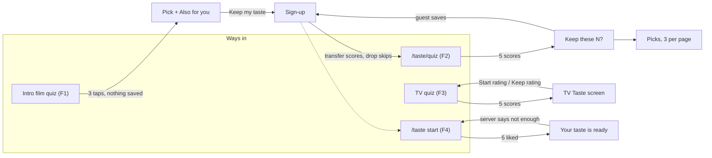
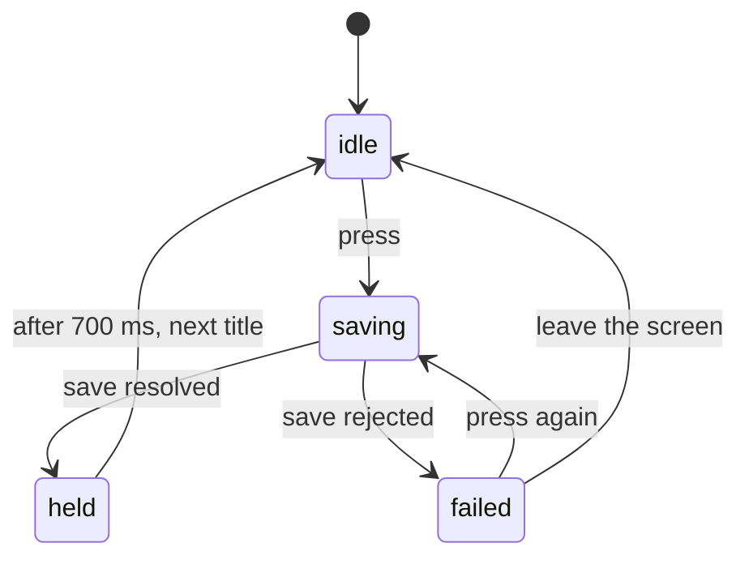

# Rating onboarding: inventory, state machine, and issues

Status: audited on October 27, 2026 against `origin/main` at `16a23dbe4`. The P0 issues and most P1 issues were fixed the same day, in the commits that added this folder. The single-flow redesign followed the same day: `/taste/quiz` and the Taste start became one rating flow (`app/ui/rating-flow/`), and then the living room TV's Rate titles screen moved onto the same core (`use-rating-core.ts`), rule and words. The old quiz (`ui/taste-quiz/`) is gone.
Line references point at that commit.

This document covers every place where a guest or a new member rates titles to build their taste: the scoring
screens, the quizzes, the messages they show, and the recommendations that follow. The four detailed audits in this
folder hold the full traces with file and line references:

- [Living room TV](audit-tv.md)
- [Quizzes and the Taste start](audit-quiz-and-taste.md)
- [Guest and member data, and every message](audit-data-and-messages.md)
- [Recommendations shown after rating](audit-recommendations.md)

## Summary

- **Five separate rating experiences** exist. Three are built on a shared hook (`useTasteQuiz`) and two on their own
  code. They use three title queues, four "done" thresholds, and different wording for the same actions.
- **Feedback A has a confirmed code path.** A member who presses **Haven't seen it** on a title they already skipped
  can never save it. The screen shows "Not saved. Try again." forever. Members get already-answered titles again
  because the title list is cached for a minute and the quiz forgets their answers when it remounts.
- **Feedback B has several candidates.** None is a plain exclusion bug in the quiz picks. The strongest candidates
  are screens that show the person's *rated* titles laid out like recommendations, and the guest sample taste, which
  ignores what the guest scored.
- Most of these bugs became visible after October 21, 2026 (`73efddc4a`, the shared score acknowledgement), October 22
  (`63329b65d`, the phone TV layout), and October 25 (`c19746c39`, one poster card for rated titles and suggestions).

## Feedback mapped to causes

### Feedback A: "asked me to rate some things twice like The Office … stuck … 'Not Saved' where the movie title is"

| # | Cause | Confidence | Where |
|---|---|---|---|
| A1 | A repeat skip returns `failed`. `updateSkipped` inserts with `ON CONFLICT DO NOTHING`, gets 0 rows, and reports `failed`. Since `73efddc4a`, `saveSkip` throws on `failed`, and the answer state holds the title in `failed`. Each retry repeats the same no-op. `updateNotInterested` handles the same case and returns success. | Very high, confirmed in code | `server/skipped.server.ts:43-79`, `ui/taste/hooks/useTasteScoring.ts:237-252` |
| A2 | The "Not saved. Try again." text replaces the title on the phone TV. The phone shows no poster and no year, so the title disappears. | Very high | `ui/living-room/tv/RatingStrip.tsx:232-253` |
| A3 | Members get answered titles again. The member title list (`/api/smart-titles`) is cached for 1 minute, and no score or skip resets it. The quiz remembers a member's answers only in component state. The TV unmounts the quiz when Taste is loading (`screens/Taste.tsx:63-74`), so a re-entry within a minute gets the same 20 titles. A re-asked skipped title then triggers A1. | High | `server/smart-titles.server.ts:143-150`, `useTasteScoring.ts:27` |
| A4 | Sign-up drops every guest skip, even though the code comment says skips "stay in this browser". The new member is asked about all of those titles again. | Medium-high | `ui/onboarding/AccountTransfer.tsx:111`, `utils/account-transfer.ts:199-210` |
| A5 | "The Office" may be two different shows (US 2005 and UK 2001). The phone shows neither year nor poster. | Medium, not checked against the catalog | — |
| A6 | An expired session makes every member save return HTTP 200 with `failed`. That shows the same "Not saved" with no sign-in prompt. | Low | `server/scores.server.ts:54-58` |

### Feedback B: "after scoring a few titles as guest it showed me three posters as recommendations … already scored"

| # | Candidate | Confidence | Where |
|---|---|---|---|
| B1 | `/taste` **Fits your taste** shows the titles the person rated 7 or higher, with a **Recommend me from this** link. Since `c19746c39` it uses the same poster card as the suggestions, three across on phones, with the guest's own score in the pill. | High | `ui/taste/tabs/SidesOfYou.tsx:235-255` |
| B2 | A guest with 1 to 4 ratings gets the sample member's taste on `/taste`. Its suggestions (**Close to your taste**, three on phones, and **More of this**) replace the guest's scores, skips, and Want to See with the sample's. Titles the guest scored can come back as suggestions. The TV avoids this on purpose. | Medium-high, a real exclusion bug | `server/taste-portrait/index.server.ts:197-251` |
| B3 | `/taste/quiz` **Keep these N?** shows the titles just rated under "Your picks are ready." N counts all guest scores, but the posters show only this visit. A returning guest with 2 earlier scores sees "Keep these 5?" over 3 posters. | Medium | `ui/taste-quiz/TasteQuizPage.tsx:322-350` |
| B4 | The intro film quiz's **Also for you** row (exactly 3 posters) excludes only its own 12 posters. It ignores guest progress and the member account. | Medium | `ui/living-room/intro/quiz/taste-quiz.tsx:43-65, 94-99` |
| B5 | A leak in the `/taste/quiz` picks themselves. The server and the client both filter scored titles, so this needs the same work stored under two IDs. | Low | `ui/taste-quiz/use-quiz-picks.ts:37-48` |

To narrow down B, ask the reporter for their device and whether they were on the start page, `/taste`, or
`/taste/quiz`.

## Inventory of rating experiences

| # | Experience | Where | Who | Done when | Ends at | Saves to |
|---|---|---|---|---|---|---|
| F1 | Intro film quiz: "Tap three you loved." | Start page film, last scene | Guests in a new tab (even with progress), members on replay | 3 taps | Pick + 3 **Also for you** posters; **Keep my taste** goes to `/sign-up` | **Nothing.** Taps stay in sessionStorage and never reach the account. |
| F2 | `/taste/quiz` | `routes/taste.quiz.tsx`, `ui/taste-quiz/` | Guests and members | 5 scores of any value per round | **Keep these N?** → 3 picks per page | Guest browser or account |
| F3 | TV quiz | Living room TV quiz screen | Guests and members | 5 scores (shared hook with F2) | TV Taste screen | Same as F2 |
| F4 | Taste start | `/taste` when a member has no taste groups yet | Members only | 5 scores of 7 or higher, then the server needs 5 loved titles and 2 groups | **Your taste is ready.**, or a bounce back with "Almost there" | Account |
| F5 | **How was it?** after **Seen it** | TV title screen | Members | One score | Back to the title | Account, without waiting. The toast shows before the save finishes, and there's no error path. |

Shared parts: the answer acknowledgement (`ui/scoring/score-ack.ts`, F2 to F4), `useTasteScoring` (F2 to F4), the
smart-titles pool (F2 to F4), and `/api/guest-recommendations` (F1 to F3).

### Entry points

- More than 10 links go to `/taste/quiz`. They include the Taste banner, the empty Taste tabs, For You **Take the
  quiz**, Discover **Rate titles** (with a `?resume=1` that does nothing), profile Stats, the command palette, and the
  TV **Full taste quiz**.
- Sign-up aims at `/taste` (F4), but the redirect fallback in `account-transfer.ts:55` and the sign-up effect
  (`sign-up.tsx:108-112`) land many new members on `/taste/quiz` (F2). New members can therefore start in either flow.
- On the TV, **Taste** opens the quiz for members and the Taste screen for guests. **Your taste** opens the Taste
  screen for both.

## State machine as built

The journey has no single state machine. Each experience keeps its own state, and they share the save and
acknowledgement pieces.

### Answer acknowledgement (shared by F2, F3, and F4)

The only exit from `failed` is another press or leaving the screen. When the server rejects every retry (A1, A6), the
person is stuck.

### Title queue

- F2 starts with 300 titles from the server-side loader, then fetches 20 at a time. F3 starts empty and fetches only
  20 at a time. Neither sends the titles already answered.
- Guests get one global top-20 list, cached for 24 hours. After about 20 answers, the TV quiz shows "No more titles to
  ask about right now." A guest who skipped most of them can end with fewer than 5 scores.
- Members get a per-user list cached for 1 minute, and no write resets it.
- Filtering by what was already answered:
  - Guests: against everything in the browser.
  - Members in F2 and F3: against this mount's answers only.
  - Members in F4: against the account's scores, but not the account's skips.
- A failed fetch looks the same as running out of titles, and there's no retry.

## Data model

| Mark | Guest (browser, `onboarding_ratings`) | Member (Crate) | A repeat write as a member |
|---|---|---|---|
| Score | One mark per title, at most 20 scores | `user_score` | Success |
| Haven't seen it | Replaces a score on the same title | `user_skipped`, kept beside the score | **`failed`** (A1) |
| Want to See | Replaces a score | `user_wishlist` | **`failed`**, but callers ignore it today |
| Not interested | Replaces a score | `user_not_interested` | Success |

- The client has three separate "what has this person answered" stores: guest localStorage, the member `user-data`
  query, and the quiz's own component state. The member queue never reads the `user-data` query.
- Member save hooks other than Not interested don't check `response.ok` or `status`. An HTTP 200 with `failed` stays
  on screen as saved.
- At the 20-score guest limit, `useScoreMutation` still reports success. Screens outside the quiz can show a score
  that wasn't saved.
- No rating write endpoint validates its input or has a rate limit.
- Guest progress doesn't sync between tabs.

## Messages a new user can see

The [data and messages audit](audit-data-and-messages.md#4-inventory-of-messages-during-onboarding-and-rating) lists
24 of them with their triggers. The overlaps:

- **Four sign-up thresholds:** 0 (filter bar), 5 (**Keep these N?**, For You), 10 (**Keep your progress** strip),
  and 20 (the limit dialog). One guest session can see all four.
- **One failure, two texts:** "Couldn't save that. Try again." on the web and "Not saved. Try again." on the phone TV.
  Neither says why, and "Try again" can't work for A1.
- **Skips:** the strip says skips are saved in this browser. Sign-up mentions only ratings and Wishlist. The transfer
  deletes skips.
- **The limit dialog** says "Create an account", but its button reads **Sign In**. It calls the action "Skip", which
  no rating screen uses.
- **"Picks"** means three things: free picks in the quiz, blurred picks behind sign-up on For You, and rated titles
  under "Your picks are ready."
- **"Fits your taste"** labels an unseen title on a title page, and a row of rated titles on `/taste`.
- **"Your taste"** shows in the guest banner after 5 scores of any value, but the server builds a taste only from 5
  liked titles.
- **The member onboarding drawer** (country, services, handle) can open over the quiz right after sign-up, on phones
  as a full-height sheet.
- **Button names differ** across flows: "Haven't seen it", "Not seen", and "Skip". "Take the quiz", "Rate titles",
  "Rate more", "Keep rating", and "5 more". "Here are your picks", "Picked for you", and "Made for you".

## Issues by priority

### P0: blocks or corrupts the flow

1. A1: a repeat skip fails forever. Make `updateSkipped` and `updateWishList` count a conflict as success, the way
   `updateNotInterested` does.
2. `failed` has no way out. Add a way to move on, and keep the title name visible when a save fails.
3. A3: members are asked again. Reset the member title cache on every write, or don't cache it, and filter the queue
   with the account's scores, skips, and watch state.
4. A4: sign-up deletes guest skips. Transfer them, or keep them and exclude them.
5. B2: the sample taste ignores the guest's own marks.

### P1: wrong or misleading results

6. Rated titles shown as recommendations (B1, B3). Give them a different heading and card.
7. Intro film recommendations ignore earlier ratings (B4), and its taps are never saved even though **Keep my taste**
   promises it.
8. Member picks ignore earlier skips, Want to See, Not interested, and watched titles, because
   `/api/guest-recommendations` has no access to the account.
9. Member save hooks hide failures (HTTP 200 with `failed`). The guest limit reports success.
10. The guest TV quiz runs out after about 20 titles. A fetch error looks like "no more titles".
11. Members see a goal per visit (5 more each visit) while the counter shows account totals.

### P2: inconsistency and cleanup

12. Five experiences with different thresholds, queues, layouts, and wording.
13. Two starting points for new members (`/taste` and `/taste/quiz`).
14. Dead code: the onboarding media API, still reset on every write, which also builds its SQL by inserting `userId`
    into the query text. Also `?resume=1`, `useTitleQueue({resume})`, the exploration rating queue, and ExploreBar.
15. Telemetry can't see these problems. A repeat skip fires no event, and no event records what titles or picks were
    shown.
16. Doc drift: `docs/member-data-cache.md` lists Not interested under `updateSkipped`.

## Challenges for streamlining

These are the decisions a redesign needs from the owner:

1. **One rating flow or several?** The TV, `/taste/quiz`, and the Taste start could become one experience with one
   queue and one completion rule, with layouts per surface. The intro film's tap-three is a different interaction:
   either keep it as a teaser that saves nothing, or make its taps real scores.
2. **What does "done" mean?** Today the threshold is 5 scores of any value, 5 scores of 7 or higher, or the server's
   5 loved titles plus 2 groups. One rule shared by the client and the server would end the "Almost there" bounce.
3. **What is a skip?** Guests replace a score with a skip. Members keep both. The transfer drops skips. Choose one
   meaning ("not seen, don't ask again") and store it the same way for everyone.
4. **Where does a new member land?** Choose either `/taste` (imports first) or the quiz, and point every link there.
5. **When does a guest get asked to sign up?** Today that happens at 0, 5, 10, and 20 scores. Pick one moment and
   one message.
6. **What does the person see after rating?** Either their taste (their own titles, clearly labeled), or
   recommendations (never their own titles), or both, kept visually apart.
7. **Failure behavior:** Decide whether to keep the wait-for-the-save behavior from the shared answer acknowledgement,
   or move to saving in the background with a quiet retry, which F5 does today without any error path.

## Owner decisions (October 27, 2026)

1. **One flow.** The TV quiz, `/taste/quiz`, and the Taste start become one rating flow. A later addition is a quick
   scoring mode for unscored titles, similar to the batch scoring table on `/my-library/scores`.
2. **"Done" rule: open.** The owner isn't sure yet whether there should be one hard limit or several soft caps.
   Proposal to discuss:
   - The server decides when a taste is ready and returns that state, with "N more liked titles needed", in every
     save response. The client never computes its own threshold, which ends the "Almost there" bounce.
   - After the taste is ready, the flow pauses with soft milestones, for example every 10 ratings. At each pause the
     person can see their taste and picks, or keep rating. Nothing forces a stop.
   - The guest limit of 20 scores belongs to decision 5 (sign-up), not to the rating flow.
3. **Two distinct marks with their own names:**
   - **Haven't seen it** means "don't show this title again for rating". It says nothing about wanting the title.
   - **Not interested** means "don't recommend this title".

   Both are stored the same way for guests and members, travel with the sign-up transfer, and never replace a score.
4. **New members continue where they left off.** Sign-up returns the person to the page they came from. The
   onboarding bar or drawer then offers to pick up the rating flow, and the person can dismiss it.
5. **Sign-up moment: open.**

## Open checks

- **A1 in production:** look for repeated `POST /api/update-skipped` requests for the same title that return
  `{"status":"failed"}`, and `user_skipped` rows older than the repeat.
- **A5:** check whether both "The Office" shows are in the member title pool.
- **B:** confirm B1 and B2 on a 375 px phone viewport as a fresh guest. Rate three blockbusters in `/taste/quiz`, then
  open `/taste`.
