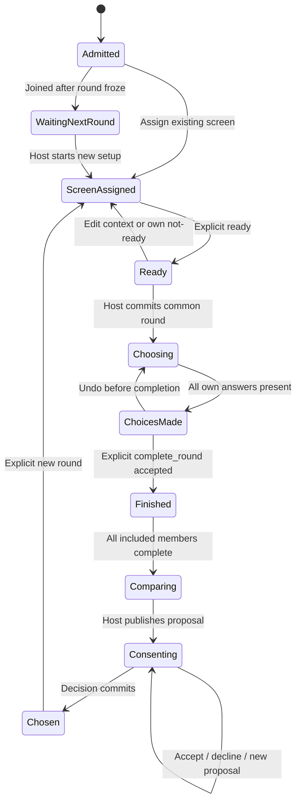
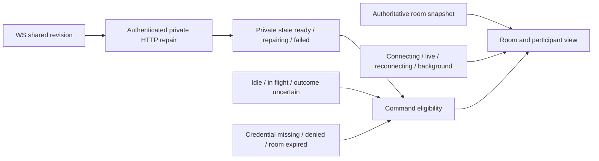

# YepWatch whole-app state machine

2026-10-21 · Draft design specification for review, grounded in the current POC. This is not an accepted ADR or a claim that future account integration exists.

**Recommendation:** keep one authoritative room lifecycle and compose it with participant, navigation, connection, private-sync and pending-command state. A disconnected person has not left the group. A finished deck is not a finished round. A unanimous shortlist is not yet the group's confirmed decision.

This specification uses the single [domain glossary](../../CONTEXT.md), especially Unknown availability, Watch, Pass, Seen and Next episode. The **Watch button** means willingness in this round; it does not record a glossary Watch. The wire value `pass` means the UI's **No**, not the glossary's Pass through a show's episodes. A YepWatch viewing screen is a physical viewing location, distinct from a GoodWatch TV screen/view. No second context or competing glossary is introduced here.

## Authority and scope

- **Confirmed product behavior:** couch, remote and mixed rooms; movies and shows to start; eventual show continuation using signed-in GoodWatch saved progress only; optional account entry and guests; full existing catalog/country/service coverage intent; full-round voting before comparison; visible participation without individual choices. No manual episode-history entry.
- **Confirmed interaction:** exactly **No** (`pass`) and **Watch** (`watch`); left/right swipe is an alternative to the same buttons. Explicit **Finish my round**, then wait for every required completion, then shortlist, proposal, each person's consent and host confirmation. No early-match interruption or automatic endless deck. No progress bars, fractions, time-to-choice promises or promotional “short” wording.
- **Implemented POC:** guest identity, two guest kinds (`movie`, `show_start`), API commands, private snapshots, realtime shared snapshots, common bounded decks, unanimous shortlist and versioned final consent. `veto` remains wire/parser and undo compatibility for older votes, without a third UI choice. Continuation commands and saved progress are currently blocked; member entry is reserved/unimplemented.
- **Proposed target:** explicit access-loss UI, read-only late-join shortlist, restart from a decided view and recovery of pending commands across process reload. These are gaps recorded below, not implementation authorization or settled new product decisions.

The data contract still lists `show_continue` and `expired`. Neither implies a currently working signed-in continuation journey or a job that writes expired rooms. Product coverage is not proof of fresh offers, episode entitlement or provider playback links. A finite local sample is test evidence, not a geographic launch restriction.

## Review diagram: choosing together

```mermaid
stateDiagram-v2
    [*] --> Setup: Create or join
    Setup --> Preparing: Host starts; others ready
    Preparing --> Setup: Loading, unknown, empty or changed context
    Preparing --> Voting: Verified common deck committed
    Voting --> Voting: Private No / Watch / undo / own finish
    Voting --> Comparing: Every included person explicitly finishes
    Comparing --> Empty: No unanimous Watch titles
    Comparing --> Shortlist: Unanimous Watch titles exist
    Shortlist --> Proposal: Host proposes one title
    Proposal --> Proposal: Consent, decline or different proposal
    Proposal --> Checking: Host confirms; everyone consents
    Checking --> Proposal: Changed consent or failed availability check
    Checking --> Decided: Fresh watchability and atomic commit
    Empty --> Setup: Host explicitly starts another round
    Shortlist --> Setup: Host explicitly starts another round
    Proposal --> Setup: Host explicitly starts another round
    Decided --> Handoff: Open provider for this viewing screen
    Decided --> Setup: Explicit restart; API exists, UI proposed
```

`Preparing`, `Comparing`, `Empty`, `Proposal`, `Checking` and `Handoff` are **display/derived states**, not additional persisted phases. During discovery the stored phase stays `setup`; during final checks it stays `shortlist`. Comparing is computed atomically with the last completion. Expiry and loss of access overlay every node; they are shown separately below to avoid implying an ordinary playable phase after expiry.

The diagram shows the normal journey. The API also permits a host's explicit `new_round` from any live phase, including voting; exposing an abort action there should require clear confirmation because it clears everyone's current round.

## Canonical room states and invariants

| Stored phase | Derived view | Meaning and permitted next step |
| --- | --- | --- |
| `setup` | Editing / awaiting readiness / preparing / recoverable deck failure | Configure viewing screens and constraints; join, assign screen, ready; host prepares a deck. No voting yet. |
| `voting` | Choosing / own choices made / own finished and waiting / late join waiting | Common immutable candidate set and frozen included member IDs. Private answers can differ in pace and current card. Only all explicit completions advance the room. |
| `shortlist` | Empty / browsing / proposed / consent pending / final check | Up to five unanimous Watch titles; host proposal and per-person consent remain separate from private preferences. |
| `decided` | Chosen title / provider handoff | A committed candidate plus checked per-screen evidence. No automatic playback, watch-history write or synchronization. |
| Effective `expired` | Terminal expired page | A passed known `expiresAt` or authoritative HTTP 410 ends interaction. Current server checks the deadline on access; it need not persist `phase=expired`. |

Invariants applying to all transitions:

1. All data access is through the namespaced API. Invite knowledge admits a guest; subsequent room commands require that participant's actual credential. A room ID, presence connection or public snapshot is not command authority.
2. Every command carries participant sequence plus deterministic command ID/body. The server's exact accepted replay returns a receipt and current snapshot; it does not repeat the transition. Version checks and Crate aggregate CAS protect the final commit, including checks after external catalog work.
3. A round freezes its member IDs, context and deck. No screen, person, No or consent is silently dropped to manufacture agreement. Missing data never means No, Watch, ready or consent.
4. Every occupied viewing screen needs country-qualified usable-service evidence. People on one couch share that screen's context; remote screens may use different providers. Personal saved services are only future prefill, not proof of shared-screen access.
5. Other people's values, current cards, swipe directions, private preference, progress and individual consent do not enter shared events. Shared outcomes and aggregate readiness/participation allow inference, particularly for two people; this is privacy of individual inputs, not anonymity.
6. A round response, final decision and provider opening never write Seen, show status, watches, ratings or saved preferences. Future continuation reads canonical saved history and episode presentation under [ADR 0009](../adr/0009-tracking-is-a-state-machine.md) and [ADR 0012](../adr/0012-episode-presentation-preserves-watch-identity.md); no silent rewind, skip or manufactured episode entitlement.

## Room transition table

All rows assume a live room and authenticated actor. Rejected commands leave durable room state and actor sequence unchanged. “Refresh” below means an authenticated snapshot, not guessing a new local phase. Transport uncertainty is handled separately from known rejection.

| Event / actor | Guard | Durable effect | UI and failure / retry |
| --- | --- | --- | --- |
| Create / anyone | Valid bootstrap admission request | New setup room, host identity, guest kinds movies + shows to start; no confirmed services | Establish one shared-screen draft with a country hint; ask for actual usable services. Retry uncertain admission with the same bootstrap identity, never create a replacement host silently. |
| Join / invitee | Valid invite, capacity, credential recovery first | Setup: add actor, increment roster/revision, clear all readiness. Active round: append waiting actor; frozen round unchanged | Resume existing same-browser membership first. Setup participant confirms a screen; active late join sees next-round waiting. Invalid invite is an entry error, not a network retry forever. |
| `setup` / host | Setup phase + expected context version; allowed guest kinds | Replace screens/constraints; increment context; clear all readiness and invalid assignments; assign host screen | Couch defaults to one screen; remote/mixed explicitly adds screens. Save is explicit. Stale edit refreshes before resubmission. Guest continuation yields `member_required`; never auto-rewrite legacy scope. |
| `assign_screen` / participant | Setup + context version + existing screen | Assign own screen, clear own readiness; increment roster | Guest chooses an existing screen; asks host to add one if needed. Does not configure a subscription for each couch participant. |
| `ready` / participant | Setup + context version + own confirmed country/services | Set only own ready flag | Guest's ready action can first assign a screen, then ready with ordered commands. Invalid context needs confirmation. Current guard also applies to setting not-ready. |
| `start_round` / host | Setup; exact roster/context; all others assigned and ready; host already ready or explicit `hostReady:true` with valid own screen | Before discovery: cheap domain preflight. On success only: common deck, increment round version, freeze all current members, clear old answers/completion/preferences/consents; hostReady sets host ready; enter voting | Start expresses host readiness only; never readies others. Preparing disables duplicate commands. A rejected discovery does not persist host readiness or a partial deck. CAS race reruns authoritative guards. |
| Catalog loading / start request | Catalog not ready within bounded wait | None | Explain loading; retry Start without changing country/services. `catalog_loading` is not zero matches. |
| Catalog incomplete / start request | Unknown/stale offers, missing metadata/episodes, scan limit or deadline | None | Structured `catalog_unavailable` explains cause and available recovery. Retry or **explicitly** edit settings; no hidden broadening. New-show episode failure may offer an explicit movies-only choice, never apply it silently. |
| Known empty / start request | Checked relevant candidates yield verified no intersection, or filtered catalog empty | None | Distinguish verified no common offers from no titles for filters and incomplete search. Offer review of real screen services or optional filters. A bounded/local sample cannot establish emptiness of the worldwide catalog. |
| `vote` / included participant | Voting + frozen round version + candidate in deck + own vote revision + not own completed | Set own value; increment own vote revision and room revision | No/Watch buttons and swipe agree. Own swipe animation may be optimistic; committed answer and any group result require server confirmation. No public card/direction event. Stale vote refreshes; uncertain write reuses envelope. |
| Undo / included participant | Same vote guards, before own completion | `vote(value:null)` with current own vote revision; old `veto` can also be cleared | Undo reopens that choice. Not allowed after Finish my round. An old round/card cannot be undone into a new round. |
| `complete_round` / included participant | Voting + round version + every own candidate has a non-null answer | Own complete=true; if others incomplete, phase remains voting | Explicit Finish my round. Own Finished/waiting view blocks more answers/undo. “Choices made” alone does not mean this command was accepted. |
| Last required `complete_round` | Every frozen member explicitly complete | Atomically calculate first five all-Watch candidates in deck order, increment shortlist version; enter shortlist even if empty | Reveal shared comparison only now. No first-overlap interruption. Empty shortlist has no proposal/consent path until explicit restart. |
| `shortlist_preference` / included participant | Shortlist + exact shortlist version + candidate listed | Store own private preferred candidate | My preference is private and currently **does not rank, aggregate or auto-select** anything. It is not consent. An empty shortlist cannot accept it. |
| `propose` / host | Shortlist + exact shortlist version + listed candidate | Set candidate; increment proposal version; clear every old consent, even when re-proposing the same title | One last check; show proposal and aggregate consent count. Host's original Watch is not final consent. Another proposal requires everyone to consent again. |
| `consent` / included participant | Active proposal + exact proposal version | Set own acceptance or decline for that version | Yes or Not this one changes own consent. Decline keeps proposal open; does not identify the declining participant publicly, auto-pick another or end the room. |
| `decide` / host | Active exact proposal + every frozen member currently accepts + fresh watchability on all required screens | Recheck chosen title server-side; CAS commits decision and enters decided only if current guards still hold | Checking is pending, not success. Consent withdrawal/proposal/context races invalidate stale commit. Unknown/no-offer preserves shortlist; explain/retry, propose another, or explicitly restart. |
| Open provider / participant | Committed decision + destination for own screen | None | Open verified HTTPS destination, labelled provider/search/where-to-watch honestly. Failure is a local handoff error; stay decided. A show-level offer is not episode entitlement. |
| `new_round` / host | Exact current room revision, any live phase | Clear round/deck/shortlist/proposal/decision and all answers/completions/preferences/consents; clear readiness; increment context/roster; keep room membership/screens/constraints | Return to setup. Must start explicitly again; same catalog candidates may recur. Existing constraints are retained, so legacy continuation needs a **second explicit** guest-mode confirmation. Stale restart refreshes; never auto-abort a newer round. |
| Deadline / any actor or client | Known room deadline passed or authoritative 410 | No further reads/commands; current server does not need an expiry write | Terminal expired, stop WS/retries/pending UI; create another room. Missing cookie 401 at an already known passed deadline still renders expired. |

The server currently rechecks a proposed title before all cheap `decide` guards; it still enforces authorization, current consent and CAS before commit. Avoid describing this as preflight-equivalent to `start_round`. A cheap finalization preflight is a possible future resource-use improvement, not required new behavior in this document.

## Participant state is separate

This is a derived participant view, not an additional stored enum. A screen may be retained but readiness is cleared on restart. A late joiner may still need assignment, so the restart destination is setup, not automatically ready. Host Start can combine the host's Ready and round-start steps only on a successful commit.

Participation labels after the binary UI update:

| Public/private evidence | Label | What it must not claim |
| --- | --- | --- |
| Included, not all card answers recorded | Choosing | No current card, direction, response or fraction. |
| Public completedCount reaches deck count | Choices made | Cannot prove explicit `complete_round`; do not call another person Finished. |
| Own private `roundCompleted=true` | Finished | Only own server-confirmed completion. |
| Shared `round.completed=true` | Round finished | Every required member completed, not that playback started. |
| Not in frozen member IDs while shared round is not completed | Next round | Cannot affect this round's preferences or consent; a later Round finished label does not grant those capabilities. |

**Disconnect is not a participant transition.** It changes only nonauthoritative presence and local connection overlays. It does not unready anyone, erase a response, revoke consent, shrink quorum or finish a round. A slow/absent required participant therefore keeps the group waiting. There is no implemented leave/kick/host-transfer/drop-absent policy. Do not simulate one by removing actors. A host may explicitly restart, but current admission membership is retained, so restart alone does not remove an absent member.

## Navigation, credentials and optional login

| Entry transition | Guard / effect | View and recovery |
| --- | --- | --- |
| Landing → create guest room | Nickname + one admission intent; ordered bootstrap retry | Create acknowledges before room navigation. No automatic second room on a lost response. |
| Link, QR payload or code → resolve invitation | Resolve admission target; retain invite intent | Invitation belongs to public app origin, not API origin. Code/link are credentials; redact logs and screenshots. No claim that QR rendering or post-install recovery is already implemented. |
| Invitation → recover membership | Existing browser cookie/native room credential successfully snapshots same room | Resume same participant/host, without POSTing a replacement join. Native credential in SecureStore; browser uses HttpOnly room cookie and saved room metadata, not a returned browser bearer. |
| Invitation → new guest admission | No usable existing membership; valid invitation | New independent identity joins. A new browser does not inherit the host's cookie. No nickname-based account recovery. |
| Room URL without credential | No recoverable room access | Reopen original invitation/join entry. A room ID alone grants no access. |
| Choose GoodWatch login | Current member start returns 501 | Explain unavailable and retain invitation intent; guest entry remains possible. No fake logged-in state or manual progress fallback. |
| Future login return | **Unimplemented:** GoodWatch-issued identity, validated return intent, explicit association with existing guest | Must retain actor/room membership and prevent account substitution. Prefill can suggest country/services/private taste; screen context still needs confirmation. Saved continuation progress requires a separately specified reconciliation policy. |
| App install interrupts invitation | **Unimplemented install recovery** | Browser fallback remains viable; preserve/share original link or code and reopen after installation. Do not claim automatic deferred deep-link recovery. |

An existing old room with continuation enabled stays explicit: setup offers confirmation to use movies/new shows; an already-active continuation round shows the saved-progress block and host Return to setup, followed by that separate scope confirmation. No silent history rewrite, rewind, episode approval or downgrade. The current server rejects continuation vote/completion/preference/proposal/consent/decision even when old manual inputs exist; future member integration must replace that gate deliberately.

## Client overlays: connection is not room phase

The client must never infer its own vote/completion/consent from public counts. WS only updates the shared projection; authenticated HTTP repairs own private state. Shared and own versions merge independently: a late private result with equal nextSequence must not overwrite newer own state after another actor's restart. Refresh demand during a private fetch triggers another repair, not a dropped request.

| Overlay transition | Guard / effect | UI / retry |
| --- | --- | --- |
| Connecting → live | One-use ticket, authenticated first frame, authorized shared snapshot | Live participation; no direct database access or vote payloads. Presence is advisory. |
| Live → reconnecting | Socket/network/bus interruption or server restart | Keep last committed view, label paused updates; fresh ticket, revision-aware resnapshot and private repair. No ordinary client polling. Shared events are repair hints, not guaranteed delivery. |
| Any connection → background → reconnecting | OS/app lifecycle | Pause socket; foreground snapshot/private repair and reconnect. No participant removal or readiness/consent mutation. |
| Shared newer revision → private repair | Authenticated private read needed | Preserve own state until ordered merge; failed repair blocks commands. Current client may still show stale own view while repairing; server version guards remain authoritative. |
| Idle → command in flight | Known access, live deadline, appropriate actor/phase/versions, no pending command or failed private repair | One envelope/sequence at a time; optimistic own-card animation only. Other commands disabled until acknowledgment. HTTP can still work while WS reconnects; a live socket is not a permission. |
| In flight → accepted | Durable receipt and authenticated snapshot | Merge committed state, clear pending, advance sequence from server. Socket arrival alone does not acknowledge the private command. |
| In flight → known rejection | Definitive validation/authorization/context/catalog error | Clear this pending action, explain and refresh; after fixing state submit a new intent with current versions/sequence. No optimistic group phase remains. |
| In flight → uncertain / busy | Deadline, network/lost acknowledgment, indeterminate write, bounded CAS exhaustion | Keep exact ID, sequence and body; Retry pending action. Do not replace it with a new vote or completion. Receipt recovery distinguishes already applied from not applied. |
| Lease expires → reconnecting | Room deadline has not passed | Repair HTTP and request a new ticket. A short gateway lease is not room expiry. |
| Known deadline or HTTP 410 → terminal expired | Applies even if another response is missing-cookie 401 after known deadline | Stop reconnect/pending loops; old cached data never reactivates room. Implemented. |
| Live room 401/403/404 → access lost | **Target gap:** distinguish denied/missing access from transport outage | Stop automatic room commands/reconnect for definitive denied access, show safe re-entry. Do not expose whether an unauthenticated room exists. Current UI lacks a dedicated terminal access-loss overlay. |
| Process reload while uncertain | **Target gap:** current exact envelope is in memory only | Do not promise exactly-once recovery across reload. Reconcile snapshot; persisted protected pending intent/receipt-aware recovery needs implementation before reliable replay of that original action can be claimed. Never regenerate a blind duplicate. |

Room expiration is already terminal; it must not be conflated with the outstanding live-room access-loss gap. Offline cached views are informational. Pending/failed private repair blocks choices; reconnecting alone does not revoke a valid member, and server checks decide every command.

## Races and invalidations to preserve

| Change | What becomes invalid | What survives |
| --- | --- | --- |
| Setup save | Every ready flag, old context-fenced intents | Membership; valid existing screen assignments; no account preference writes. |
| Setup admission | Old roster-fenced Start and everyone's readiness | Screen configuration. |
| Own screen assignment | Own readiness, old roster-fenced Start | Others' readiness. |
| Late admission during voting/shortlist | Future roster-based operations; a held start in setup must lose CAS | Current frozen round/quorum/deck and current consent remain intact. |
| Own vote/undo | Previous own candidate revision | Others' private responses; common deck; no shared current-card change. |
| Own Finish my round | Further own vote/undo for this round | Other included people can still finish independently. |
| Another proposal, including same candidate again | All prior consent versions | Private shortlist preference; shortlist itself. |
| Consent withdrawn while final check runs | Stale finalization CAS / required unanimity | Proposal; no decision commits from stale consent. |
| Host new round | Old round/context/roster intents, all answers/completions/preferences/consents, previous current decision | Identity, screens, constraints and room deadline. No automatic renewal of room lifetime. |
| Disconnect or gateway restart | Live delivery/presence certainty only | All durable state. |

No client should automatically replay a **rejected** stale vote/proposal/restart against newer versions; that would turn an old intention into a new action. Exact receipt replay after an ambiguous response is different and is safe within the retained receipt window. The window is bounded; `outcome_unknown` after receipt eviction needs explicit reconciliation, not a promise of unlimited replay.

## Simulator and review scenarios

These are acceptance scenarios, not a report that this document ran them. Use independent API/WS credentials and fresh disposable memory rooms. For host app 8101, ordinary fresh rooms on its configured API 15995 preserve the current endpoint pairing; do not reset/restart that server or touch retained user rooms. A distinct disposable API requires a matching host app configuration. Never write production rooms or log invitations/tokens/private inputs. Operator auto/manual controls do not bypass API guards.

| ID | Scenario / operator event | Expected observation and negative assertion |
| --- | --- | --- |
| S01 | Host + two guests, couch then mixed screens; each explicitly ready | Successful Start includes all current participants and all occupied screens. `hostReady:true` affects only host. A pending guest prevents start; no silent ready. |
| S02 | All actors Watch same card, continue rest at different speeds | No early match or public card identities; each sees their own card. Choices made precedes explicit completion. Last completion alone opens shortlist. |
| S03 | Agreement deck, explicit completes, private preference, host proposal | Preference is private and has no automatic ranking effect. Host must also consent; only every included acceptance permits final confirmation. |
| S04 | Disagreement: every card has at least one No | After all complete, empty shortlist. No closest-match invention, majority override or automatic next deck. Host explicitly restarts. |
| S05 | Slow guest or disconnect before ready / during voting / before consent | Existing readiness/votes/consent survive; unfinished requirement keeps group waiting. No timeout elimination or disclosure of which card/choice caused delay. |
| S06 | Disconnect after accepted vote but before HTTP acknowledgment | Same-envelope retry returns receipt/current snapshot, never applies another vote. Reconnect WS repairs shared and private state. |
| S07 | Undo No or historical veto before completion; retry undo; attempt undo after Finish | Own revision increments once; retry is idempotent; post-completion undo rejects. Only two current UI response buttons. |
| S08 | Late actor joins voting and then shortlist | Reads shared group result but cannot vote/prefer/consent in this round. Next-round waiting must apply to every active-round view. |
| S09 | Change proposal with some consents; delayed old consent arrives | New proposal version clears all consents; stale consent rejects. No individual accept/decline maps in shared payload. |
| S10 | Withdraw consent during held final availability recheck | Old CAS loses; revalidation refuses decision. Unknown/changed offers also fail closed without altering screen filters. |
| S11 | Restart while old private snapshot/command response is delayed | Own state does not roll back despite equal nextSequence; no old votes/finished view in new round. Ready all over again. |
| S12 | Catalog loading, unknown offers, checked-empty, filtered empty and bounded scan | Different structured recovery, no blanket “no matches”; a retry does not silently change country/provider/kinds. Use deterministic doubles for hard-to-force failures. |
| S13 | Saved old guest continuation setup and active round | Explicit guest-scope recovery, no manual progress input; active round actions rejected until host restart and explicit mode confirmation. No fake login. |
| S14 | Background/resume, bus failure/restart, lost hint, expired short lease | Resnapshot/repair and fresh ticket restore state; no room phase/quorum mutation and no private payload broadcast. |
| S15 | Deadline, 410, missing cookie at known deadline; separately live-room denied access | Expiry terminal without endless reconnect. Record live-room access-loss UI gap separately; do not call temporary network failure expiry. |
| S16 | Chosen provider fails to open; host wants another round | Stay decided with local handoff error; no playback/history write. API restart works; expose UI restart only after agreed follow-up. |

Current implementation bounds: **12 participants, 12 screens, at most 20 candidates, at most 5 shortlist entries, 6-hour room lifetime, 64 receipts per actor, bounded aggregate size**. These are implementation limits to exercise, not permanent product promises. One-person rooms are currently permitted. A restart does not remove old members, reset the deadline or guarantee unseen candidates; no cross-round exclusion policy exists yet. Simulated scale/performance is not proof for physical phones or production deployment.

## Implementation gaps and source evidence

Source inspection: 2026-10-21, including the app owner's in-flight binary UI patch. References describe current code, not immutable future line numbers. The design intentionally adds no state-machine library or speculative rewrite.

| Area | Current evidence | Status / owner follow-up |
| --- | --- | --- |
| Contract, shared vs own data, command/error/version shapes | [Contracts](../../goodwatch-webapp/packages/yepwatch-contracts/index.ts#L91), [commands](../../goodwatch-webapp/packages/yepwatch-contracts/index.ts#L165) | Implemented guest transport; member/progress surfaces remain reserved or rejected. |
| Durable transitions, unanimous shortlist, consent and reset | [Machine](../../goodwatch-webapp/app/server/yepwatch/machine.ts#L63) | Source of truth for this spec; no disconnect transition. |
| Admission, sequencing, receipts, external work and CAS | [Service](../../goodwatch-webapp/app/server/yepwatch/service.server.ts#L35), [commands](../../goodwatch-webapp/app/server/yepwatch/service.server.ts#L80) | Durable repository authority, not gateway memory. Discovery preflight implemented; final recheck still precedes cheap decide guards. |
| Limits and stored actor/room data | [Types](../../goodwatch-webapp/app/server/yepwatch/types.ts#L2) | Bounded guest POC, not unlimited room/history storage. |
| Evidence and incomplete/empty distinction | [Catalog adapter](../../goodwatch-webapp/app/server/yepwatch/catalog-adapter.ts), [startup wait](../../goodwatch-webapp/app/server/yepwatch/catalog-startup.ts), [recovery text](../../yepwatch-app/src/core/recovery.ts#L3) | Implemented truthful recovery; local finite sample limits remain explicit. |
| No/Watch, explicit completion, old-vote undo | [Voting](../../yepwatch-app/src/features/Voting.tsx#L17), [participation labels](../../yepwatch-app/src/features/Lobby.tsx#L12) | Binary UI owner reports 23 unit and 16 browser checks plus actual guest flow on 8101 pass; not independently rerun for this documentation task. No bars/fractions; own Finished requires own completion. |
| Waiting actors on shortlist | [Shortlist](../../yepwatch-app/src/features/Shortlist.tsx#L5) | UI still renders private preference/consent controls for late actors; API rejects. Target read-only Next round view; sent to app owner. |
| Restart after decision | [Decision](../../yepwatch-app/src/features/Decision.tsx#L7), machine `new_round` | API implemented, UI action absent. Proposed explicit restart; sent to app owner. |
| Terminal expiry vs access loss | [Room route](../../yepwatch-app/src/app/room/[id].tsx#L26), [hook](../../yepwatch-app/src/features/useRoom.ts#L22), [realtime](../../yepwatch-app/src/core/realtime.ts#L78) | Expiry implemented. Live-room 401/403/404 need distinct access-loss treatment; app owner confirms limitation. |
| Pending and private merge | [Queue/merge](../../yepwatch-app/src/core/room-state.ts#L4), [hook](../../yepwatch-app/src/features/useRoom.ts#L68) | Exact retry and ordered merge implemented; envelope is memory-only across reload. Target protected persistence/reconciliation, not promised now. |
| Legacy continuation and optional login | [Legacy round](../../yepwatch-app/src/features/LegacyRound.tsx#L4), [entrance](../../yepwatch-app/src/features/Entrance.tsx), [member boundary](../../goodwatch-webapp/app/server/yepwatch/errors.ts#L11) | Manual progress forbidden and guest modes explicit; saved-member continuation/auth integration unimplemented. No new policy chooses whose saved episode wins. |

No user decision is blocking review of this model. The few follow-ups needing product/implementation agreement are how to recover an absent required member (currently never auto-remove), whether a private preference should eventually influence ranking (currently no effect), and a safe finalization/re-entry policy for future saved-progress continuation. They must not be smuggled into current behavior by simulator convenience or optimistic UI.
