# YepWatch continuous choosing state machine

2026-10-22 · Implementation agreement, contract2. The approved Glow prototype at isolated commit `7e60f253` supplies product behavior, not production state/storage. This replaces the earlier complete-round/shortlist/proposal/consent proposal. The single [domain glossary](../../CONTEXT.md) and tracking/episode ADRs remain authoritative: Yep never records a Watch; wire `pass` is Nope, not a show's Pass.

## Confirmed flow

```mermaid
stateDiagram-v2
    [*] --> Entry
    Entry --> Setup: Create / join / recover own identity
    Setup --> Choosing: Host starts with confirmed screens and readiness
    Choosing --> Choosing: Private Nope / Yep / undo / refill
    Choosing --> Matches: Inspect immediate unanimous matches
    Matches --> Matches: Set or replace own pick
    Matches --> Choosing: Keep voting at exact prior card; pick retained
    Matches --> Checking: All current required people hold same valid match
    Checking --> Choosing: Roster / undo / pick change defeats stale check
    Checking --> Matches: Fresh evidence unavailable; picks retained for repair
    Checking --> Decided: Fresh per-screen evidence + CAS
    Decided --> Setup: Explicit host restart
```

Only setup/choosing/decided are durable live phases. Matches is private navigation; checking is a durable agreement substate of choosing, not a blocking modal. New matches signal without pulling anyone out of voting. Every admitted participant counts immediately, with no invented votes, pick, readiness or progress. Disconnect/away never removes required people. No finish bar, deck-completion command, forced shortlist, proposal/consent dialog or host finalize exists in this version.

## Commands and transitions

All mutating intents have actor sequence + idempotent command ID/body. On ambiguous response retry exactly that envelope; authoritative read/CAS and retained receipts govern recovery. Known stale intents refresh before a new intent. Client and server never accept a shared event as private command acknowledgment.

| Event / actor | Guard | Durable effect | UI / failure recovery |
| --- | --- | --- | --- |
| Create / guest | Contract2 admission, nickname, bootstrap secret | Setup room with guest movies/new shows; host identity | Country hint only; confirm actual screen services. Browser cookie/native scoped bearer. Exact admission retry; no replacement host. |
| Join / invitee | Valid invite, capacity, recover existing credential first | Add required member immediately, no responses/pick; roster version advances, matches recompute and invalid picks clear | Joined notice; explain picks affected. Select existing couch screen or explicitly configure remote screen. No waiting-next-round fiction. Proposed closed-room admission refusal after decision, pending coordination. |
| Setup / host | Context fence, allowed kinds/screens | Explicit screen/constraint change invalidates old generation/candidates/answers/picks; readiness clears | Setup settings explain reset. No silent widening, provider defaults or scope change. Guests cannot enable continuation. |
| Assign screen / participant | Context fence, existing screen | Own assignment, own readiness clears; roster/context eligibility invalidates stale checks | Couch shares configured screen; mixed/remote separate contexts. All occupied screens required for evidence. |
| Ready / participant | Own confirmed country/usable services | Only own ready changes | No guessed subscriptions. Start may explicitly ready host only. |
| Start / host | Setup, exact roster/context, everyone ready and assigned | First verified page, generation advances, choosing begins | Loading/incomplete/known-empty stay distinguishable; failed start does not change filters or create partial state. |
| Vote / included actor | Choosing, generation, retained candidate, own vote revision | Set watch/pass/null; immediate matches recompute against all required members; invalid picks clear | Own animation only; no public title/index/direction/value events. Match arrival never interrupts. Undo remains possible until decision. |
| Pick / actor | Choosing, generation+roster fence, own pick revision, candidate is current match or null | Replace/clear own pick; increment own revision and agreement version | One tap; shared anonymous counts plus own pick only. Returning to exact card preserves still-valid pick. |
| Refill / actor | Choosing, generation+stream fence, bounded capacity | Append deduped catalog candidates; retain unresolved and matched titles; bounded retention | Near-end prefetch; no invented finite seed guarantee. Exhausted, unknown and capacity recovery honest; no automatic restart. |
| Automatic check / server | Every required member picks same still-current match | Durable agreement state checking; fresh evidence for every occupied screen; fenced CAS commits decision | No host confirmation/modal. Failed evidence records public safe code; retry repair without changing subscriptions or manufacturing episode entitlement. |
| Join / undo / pick during check | Any valid concurrent mutation | Recompute unanimity; increment agreement fence; CAS defeats stale checker | No stale decision survives new required member or broken match. Old response cannot overwrite newer own state. |
| Restart / host | Exact revision, live room | Explicit new setup/generation; clear answers/picks/decision, retain members/screens/settings and deadline | Destructive reset explicit; no automatic refill-as-restart. Disconnect does not remove absent members even on restart. |
| Deadline / server or known client clock | Known expiresAt passed or HTTP410 | No more commands/read access | Terminal expired even if another request lacks cookie at known deadline. Distinct from live-room access loss/temporary offline. |

## Projections and overlays

[Portable contract](../../goodwatch-webapp/packages/yepwatch-contracts/continuous.ts), [integration agreement](../../goodwatch-webapp/packages/yepwatch-contracts/CONTINUOUS.md).

- Shared: room revisions, live roster/screens, common candidates, immediate matches with aggregate pick counts, agreement checking/error, committed decision. Never individual vote/pick/history, current card, participant answer count or per-person consent.
- Own: ordered vote revisions, own one pick/revision, next unanswered candidate identity, next sequence, private account status/prefill. Client preserves exact browsing focus across matches/trailer/room drawers. No toy global state becomes authority.
- Navigation: entry/lobby/voting/matches/details/trailer/decision. Opening/closing details/trailer never votes or changes pick. Unknown trailer/artwork/score stays honestly missing.
- Connection: connecting/live/reconnecting/background/access lost/expired. HTTP commands + server-pushed shared revisions; reconnect snapshot and private repair. No normal polling. Missing revisions repair; old private responses cannot roll back own state at equal nextSequence.
- Pending: idle/inflight/uncertain. Exact pending envelope blocks new ordered commands; protected reload recovery remains required, not a claim that in-memory queue is sufficient.
- Ephemeral Glow: named neutral voting/matches/trailer/away, reach/handle/release and answer beat. Server-assigned session/actor/time, bounded rate and TTL; view renewal generates no fake pulses. No coordinates/title/index/choice/direction/red-green/pick owner leak. Own actor filtered; one disconnected session does not mark another session absent.

## Data and compatibility

New contract2 export/routes/table/processes are isolated from retained contract1 rooms and demos. No destructive migration or reinterpretation of old phases. All client access remains namespaced API only; Crate aggregate CAS/receipts are authority, Pub/Sub is an at-most-once hint. Durable pending agreement and revision repair must survive commit-before-publish/checker crashes.

Continuous delivery needs exact dedupe with bounded active candidates, retained seen IDs, receipts and private votes. Retire only answered nonmatches safe for every required participant; never evict a current match/pick or fabricate an answer for a slow/late member. At bounds report explicit capacity rather than lose dedupe or imply full-catalog exhaustion. Finite local real sample does not prove all-country/provider coverage. Fresh title-level evidence remains title-level for shows.

Optional member login/prefill/saved-history continuation is included work. Reuse GoodWatch central issuer/accounts and read methods; cookies do not cross unrelated domains. Until the real issuer linkage is runnable, status is honest unavailable and guest movies/new shows remain usable. Manual history never substitutes. Future continuation reconciles canonical saved tracking with explicit rewind/spoiler disagreement rather than choosing a person's progress silently; episode presentation preserves identity.

## Verification scenarios for the real implementation

1. Two independent users Yep one title: immediate match without navigation; votes on other titles continue.
2. Picks differ, replace one, all agree: automatic fresh-evidence decision, no host command. Own pick survives return to exact card.
3. Hold final evidence; late join or undo or pick replacement commits: stale final CAS loses. Newcomer has no votes and immediately counts.
4. Disconnect/away before voting or picking: quorum unchanged; no timeout exclusion.
5. Multiple refill callers, retries/lost acknowledgments: one append, no duplicate title, bounded state; honest incomplete/end/capacity results.
6. Unknown/stale/no matching offer and multi-country screens: no hidden provider/filter changes, no title-to-episode entitlement invention.
7. Real Crate insert/read/CAS, lost write acknowledgment, API/store restart and pending-agreement/revision repair; independent clients/tickets and strict privacy projection.
8. Valid/expired/replayed tickets, missing access, terminal expiry, per-session activity rate/TTL and background resume.
9. Browser/native guest -> real GoodWatch member retains same actor; private prefill only; saved progress source verified and manual input rejected.

Implementation/test results belong in backend runbooks and review evidence. This spec records current confirmed behavior and flags proposed resource/leave/revoke/post-decision policies; it does not claim those tests or production release are already complete.
