# YepWatch proposal state machine

2026-10-22 · Contract 3 implementation agreement, approved hybrid prototype `5c4e53cf`. This supersedes independent private picks **for new protocol 3 rooms**; existing contract 2 rooms keep their own behavior and namespace. The single [domain glossary](../../CONTEXT.md) and tracking/episode ADRs remain authoritative. Yep and Agree never record a Watch or change global taste/Seen/history.

Exact portable shapes: [proposal.ts](../../goodwatch-webapp/packages/yepwatch-contracts/proposal.ts); timing/activity rules: [PROPOSAL.md](../../goodwatch-webapp/packages/yepwatch-contracts/PROPOSAL.md). API-only clients use `/api/yepwatch/v1/proposal`, separate Crate table `doc.yepwatch_room_v3`, cookie and channels. No migration or silent reinterpretation.

```mermaid
stateDiagram-v2
    [*] --> Entry
    Entry --> Setup: Create / join / recover same actor
    Setup --> Choosing: Host starts; screens confirmed, others ready
    Choosing --> Choosing: Private Nope / Yep / undo / refill
    Choosing --> Matches: Inspect immediate all-Yep matches
    Matches --> Choosing: Return to exact own card
    Matches --> Proposed: Anyone proposes current match; proposer agrees
    Proposed --> Proposed: Replace resets approvals
    Proposed --> Proposed: Late join retains proposal; newcomer required
    Proposed --> Proposed: Agree / withdraw; navigation retains agreement
    Proposed --> Choosing: Nope / undo invalidates proposal
    Proposed --> Checking: Everyone explicitly agrees; usable screens
    Checking --> Proposed: Roster / vote / proposal / withdrawal defeats stale CAS
    Checking --> Proposed: Unknown / unavailable evidence; explicit retry
    Checking --> Decided: Fresh per-screen evidence + aggregate CAS
    Decided --> Setup: Explicit host restart
    Setup --> Expired: Authoritative deadline
    Choosing --> Expired: Authoritative deadline
    Proposed --> Expired: Authoritative deadline
    Checking --> Expired: Authoritative deadline
    Decided --> Expired: Authoritative deadline
```

Matches/Proposed are views or derived states inside durable `choosing`, not extra stored phases. Match signals never interrupt voting. There is no deck completion barrier, shortlist, completion bar, host-finalize dialog or automatic timeout removal.

## Durable transitions

All commands use actor credentials, deterministic command IDs, monotonically increasing actor sequence and relevant state versions. Exact retries return retained receipts plus a current snapshot. Uncertain outcomes keep the same envelope for retry. A conflict requires reconciliation before a new intent; it is not permission to replay an old intent against new context.

| Event / actor | Guard | Effect | UI / failure and retry |
| --- | --- | --- | --- |
| Create / anyone | Contract 3 bootstrap, live TTL | Host guest identity; movies + new shows defaults | Minimal lobby, no assumed services; exact lost-ack retry |
| Join / invite holder | Live room/capacity, not already decided | Required participant immediately, zero votes/agreement, roster increments | Current proposal/approvals retained; no automatic quorum reduction |
| Setup / host | Current context; continuation requires linked saved-progress grants | Confirm per-screen countries/services; reset generation/votes/proposal/approvals | Country hint and personal services require confirmation for actual shared screen |
| Assign screen / own participant | Current context, known screen | Own assignment changes roster, refreshes watchability, cancels stale final check | Concurrent assignments share stable context; host context edits still fence stale confirmation |
| Ready / own participant | Confirmed assigned screen | Own readiness only | Start explicitly expresses host readiness; never another participant's |
| Start / host | Setup, current roster/context, usable screens, others ready | Bounded real page, choosing generation | Loading/unknown/incomplete remains uncertainty; known empty distinct; never broaden filters silently |
| Yep / own participant | Choosing, generation, candidate, exact own vote revision | Private watch plus optional active exposure; immediate all-roster match | No navigation; own animation provisional until commit |
| Nope / undo / own participant | Same vote fences | Private pass/null, clear timing; invalidate broken match/proposal | One Nope; own Undo restores exact card; no public direction/card identity |
| Propose / anyone | Current generation/roster/proposal version and actual current match | New proposal version, previous title, clear approvals, proposer agrees | No public proposer identity. Same-title re-propose no-op; approval uses Agree |
| Agree / own participant | Exact title/proposal/roster/generation/own agreement revision | Explicit own approval; unvoted newcomer gets implied Yep without timing | Shared anonymous count, own approval private; guest cannot Agree to continuation |
| Withdraw / own participant | Same proposal fences | Clear own approval, retain Yep/time and proposal | Back/details/trailer/voting never withdraw automatically |
| Late join during proposal | Live/capacity | Preserve proposal/approvals, add required person, cancel held checker | Pending proposal can be absent from matches; mean then null; no invented answers |
| Newcomer undo after explicit/implied Yep | Exact own vote revision | Invalidate proposal as for original participants | Nobody finalizes against absent vote |
| Refill / anyone | Current generation/stream and usable screens | Append unseen page; retire fully answered nonmatches except proposal/last-answer pins | Slow people pin cards; honest exhausted/incomplete/capacity, no infinite/full-catalog guarantee |
| Final check / server | Current proposal, every required person approved and Yep, usable screens | Persist checking, fresh occupied-screen evidence, CAS Done | No host finalize. Join/undo/replacement/withdraw defeats stale CAS; unknown retains proposal |
| Retry / participant | Exact checker and proposal versions, complete agreement | New durable checking attempt | Explicit recovery; unavailable is not a decision |
| Restart / host | Exact room revision | New setup/context/roster/generation; clear candidates/votes/proposal | Explicit only, never automatic after no match/away |

## Orthogonal state

- **Participant:** Guest/linked member, screen, readiness, private ordered votes, private own agreement revision. Disconnect/away never removes quorum or withdraws agreement. No leave/kick/transfer UI here. Revocation retains required roster and blocks completion rather than silently reducing it.
- **Navigation:** Entry/lobby/choosing with matches/details/trailer views and Done. Exact card remains local/private across inspection. Navigation has no durable agreement command.
- **Connection/private sync:** Connecting/live/degraded/reconnecting is independent of phase. Shared revisioned WebSocket snapshots and private HTTP state reconcile separately. Resume gets a fresh ticket/snapshot; no normal live polling.
- **Pending command:** One envelope stays pending while uncertain. Own optimistic motion is not committed Yep/Agree/Done. Late private responses must not overwrite newer authoritative state; client persistence is separately verified by app owner.
- **Expiry/access loss:** `expiresAt`/410 ends room. Live unauthorized/not-found is access loss, not proof of expiry. Never silently re-admit as another actor. Logical TTL does not establish physical deletion.

## Timing, lenses and co-presence

Quickest is the arithmetic mean of client-reported **active time to Yep** from every current required participant, only for a current all-Yep match. Missing, implied, pending newcomer or incomplete roster means null, never zero. Measure only exact foreground interactive voting card; pause for background/details/trailer/matches and uncertain commands. Integer bound 0–1,200,000 ms; overflow becomes unavailable. It is self-reported exposure, not verified human attention. Only own timing is private HTTP; only complete-roster mean is shared.

`viewingDuration` is actual movie or canonical episode runtime, otherwise null. Current adapter exposes real movie runtime, leaves episode duration null, and never uses a show average as a specific episode length. Shortest can conservatively rank movies; optional scores/genres/trailers come from real catalog reads. Dice/lenses inspect, never approve.

Ephemeral named/session presence supports voting/matches/trailer/away and neutral motion. Pointer-capable clients also share bounded poster-relative hover/touch coordinates (1.5-second TTL); horizontal movement while pressed stays at the initial contact point so a vote swipe does not reveal its answer. Release removes the pointer; heartbeats never replay it. The gateway strips the optional pointer field for older clients. Peer answer reactions are identical; only your own avatar distinguishes Yep and Nope. Poster inspection can name only a current shared match; lens/dice contain no candidate. It is an action pulse (1.5 seconds), never repeated by view heartbeat. A pending proposal absent from matches has no poster-target pulse. No current voting title/index, direction/value, per-person exposure, proposer, approval identity or private pick in shared/event payloads. Small-room aggregate changes can still permit social inference.

## Availability and member compatibility

Each occupied viewing screen confirms its country/usable services; couch participants share that context. Different screens may use different providers. Full GoodWatch coverage is intent, not proof every offer/entitlement is known. Fresh show title evidence remains title-scoped and cannot prove individual episode entitlement. Unknown/stale and known-empty remain distinct.

Guests use movies/new shows. Continuation uses exact-common canonical next episodes from signed-in GoodWatch saved tracking through existing reads, never manual history or a silent rewind. Missing/disagreeing saved progress stays conservative. The handler accepts the established member module with an explicitly configured protocol 3 callback. The isolated guest runner does not register clients/reseed identity; its member entry is honestly unconfigured until separate callback configuration is authorized.

Functional tests/run results and exact runtime evidence are recorded in [PROPOSAL-RUNBOOK.md](../../goodwatch-webapp/app/server/yepwatch/PROPOSAL-RUNBOOK.md). App/gateway own connected browser/Android evidence; an Android build is not physical-device proof.
