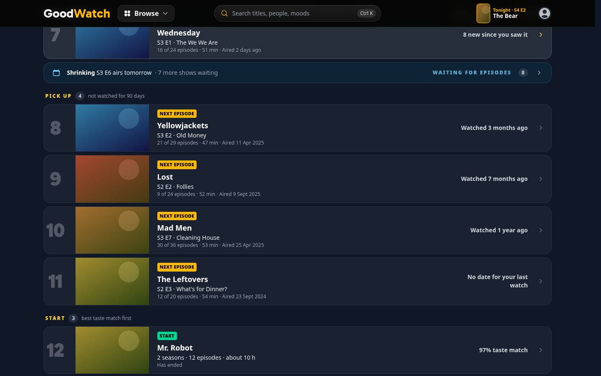
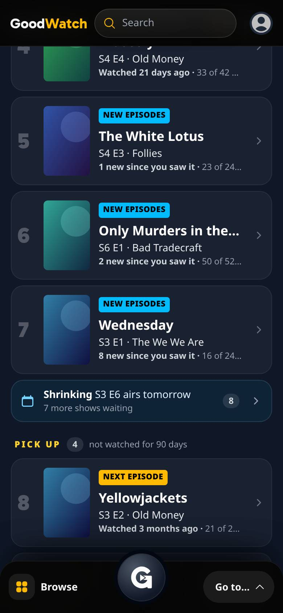
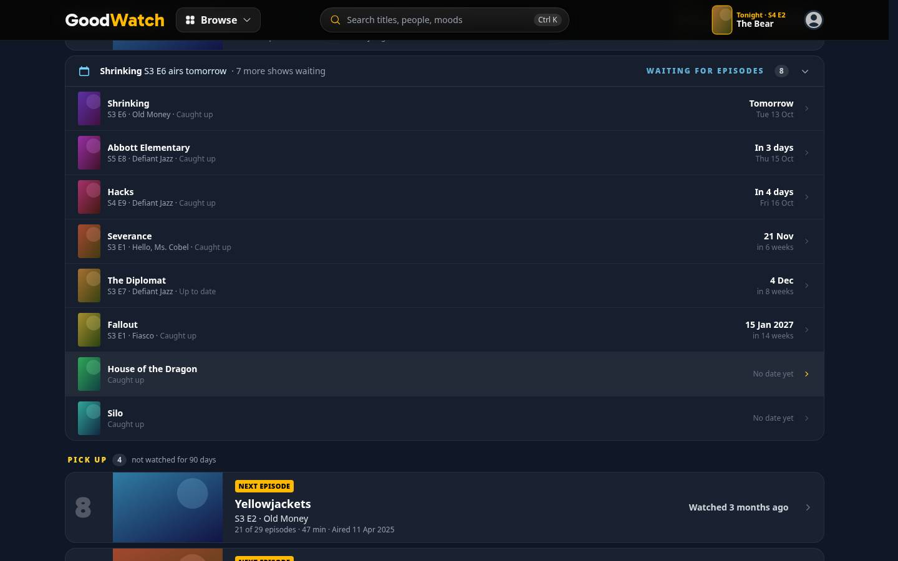
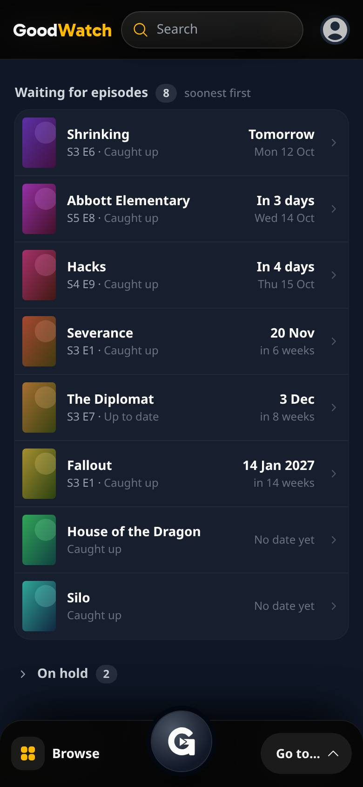
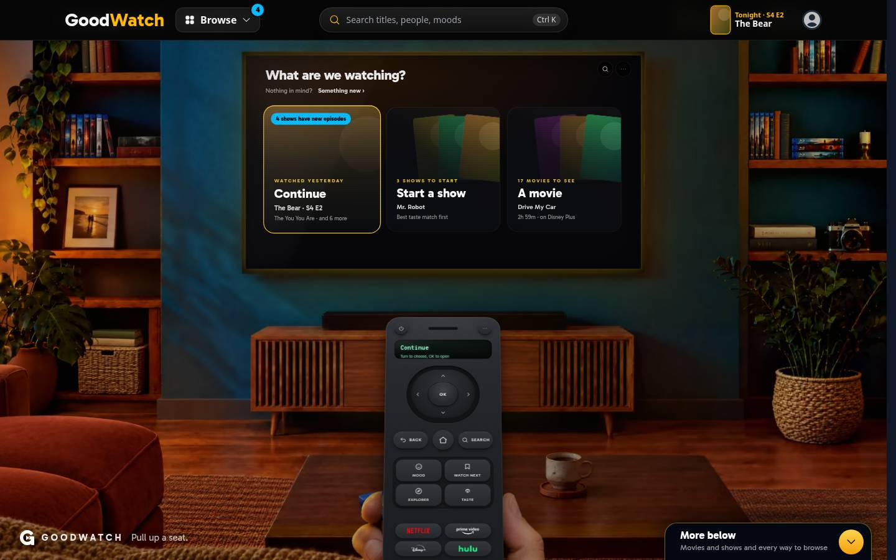
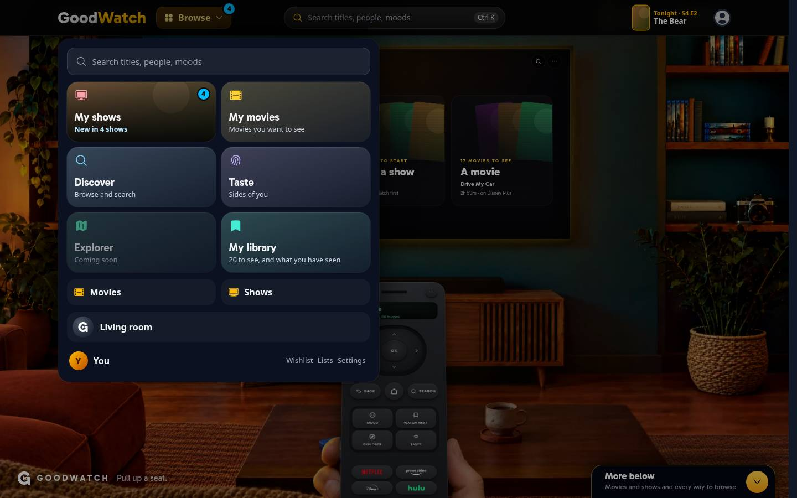
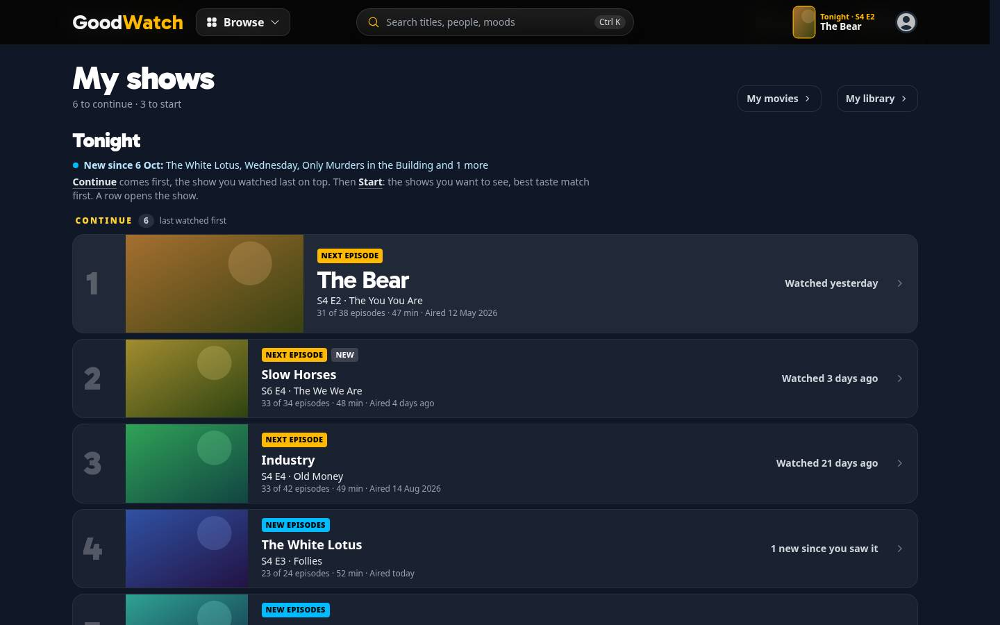

# New episodes for the shows a member tracks

> Since October 14, 2026 the webapp reads no `REC_*` feature flag: what `on` did is what the site does
> (`docs/implementation/tv-screen-revamp/rec-flags/`). The flags here record how this was built and run then. A server
> of a later commit needs none of them.

What [#442](https://github.com/alp82/goodwatch-monorepo/issues/442) built, from the decisions of
[#437](https://github.com/alp82/goodwatch-monorepo/issues/437). In the app only: no email, no push, no release
calendar. Everything is behind `REC_TRACKING`. Vocabulary: [`CONTEXT.md`](../../../../CONTEXT.md) (Waiting for
episodes, My shows visit, New episodes signal). Reads: [data-model.md](../data-model.md), section 10. The prototype
was at `/prototype/new-episodes` and is removed; its [notes](../../../prototypes/new-episodes/README.md) stay. Paths without a prefix are
under `goodwatch-webapp/app/`.

The signal has a second source since [#456](https://github.com/alp82/goodwatch-monorepo/issues/456): titles that
landed on one of the member's services. What opens the hub then shows the sum, and the My shows tile counts a show
once. See [newly-available/README.md](../newly-available/README.md).

## Changed on 2026-10-20: returning shows and persistent announcements

The owner confirmed these changes after Cyberpunk: Edgerunners appeared in Waiting while its details and the
signal showed a new season. My shows grouped by `show.aired_episode_count`, while the signal read episode dates.
My shows now groups using one batched UTC count of regular, non-removed episodes with known dates that have come.
The cached show-level count no longer decides placement. Unknown/future dates never make an episode aired.

- Seen with aired episodes unwatched has derived display state `new_episodes`, labelled by count in amber.
  Continue sorts every eligible show by its Next episode air date, newest first, then last activity. A new weekly
  episode and a returning season follow the same rule; an older unwatched episode stays below newer ones.
  Seen, running and nothing unwatched is `caught_up`. Stored status never changes
  without a member action. Tonight's pick still uses the active Watching show and its own episode.
- Every Continue candidate's Next episode is resolved before ordering and before choosing the home's first rows.
  The episode-list budget limits additional Pick up rows, not the candidates needed for Continue ordering.
- Episode announcements remain until explicitly dismissed or any episode in the announced snapshot is watched.
  Visiting My shows or title details does not clear them. The number outside My shows counts pending shows.
- A first read freezes an initial seven-day baseline in `user_setting` under `show_release_since`.
  Immutable snapshots use `show_release:<show>:<pass>:<first-episode-sequence>`; each records the first episode,
  its air date, the batch's aired episode sequences and last sequence. Acknowledgments use
  `show_release_ack:<show>:<pass>:<first-episode-sequence>`. The sequence is catalog season * 100000 + episode.
  No schema migration is needed. Prefetch may discover a release but never dismisses one or records a visit.
- Snapshot inserts use ON CONFLICT DO NOTHING and refresh new snapshots before answering prefix reads.
  Acknowledgments are read by whole primary keys together. An old tab can dismiss only its displayed snapshot.
  Watching any episode in that snapshot persists the acknowledgment on the next signal read. Dismissal does
  not change stored show status or Continue placement. A subsequent release can announce after catch-up.
- On hold, Dropped, and already-behind shows generate no new announcement. A Watching show's next episode must
  also have aired after its last activity day. An undated or removed episode cannot keep an obsolete announcement.
- My shows visits still record `my_shows_visited_at` for streaming-service news. That behavior is unchanged.
- Removed the paragraph explaining ordering and row navigation. Each pending show has its own Dismiss button.

The earlier sections below describe the original implementation and are superseded by these rules where they differ.

## Changed on 2026-10-12: Pick up, the waiting row, and what counts as activity

Decided by the owner after looking at the page with their own shows. Still behind `REC_TRACKING`; the rule and the
production counts are in [data-model.md](../data-model.md), section 10, "Activity".

- **A member's own move of a show to Watching counts as activity:** unmarking a season of a Seen show, taking back
  a Seen press, resuming from On hold or Dropped, Watch again. Such a show is in Continue for 90 days even when its
  watches are old or have no date, and its row says "Watching since yesterday" or "Watching for 12 days". An
  import never counts.
- **The cut-off is 90 days,** not 30, for Continue, Tonight's pick and home's Continue door.
- **Pick up** replaces "Not watched for 30 days". It is a list like Continue and Start, between them, open, the
  show watched last first. Five rows are drawn, and a button draws the rest.
- **Waiting for episodes is one row** between Continue and Pick up: "Shrinking S3 E6 airs tomorrow · 7 more shows
  waiting". It opens to the list below with its day column. One waiting show without a date reads "The White Lotus
  is waiting for episodes · No date yet"; several without a date "3 shows are waiting for episodes · No dates
  yet"; without a waiting show there is no row.
- **Under the list** only the shows the member set aside remain: On hold and Dropped, closed.




Design choices that are the owner's to confirm:

1. **The row's words.** It names one show and counts the rest. The other design looked at was the opened list as it
   stands, always open ([desktop](waiting-desktop.jpg)): it says more and pushes Pick up eight rows down.
2. **Pick up draws five rows first.** A member who imported a history can have dozens of shows there, and Start
   comes after it.
3. **"Watching since today", "Watching for 12 days"** for a row placed by the member's move. One wording for all
   four actions; the row cannot say which one it was.
4. **The first tick of a show is a move to Watching too.** A show started today by logging an episode with a date
   of 2019 is in Continue, by the move and not by the watch.

## What a member sees

**Waiting for episodes, on My shows.** Opened from its row: one column, one show a line. Each line ends in a column with the day the
show's next episode airs: "Tomorrow" with "Mon 12 Oct" under it, "In 4 days", and from a week out the date with
"in 6 weeks" under it. A show without a dated episode to come says "No date yet". The group is ordered soonest
first, then the shows without a date in the order they had. The days go by the member's day, the device's date. On a
phone the episode's name is left out, so that "Caught up" is never cut off.




**The signal outside My shows.** The number of shows that are new, in sky blue, the colour of the "New episodes" tag:

- on the Browse button (desktop) and on the round key of the phone's dock, which open the hub;
- on the My shows tile in the hub, whose line then reads "New in 4 shows";
- as a pill on home's Continue door: "4 shows have new episodes", on a phone "4 shows".

When exactly one show is new it is named: "New: Slow Horses S6 E4", or "New: Wednesday, 8 episodes" when a season
dropped. The Continue door itself stays Tonight's pick.




Phone: [home](home-phone.jpg), [the hub](hub-phone.jpg).

**On arrival.** Opening My shows is the visit that clears the signal everywhere. The page says once, above the
list, what was new: "New since 6 Oct: The White Lotus, Wednesday, Only Murders in the Building and 1 more". The line
stays for that visit and is gone on the next one. There are no dots beside the tags.



Phone: [My shows](shows-phone.jpg). After the visit: [home, desktop](home-cleared-desktop.jpg),
[home, phone](home-cleared-phone.jpg).

## The rule

A show is **new** when its Next episode aired after the day of the member's last My shows visit.

- Watching and Seen shows only. On hold and Dropped shows are never new, a returning On hold show included.
- A show the member was already behind on has an older Next episode, and is not new when one more airs.
- An episode dated the day of the visit had aired when the member looked, so it is not new afterwards.
- Watching the new episode elsewhere takes the show out: its Next episode is then another one, or none.
- What has aired goes by the UTC date and the `episode` table. `show.aired_episode_count` is not used for this: it
  is up to a day behind the calendar.

**A member who has never opened My shows** has no visit to count from. They are shown what aired in the last seven
days, which is the rule of the page's own "New" mark, and their line reads "New in the last 7 days:". Every member
starts there on the day this ships. This was not part of the decisions; the alternative is no signal at all until
the first visit.

## The stored fact

The time of the last My shows visit is one row of `user_setting`: `key = 'my_shows_visited_at'`, `value` an ISO time
in UTC. The table and its key (`user_id, key`) exist, so **no statement was run on the production database and no
table changed**. The settings API ignores the key, because it is not in its schema, and cannot set it.

The row is written by `POST /api/new-episodes`, which the page sends once it is on screen (`useMyShowsVisit`). The
page's loader never writes: the hub's links load My shows ahead of a tap, and that must not clear the signal.

## Routes

| Route | Flag off | Flag on, member | Flag on, guest |
| --- | --- | --- | --- |
| `GET /api/new-episodes` | 404 | `{ shows, only }`: how many shows are new, and the show when it is one | 401 |
| `POST /api/new-episodes` | 404 | Records the visit and answers `{ shows: 0, only: null }` | 401 |
| `/my-shows` | 404 | As before, with the waiting days and the arrival line | As before |

With the flag off nothing changes for anyone: the hook that asks for the signal is not enabled, so no request is
sent and nothing is drawn. The same holds for a guest and for a member without a Watching or Seen show.

## Reads, and what was measured first

Measured on production with `goodwatch-webapp/scripts/measure-waiting-shows.mjs` (read-only) on 2026-10-11:

| Question | Answer |
| --- | --- |
| How many waiting shows do members have? | 148 members have a Watching or Seen show, 57 of them a waiting show. Among those: median 1, 90th percentile 3, most 10. Nobody has more than 30 |
| What does one episode list a show cost? | For the member with 10: 163 to 236 ms (median of 15 runs, two rounds), 402 rows, all ten at once. A list now carries every episode's description |
| What does one statement for all of them cost? | 77 to 84 ms, 19 or 20 rows. A round trip from the measuring machine is about 75 ms on its own (a statement that returns no row took 73 to 78 ms) |
| How often does the catalog hold a dated next episode for a waiting show? | Measured again on 2026-10-12: 12 of 59 shows (20%), 22 of 94 waiting rows (23%). 7 shows (12%) have only an episode without a date, 40 (68%) have no episode to come listed. The first run, on 2026-10-11, said 18 of 58 and none without a date: the script read the driver's `json`, which turns a NULL timestamp into 1 January 1970, and so counted an undated episode as dated |
| How fresh are those shows' episodes? | All were copied within the last 7 days |

What that led to:

- **One statement for all waiting shows** (Q8), not one cached episode list a show. It asks only for the regular
  episodes dated after today. It runs beside the Continue rows' episode lists, so it adds no step to the page.
- **Only dated episodes.** The prototype had two statements for a show without a date ("S4 E1 has no date yet" and
  "No new episodes announced"). No waiting show in production had an undated episode alone, so the page has one
  plain statement, "No date yet", and the read needs no rule for undated holes in old seasons.
- **Two of three waiting rows say "No date yet"** today. That is what the catalog knows.

| Read | When | What |
| --- | --- | --- |
| Q8 | My shows, once | The dated episodes to come of all waiting shows, by show key |
| Q9 | The signal, and My shows on arrival | Which of the member's Watching and Seen shows had an episode air since the visit, by show key |
| Q10 | The same | The visit: the member's row of `user_setting` by its whole key |
| Episode lists | The same, for the shows Q9 names | Cached per show for 10 minutes, as for Continue |
| `show` by key | The same, for the shows that turn out new | Their names |

The signal is asked for on every page a tracking member loads, after first paint. For a member with nothing aired
since their visit that is the member data (cached), Q10 and Q9. Home's doors do not read Q8.

## The render path

The header and the dock are on every landing surface. Measured on a production build against `origin/main`
(`remix vite:build`, the manifest's scripts for the entry, the root and the route, Brotli level 11):

| Surface | Scripts | Script bytes, before | after | More |
| --- | --- | --- | --- | --- |
| Home | 16, as before | 244,798 | 245,403 | 605 |
| Movie page | 21, as before | 246,881 | 247,436 | 555 |
| Show page | 21, as before | 247,104 | 247,660 | 556 |
| Person page | 14, as before | 182,706 | 183,267 | 561 |
| Discover | 33, as before | 319,426 | 319,958 | 532 |

The first version put the whole rules module into the shell chunk (1,156 bytes gzip more). The words the navigation
needs are now `domain/new-episodes-signal.ts`, and the shell grows by 649 bytes gzip. The hub's and the doors' own
chunks grow by 78 and 175 bytes gzip and load on first use, as before.

`./bench.sh budget` measures the deployed site, so it cannot check a branch that is not deployed. It was run on
production on 2026-10-11 for five of the six surfaces (the share list needs `SHARE_LIST_PATH` from a `config.env`
that was not on the machine) and passed every line. What is left under each script limit, against what this adds:

| Surface | Script bytes, production | Limit | Left | This adds |
| --- | --- | --- | --- | --- |
| Home | 244.7 KB | 256.0 KB | 11.3 KB | 0.6 KB |
| Movie page | 267.2 KB | 277.0 KB | 9.8 KB | 0.6 KB |
| Show page | 267.4 KB | 278.0 KB | 10.6 KB | 0.6 KB |
| Person page | 186.1 KB | 193.0 KB | 6.9 KB | 0.6 KB |
| Discover | 326.0 KB | 340.0 KB | 14.0 KB | 0.5 KB |

The number of scripts is at its limit on every surface today (16, 22, 22, 14, 31) and does not change. The
tightest total is the movie page's: 465.2 of 472.0 KB, 6.8 KB left. No limit in `urls/budget.json` was raised.
**Run the budget again after the deploy**: only that run measures this code.

## Where it is

| What | Where |
| --- | --- |
| The rule, the order of the waiting group, the days and the arrival line | `domain/new-episodes.ts` |
| What the signal says | `domain/new-episodes-signal.ts` |
| The visit and what is new | `server/new-episodes.server.ts`, statements Q8 to Q10 in `server/tracking-sql.ts` |
| The waiting days | `getMyShows` in `server/my-shows.server.ts` |
| The endpoint | `routes/api.new-episodes.ts` |
| The hook and the mark | `ui/navigation/useNewEpisodes.ts`, `NewEpisodesMark` in `ui/navigation/bits.tsx` |
| The pages | `ui/my-shows/MyShowsPage.tsx`, `ui/navigation/{SiteHeader,MobileDock,Hub}.tsx`, `ui/living-room/HomeDoors.tsx` |

## How it was checked

Tests, from `goodwatch-webapp`:

```
node --test app/domain/new-episodes.test.ts app/domain/my-shows.test.ts app/server/my-pages.test.ts
```

The rules are pure functions (the days, the waiting order, what is new, what the signal and the arrival line say).
`my-pages.test.ts` runs the server reads against the in-memory Crate of the tracking tests and asserts which
statements they send: one read for all waiting shows and no episode list for any of them; for the signal one read
of the episodes aired since, a list only for the shows it names, and the catalog only for the names of the new
shows.

The real pages were driven in headless Chromium at 390 x 844 and 1440 x 900 on `/prototype/my-library-real`, the
harness of [#385](../my-library/README.md), with a new sample member, `member=new`: they opened My shows five days
ago, four shows have returned since, eight are waiting. The harness now mounts the site's header, dock and hub a
second time for the member, over the ones the shell draws for a guest, so the signal on them is the app's own.
85 checks since 2026-10-12 (51 before), all passing; the script is [`drive.mjs`](drive.mjs) and also took the pictures above:

```
cd goodwatch-webapp        # no .env: the harness refuses to start when CRATE_HOSTS is set
REC_TRACKING=on REC_WATCH_NEXT=on REC_NAVIGATION=on REC_TASTE_MATCH=on \
  node_modules/.bin/remix vite:dev --port 3107 --strictPort --host 127.0.0.1
HARNESS=http://127.0.0.1:3107 node drive.mjs <screenshot dir>   # with playwright-core beside it, and system Chromium
```

`/prototype/my-library-real?page=home|shows&member=new&reset=1`, and `&hub=open` for the hub. `reset=1` starts the
member over, which brings the signal back after a visit.

Posters and backdrops in the pictures are painted tiles: the harness's titles are names only.

## To try it in preview

After a deploy with `REC_TRACKING=preview` and the owner in `REC_PREVIEW_USERS`:

1. Open any page. If a Watching or Seen show's Next episode aired in the last seven days, the Browse button (or the
   dock's key) carries a number, and so does the My shows tile.
2. Open home: the Continue door has the pill.
3. Open My shows: the line above the list names the shows, and the waiting group has its days.
4. Go back to home: the number and the pill are gone. They return when a Next episode airs on a later day.

Before a deploy, the owner's dev server needs `REC_TRACKING=on` (or `preview`) and a signed-in member. Its `.env`
points at production, so opening My shows there writes the visit row for that member.

## Left open, and not verified

- **The app has not run this against the real tables.** The tests and the harness use the in-memory Crate. The
  three reads were each sent to production once, read-only: Q8 by the measuring script, Q9 for five shows (4 rows),
  Q10 for a member who does not exist (Crate plans it as a `Get` by key). The upsert of the visit row was not sent.
- **A Watching show that returns after 90 days without a watch** is new and is named in the arrival line, and its
  row is in Pick up, which is open since 2026-10-12, with the "New" tag. A Seen show that returns goes to Continue.
- **On the day an episode airs**, `show.aired_episode_count` can be behind for some hours. The signal goes by the
  calendar and names the show; My shows can still list it under Waiting until the count follows.
- **The arrival line is for one page load.** Going to a show and back is a new visit, and the line is gone.
- **"Today"** in the waiting group is only for a member whose day is ahead of UTC. In Kiritimati (UTC+14) the check
  passed: an episode dated tomorrow by UTC read "Today" or "Tomorrow" as their date said.
- **Account deletion.** `user_setting` has no deletion yet (data-model.md, section 8); the visit row is covered when
  that flow is built.
