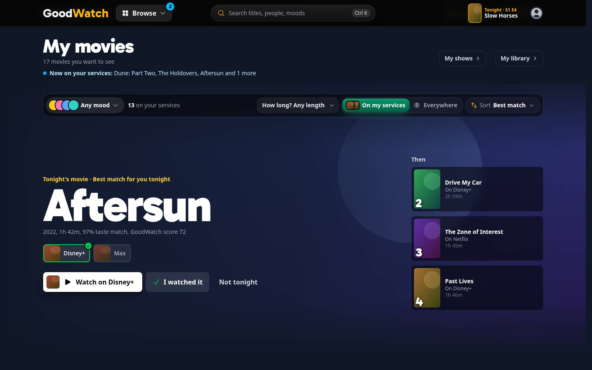
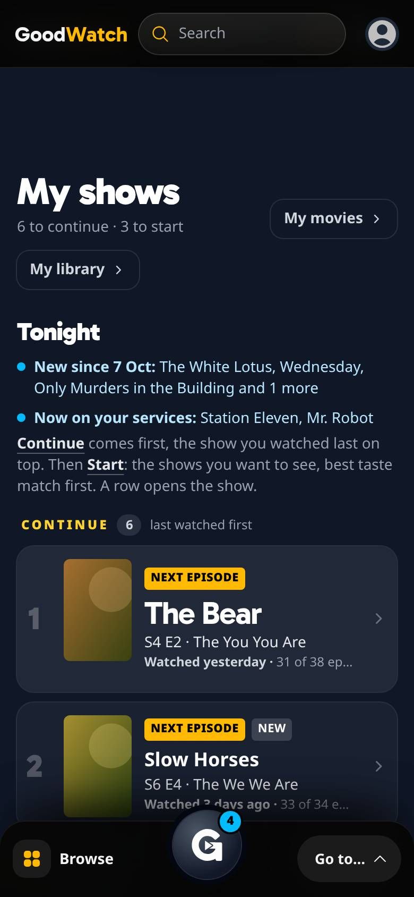

# Newly available on your services

What [#456](https://github.com/alp82/goodwatch-monorepo/issues/456) built: a second source of the signal that
[new episodes](../new-episodes/README.md) introduced. In the app only: no email, no push. Everything is behind
`REC_TRACKING`. Vocabulary: [`CONTEXT.md`](../../../../CONTEXT.md) (Newly available, My movies visit, New episodes
signal). Reads: [data-model.md](../data-model.md), section 10. Paths without a prefix are under
`goodwatch-webapp/app/`.

In the code a title that becomes newly available has **landed** on a service. "Arrival" is already the member's
arrival on My shows, and the line the page says then.

## What a member sees

A member is told when a title they want to see lands on a streaming service they have.

**The signal.** The same sky blue number as for new episodes, in the same places:

- on the Browse button (desktop) and the round key of the phone's dock, which open the hub: the sum of everything
  new, shows and movies;
- on the My movies tile of the hub, and on the My shows tile, which counts a show once whether it has a new episode,
  landed on a service, or both;
- as a pill on home's doors: movies on A movie, shows on the door that opens My shows (Continue, or Start a show for
  a member with nothing to continue).

One title is named with its service, several are counted:

| | One | Several | New episodes and landed shows |
| --- | --- | --- | --- |
| Tile | Now on Netflix: Dune: Part Two | 4 now on your services | New in 6 shows |
| Door, desktop | Dune: Part Two is now on Netflix | 4 movies are now on your services | 6 shows have something new |
| Door, phone | 1 movie | 4 movies | 6 shows |


**On arrival.** My movies says once, under its head, what landed: "Dune: Part Two is now on Netflix", and with
several "Now on your services: Dune: Part Two, The Holdovers, Aftersun and 1 more". My shows says the same under its
line about new episodes. The line stays for that visit and is gone on the next one.




**It clears by opening the page.** A visit of My movies clears the movies, a visit of My shows the shows. What opens
the hub then shows what is left.

### Every case, at 390 x 844 and 1440 x 900

| Case | Home | Hub | Page |
| --- | --- | --- | --- |
| Nothing new | [desktop](nothing-home-desktop.jpg), [phone](nothing-home-phone.jpg) | [desktop](nothing-hub-desktop.jpg), [phone](nothing-hub-phone.jpg) | |
| One movie | [desktop](one-movie-home-desktop.jpg), [phone](one-movie-home-phone.jpg) | [desktop](one-movie-hub-desktop.jpg), [phone](one-movie-hub-phone.jpg) | [desktop](one-movie-page-desktop.jpg), [phone](one-movie-page-phone.jpg) |
| One show | [desktop](one-show-home-desktop.jpg), [phone](one-show-home-phone.jpg) | [desktop](one-show-hub-desktop.jpg), [phone](one-show-hub-phone.jpg) | [desktop](one-show-page-desktop.jpg), [phone](one-show-page-phone.jpg) |
| Several: 4 movies, 2 shows | [desktop](several-home-desktop.jpg), [phone](several-home-phone.jpg) | [desktop](several-hub-desktop.jpg), [phone](several-hub-phone.jpg) | [desktop](several-page-desktop.jpg), [phone](several-page-phone.jpg), after My movies was opened |
| A new episode and landed titles together | [desktop](together-home-desktop.jpg), [phone](together-home-phone.jpg) | [desktop](together-hub-desktop.jpg), [phone](together-hub-phone.jpg) | [desktop](together-page-desktop.jpg), [phone](together-page-phone.jpg) |

Posters and backdrops in the pictures are painted tiles: the harness's titles are names only.

## The rule

Decided in #456:

- **Which titles.** A member's Want to See titles, and the shows they are Watching or have On hold.
- **Which offers.** Subscription and free offers (`flatrate`, `free`, `ads`) on a service the member saved, in the
  country the member saved. Rent and buy do not count. This is the rule of On my services.
- **What lands.** A title that was on none of the member's services and is now on one. A further service for a
  title that was already watchable is not news.
- **Who.** A member without a saved country or without a saved service is told nothing. The country guessed from
  the request does not count as theirs.

Built as defaults, **not confirmed by the owner yet**:

1. **When a title landed** is the earliest `created_at` among its current qualifying rows of
   `streaming_availability` on the member's services.
2. **It is news** when that time is after the member's last visit of the page the title lives on, after the launch,
   and after the member added the title to Want to See. A member who never opened the page is told everything
   since the launch.
3. **The launch** is 2026-10-12 00:00 UTC, a constant in `server/availability-first-seen.server.ts`. It is after the
   catch-up of late September 2026, so none of those offers is news. `NEWLY_AVAILABLE_SINCE` (an ISO time) moves it
   to the day of the deploy, if nothing from before that day should be said either.
4. **Movies belong to My movies and shows to My shows.** Movies clear with a My movies visit, stored in a row of its
   own. Shows clear with a My shows visit and share its stored time (#442).
5. **Duplicate service ids are one service.** 9, 10 and 119 are Amazon Prime Video; 2 and 350 are Apple TV. The
   mapping is `duplicateProviderMapping` in `utils/streaming-links.ts`, which the availability index and the saved
   services already use. A title that Amazon Video carried before has not landed when Amazon Prime Video lists it.
6. **A title whose offers are unknown** has not landed until an offer row exists.
7. **Everything is behind `REC_TRACKING`**, like new episodes. The flag is `on` in production, so this is live for
   every member with the deploy.

Decided while building, also for the owner to confirm:

8. **A show the member is Watching or has On hold has no time it was added.** The watch state keeps no such time in
   the member data, so such a show counts from the launch on. A Want to See show the member also watches counts
   the same way.
9. **A landing older than 90 days is not news.** The index keeps the times of the last 90 days (see below). A member
   who was away for longer is not told about what landed before that.
10. **The page names the titles when several landed** ("Now on your services: Dune: Part Two, The Holdovers,
    Aftersun and 1 more"), where the default was a count. The ticket asks for a line "that says what came", and My
    shows names its new episodes the same way. The tile, the door and the number still count.
11. **A phone's tile leads with the service** ("Now on Netflix: Dune: Part Two"). A tile's line is cut after about
    22 characters, and "Dune: Part Two is no…" no longer said what happened.
12. **A show with a new episode that also landed** is one show on the tile and the door, and its episode is what is
    said when it is the only one.

Known noise, and what happens to it:

| Noise | What happens |
| --- | --- |
| The catch-up of late September 2026 | Before the launch: never news |
| Another catch-up later | More than 20,000 titles of a country with an offer newer than the days kept: the index keeps no time for that country, logs a warning, and nothing is announced there until the days have passed or the launch is moved |
| Duplicate service ids | One service, by its earliest row |
| An offer that leaves and returns | The row is written again with a new `created_at`: the title lands again. Accepted |
| A member saves another service | Its old offers have old times, so nothing lands. An offer of that service newer than their last visit is told to them, although they could not have seen it before |

## The stored fact

The time of the last My movies visit is one row of `user_setting`: `key = 'my_movies_visited_at'`, `value` an ISO
time in UTC. The table and its key (`user_id, key`) exist, so **no statement was run on the production database and
no table changed**. The settings API ignores the key, because it is not in its schema, and cannot set it.

The row is written by `POST /api/newly-available`, which the page sends once it is on screen (`useMyMoviesVisit`).
The page's loader never writes: the hub's links load My movies ahead of a tap, and that must not clear the signal.
Shows use the row of #442, `my_shows_visited_at`, which `POST /api/new-episodes` writes.

## Routes

| Route | Flag off | Flag on, member | Flag on, guest |
| --- | --- | --- | --- |
| `GET /api/tonight` | As before | As before, with `landed` when something landed: `{ movies, shows }`, each `{ count, ids, only }` | As before |
| `POST /api/newly-available` | 404 | Stores the My movies visit and answers `{ ok: true }` | 401 |
| `GET /api/new-episodes` | 404 | As before, with `ids`, the shows that are new, so that a show is counted once | 401 |
| `/my-movies`, `/my-shows` | As before | As before, with the line on arrival | As before |

No request was added to a page. What landed rides along with Tonight's pick, which the navigation asks for on every
page already.

## Measured first, and the path chosen

Measured on production with `goodwatch-webapp/scripts/measure-newly-available.mjs` (read-only, counts only) on
2026-10-12. A round trip from the measuring machine is about 70 ms on its own.

| Question | Answer |
| --- | --- |
| Does every row have the time? | 18.9 million rows, 10.4 million of them `flatrate`, `free` or `ads`, none without `created_at` |
| How many titles do members have that can land? | 150 members have one. Median 2.5, 90th percentile 29, most 361. 114 of them have a saved country and a saved service; 10 have no country, 36 no service |
| **At request time:** one statement for all of a member's titles, the largest list (361 titles, 5 service ids) | 96 to 99 ms as a median of 15 runs, 160 to 187 rows, so about 30 ms on the database. With 12 service ids: 99 to 101 ms |
| **In the index, a time for every offer:** the load of the United States | The answer grows from 6.1 MB to 16.6 MB (two lists a title) or 23.4 MB (a row a title and service). Parsing it holds the event loop for 154 to 506 ms, or 289 to 875 ms, against 54 to 155 ms today. Crate takes longer too: 4.0 to 4.7 s against 2.6 s in the steadier of two rounds |
| **In the index, only what appeared lately:** the United States, last 7 days | 906 rows of 545 titles. As built: one statement for those titles (86 ms, 8.6 KB), then every offer of them (125 ms for 420 movies, 98 ms for 125 shows, 108 KB together). About 100 ms on the database a load. Germany: 151 titles |
| How much appears? | 1,000 to 1,700 offers a day in all countries since 2026-10-02. From 2026-09-21 to 2026-10-01 the catch-up wrote 4.5 million |
| How many landings would members have been told? | 6 in the week of 2026-10-05, 4 in the week before. 120 in the week of 2026-09-21, which is the catch-up |

**Chosen: the index carries the times, and only for what appeared lately.** A request reads nothing from Crate for
this. Why:

- The statement at request time is cheap (30 ms) but would run on every page a member loads, for every member with
  a Wishlist. In memory the same answer is a lookup per title.
- The times must match what On my services says. The index decides what is on a member's services and reloads
  every 6 hours. Read at request time, a title could be announced up to 6 hours before My movies lists it as on
  the member's services. From the index, a title is announced with the load that first holds its offer.
- A time for every offer is the wrong trade: 10 MB and up to 350 ms of a blocked event loop on each load of the
  United States, for times of which all but the last days are never used. Only an offer that appeared after the
  launch can be news.

What it costs: three statements more on each load of a country (every 6 hours, for countries in use), and a landing
is known up to 6 hours after its row was written, the same delay On my services has.

**How the times are read** (`readFirstSeen`): the titles of the country with a subscription offer that first
appeared since, and then every subscription offer of those titles, grouped by service with its earliest time. The
second read is needed because a recent row alone does not say that the service is new for the title: an older row
of a duplicate id, or of another kind of offer on the same service, means it was there before. The index keeps, by
title and base service, the time of each service that started since. Since is the launch, and from 90 days after
it the last 90 days. A country whose read fails keeps the times of the load before, and the index is whole
without them.

| Read | When | What |
| --- | --- | --- |
| The index's load | Every 6 hours for a country in use | As before, then the two kinds of statement above |
| The member data, the settings | Every request for Tonight's pick | Both cached, both read for the pick already |
| Q10, twice | Only when a title landed after the launch | The My movies visit and the My shows visit, each by its whole key |
| Names | Only when a landing is news | The display fields of up to three titles a kind (cached), and the service's name (in memory) |

For a member with nothing landed that is no statement, which the server test asserts.

## The render path

The header and the dock are on every landing surface. Measured on a production build against `origin/main`
(`remix vite:build`, the manifest's scripts for the entry, the root and the route, Brotli level 11):

| Surface | Scripts | Script bytes, before | after | More | More in gzip |
| --- | --- | --- | --- | --- | --- |
| Home | 15, as before | 240,652 | 240,854 | 202 | 406 |
| Movie page | 20, as before | 242,732 | 242,916 | 184 | 380 |
| Show page | 20, as before | 242,952 | 243,135 | 183 | 385 |
| Person page | 13, as before | 178,483 | 178,714 | 231 | 380 |
| Discover | 32, as before | 315,082 | 315,370 | 288 | 381 |

The one first-view file that grows is the shell: 162,785 to 163,877 bytes, 344 more in Brotli and 387 in gzip. It
holds the sum for the Browse button and the dock's key, and what clears the signal after a visit. The Brotli
totals move by about a hundred bytes from one build of the same code to the next, because the names of the chunks
change; an earlier pair of builds gave 241 to 354 bytes a surface and 311 for the shell. The gzip numbers are the
steadier ones.

The first version put the words of the tiles, the doors and the pages into the shell too, because the chunk rules
send a small module that several parts share there (680 bytes Brotli more). They are now a chunk of their own,
`newly-available` (932 bytes Brotli; rule 5 in `vite.config.js`), which loads with the hub, home's doors, My shows
or My movies. The hub's chunk grows by 69 bytes and the doors' by 100. My shows and My movies load one script more
(1.2 and 1.5 KB more in all); neither is a landing surface.

`./bench.sh budget` measures the deployed site, so it cannot check a branch. No limit in `urls/budget.json` was
raised. **Run the budget again after the deploy**: only that run measures this code.

## Where it is

| What | Where |
| --- | --- |
| The rules: when a title landed, which landings are news | `domain/newly-available.ts` |
| What the navigation is told, and the sum for what opens the hub | `domain/newly-available-signal.ts` |
| What the tiles, the doors and the pages say | `domain/newly-available-words.ts` |
| The times, read with the index's load | `server/availability-first-seen.server.ts`, `landingsOnServices` in `server/availability-index.server.ts` |
| What a member is told, and the My movies visit | `server/newly-available.server.ts` |
| The endpoints | `routes/api.tonight.ts`, `routes/api.newly-available.ts` |
| The hooks | `ui/navigation/useWhatsNew.ts`, `ui/navigation/useTonightsPick.ts`, `ui/my-movies/useMyMoviesVisit.ts` |
| The pages | `ui/my-pages/LandedNote.tsx`, `ui/my-movies/MyMoviesPage.tsx`, `ui/my-shows/MyShowsPage.tsx`, `ui/navigation/{SiteHeader,MobileDock,Hub}.tsx`, `ui/living-room/HomeDoors.tsx` |

## How it was checked

Tests, from `goodwatch-webapp`:

```
node --test app/domain/newly-available.test.ts app/server/newly-available.test.ts
```

22 tests of the rules: the times the index keeps, duplicates, a title already watchable, a member without services,
which titles can land, the launch, the visit of each page, a title added after its offer appeared, and every
wording. 13 tests of the server against the in-memory Crate of the tracking tests with a country's offers beside
it: the statements the index sends, what a member is told, that nothing landed means no statement, the two visits,
a member without a country or a service, and a failed read of the times. The whole suite: 1,574 tests, 1,573 pass,
1 is skipped, as before this work.

The real pages were driven in headless Chromium at 390 x 844 and 1440 x 900 on `/prototype/my-library-real`, the
harness of [#385](../my-library/README.md), which has a new parameter: `landed=movie|show|several` puts titles of
the sample member's Wishlist on their services a day ago. 102 checks, all passing; the script is
[`drive.mjs`](drive.mjs) and also took the pictures. The 51 checks of [new episodes](../new-episodes/drive.mjs)
still pass.

```
cd goodwatch-webapp        # no .env: the harness refuses to start when CRATE_HOSTS is set
REC_TRACKING=on REC_WATCH_NEXT=on REC_NAVIGATION=on REC_TASTE_MATCH=on \
  node_modules/.bin/remix vite:dev --port 3107 --strictPort --host 127.0.0.1
HARNESS=http://127.0.0.1:3107 node drive.mjs <screenshot dir>   # with playwright-core beside it, and system Chromium
```

`/prototype/my-library-real?page=home|shows|movies&member=six|new|none&landed=movie|show|several&reset=1`, and
`&hub=open` for the hub. `member=new` with a `landed` is a new episode and a landing together. `reset=1` starts the
member over, which brings the signal back after a visit.

## To try it signed in

After the deploy, for a member with a saved country and a saved service:

1. Nothing shows until a Want to See title gets its first offer on one of the member's services after the launch.
   Fewer than ten such landings a week happen across all members, so most members see nothing for a while.
2. When one lands: the Browse button (or the dock's key) and the My movies or My shows tile carry a number, and the
   door on home has a pill.
3. Open My movies: the line under the head names the movie and the service, and the movie is among the ones On my
   services lists.
4. Go back to home: the number and the pill are gone.

To see it without waiting, on a dev server only: set `NEWLY_AVAILABLE_SINCE` to a day in the past week, which makes
that week's real landings news. Its `.env` points at production, so opening My movies there writes the visit row
for that member.

## Left open, and not verified

- **The app has not run this against the real tables.** The tests and the harness use the in-memory Crate. The
  statements of the index were sent to production by the measuring script, read-only; Q10 with the new key and the
  upsert of the visit row were not.
- **Nothing was looked at with a signed-in member on real data.**
- **`/api/tonight` needs `REC_WATCH_NEXT`.** With tracking on and Watch next off there is no My movies either, and
  no signal for landed shows. Both flags are on in production.
- **A page loaded from the build before** keeps working across the deploy: it reads `pick` from the answer of
  `/api/tonight` and ignores `landed`.
- **The time a Watching show was started is not compared** (see 8). A member who starts a show on the day it lands
  is told that it landed.
- **Account deletion.** `user_setting` has no deletion yet (data-model.md, section 8); the visit row is covered when
  that flow is built.
- **The harness check of #385** ([`my-library/drive.mjs`](../my-library/drive.mjs)) does not run through on this
  machine, on the commit this starts from either: it waits for the network to fall idle, and stops at different
  steps from run to run. Found on the way: the answer of the visit's POST was never read, which keeps its request
  open in the browser. Both visits now let go of it.
