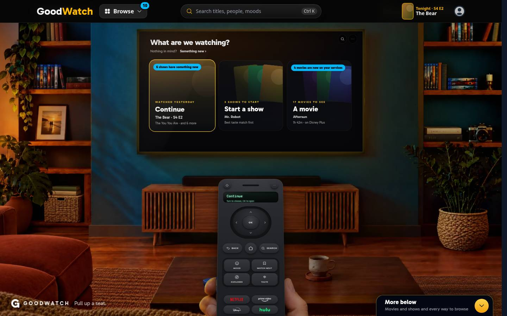
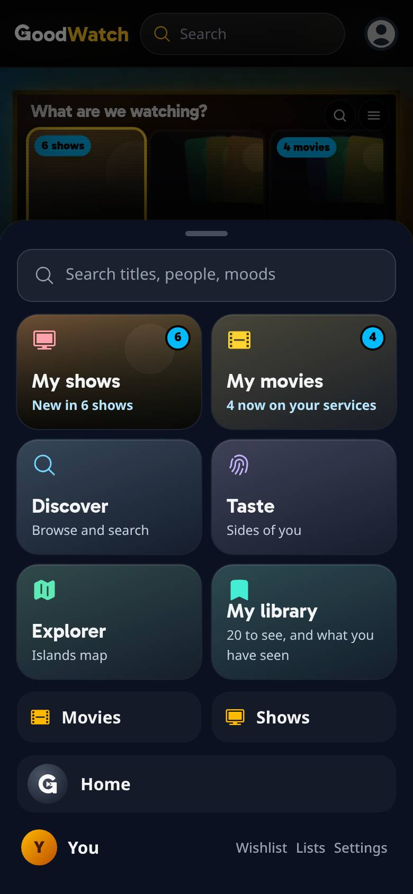
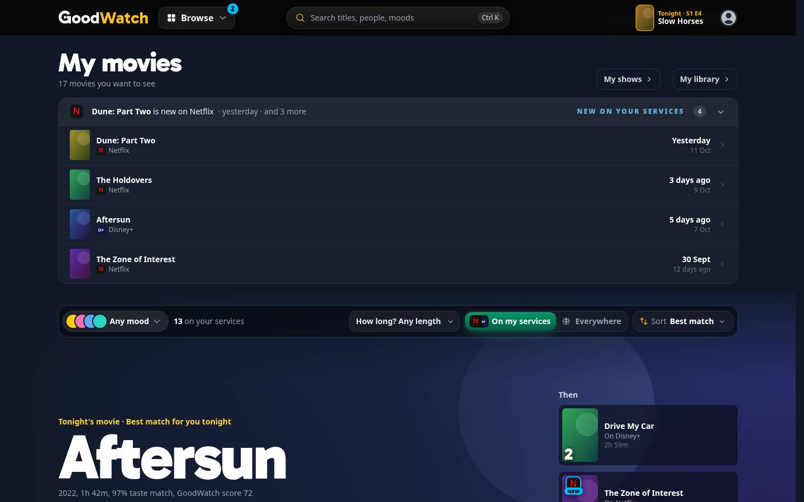
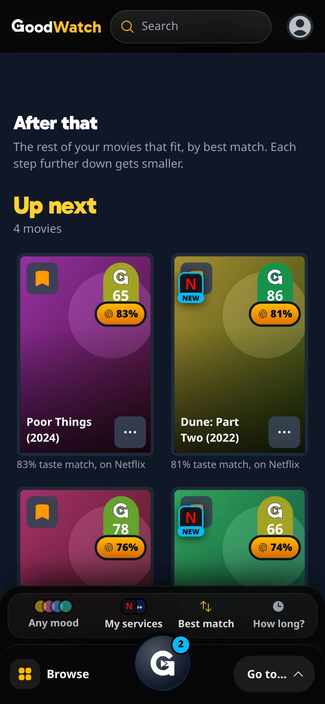
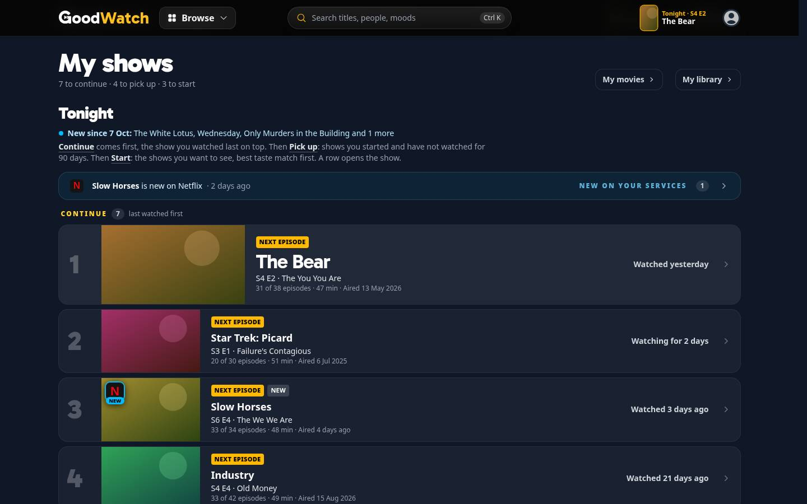
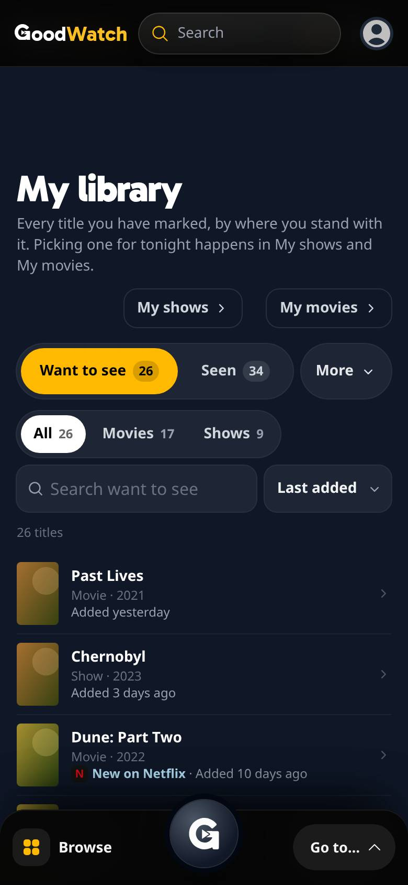
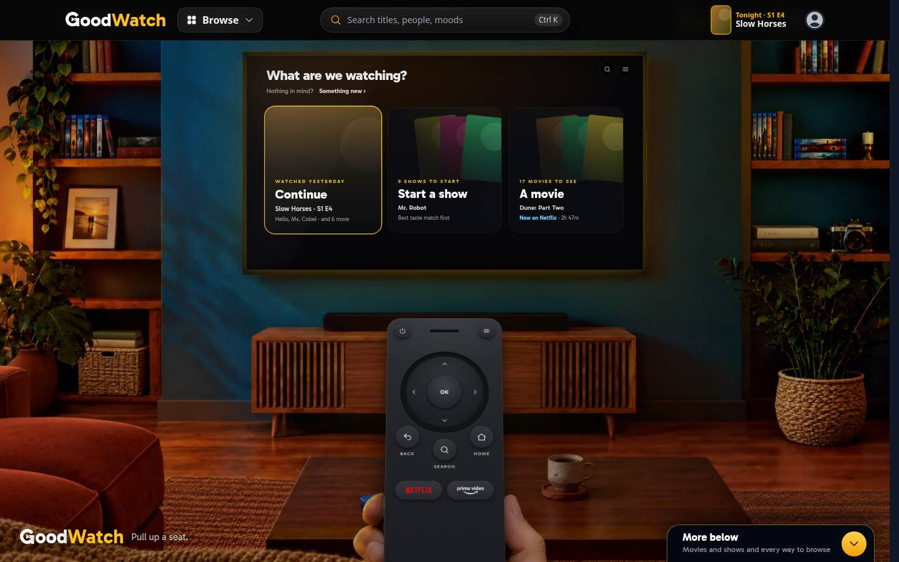

# Newly available on your services

> Since October 14, 2026 the webapp reads no `REC_*` feature flag: what `on` did is what the site does
> (`docs/implementation/tv-screen-revamp/rec-flags/`). The flags here record how this was built and run then. A server
> of a later commit needs none of them.

What [#456](https://github.com/alp82/goodwatch-monorepo/issues/456) built: a second source of the signal that
[new episodes](../new-episodes/README.md) introduced. And what
[#489](https://github.com/alp82/goodwatch-monorepo/issues/489) added on 2026-10-12: for 14 days a title that landed
is listed on its page, marked with the service's logo, and first on its own home door. In the app only: no email,
no push. Everything is behind `REC_TRACKING`. Vocabulary: [`CONTEXT.md`](../../../../CONTEXT.md) (Newly available,
Recently landed, My movies visit, New episodes signal). Reads: [data-model.md](../data-model.md), section 10. Paths
without a prefix are under `goodwatch-webapp/app/`.

In the code a title that becomes newly available has **landed** on a service. Opening My shows is a separate event.

## What a member sees

A member is told when a title they want to see lands on a streaming service they have.

**The signal.** The same sky blue number as for new episodes, in the same places:

- on the Browse button (desktop) and the round key of the phone's dock, which open the hub: the sum of everything
  new, shows and movies;
- on the My movies tile of the hub, and on the My shows tile, which counts a show once whether it has a new episode,
  landed on a service, or both;
- as a pill on home's doors: movies on A movie, shows on the door that opens My shows (Continue, or Start a show for
  a member with nothing to continue).

One title is named with its service, several are counted:

| | One | Several | New episodes and landed shows |
| --- | --- | --- | --- |
| Tile | Now on Netflix: Dune: Part Two | 4 now on your services | New in 6 shows |
| Door, desktop | Dune: Part Two is now on Netflix | 4 movies are now on your services | 6 shows have something new |
| Door, phone | 1 movie | 4 movies | 6 shows |




**It clears by opening the page.** A visit of My movies clears the movies, a visit of My shows the shows. What opens
the hub then shows what is left.

**For 14 days (#489).** A title that landed stays visible for 14 days from the day it landed, whether the member
has opened the page since or not. This replaces the line the pages said once when the page opened ("Dune: Part Two is now on
Netflix"), which is gone.

- **One row on My movies and on My shows** names the latest title with its service and its day ("Dune: Part Two is
  new on Netflix · yesterday · and 3 more") and opens to all of them, the latest first, each with its service and
  the day it landed. A row of the list opens the title. On My movies it is under the page's head, on My shows above
  Continue.
- **The service's logo on the title**, ringed in the signal's sky blue with a "New" tab: on the posters of My
  movies (the Then column and the grid) and on a show's picture in My shows. The Want to See list of My library has
  posters of 40 pixels, too small for it: there the logo stands beside the words "New on Netflix" in the row's
  line. The same goes for a show On hold.
- **The title is first on its own home door**: a movie on A movie, a show not started on Start a show. The door's
  small line says "New on Netflix" in sky blue; on a phone it takes the place of the count. Continue is untouched,
  and so is the order of the doors, so Tonight's pick is still the show the member is in the middle of.







**The pill and the door do not say the same thing twice.** The pill is as it was. While it names the door's first
title with its service (one landing, on a wide screen), the door's own line leaves that to it. Once the page was
opened the pill is gone and the line says it.

| | The pill | The door's lines |
| --- | --- | --- |
| One movie, not seen yet, desktop | Dune: Part Two is now on Netflix | Dune: Part Two · 2h 47m |
| The same, after My movies was opened | none | Dune: Part Two · **New on Netflix** · 2h 47m |
| Several, not seen yet, desktop | 4 movies are now on your services | Dune: Part Two · **New on Netflix** · 2h 47m |
| Phone, not seen yet | 1 movie, 4 movies | **New on Netflix** |

### Every case, at 390 x 844 and 1440 x 900

| Case | Home | Hub | Page |
| --- | --- | --- | --- |
| Nothing new | [desktop](nothing-home-desktop.jpg), [phone](nothing-home-phone.jpg) | [desktop](nothing-hub-desktop.jpg), [phone](nothing-hub-phone.jpg) | |
| One movie | [desktop](one-movie-home-desktop.jpg), [phone](one-movie-home-phone.jpg); after My movies was opened [desktop](one-movie-home-visited-desktop.jpg), [phone](one-movie-home-visited-phone.jpg) | [desktop](one-movie-hub-desktop.jpg), [phone](one-movie-hub-phone.jpg) | [desktop](one-movie-page-desktop.jpg), [phone](one-movie-page-phone.jpg) |
| One show | [desktop](one-show-home-desktop.jpg), [phone](one-show-home-phone.jpg) | [desktop](one-show-hub-desktop.jpg), [phone](one-show-hub-phone.jpg) | [desktop](one-show-page-desktop.jpg), [phone](one-show-page-phone.jpg) |
| Several: 4 movies and 2 shows on two services, 1 to 12 days ago | [desktop](several-home-desktop.jpg), [phone](several-home-phone.jpg) | [desktop](several-hub-desktop.jpg), [phone](several-hub-phone.jpg) | My movies [desktop](several-page-desktop.jpg), [phone](several-page-phone.jpg); the row open [desktop](several-page-open-desktop.jpg), [phone](several-page-open-phone.jpg); the grid [desktop](several-grid-desktop.jpg), [phone](several-grid-phone.jpg); My shows [desktop](several-shows-page-desktop.jpg), [phone](several-shows-page-phone.jpg); Want to See [desktop](several-library-desktop.jpg), [phone](several-library-phone.jpg) |
| A new episode and landed titles together | [desktop](together-home-desktop.jpg), [phone](together-home-phone.jpg) | [desktop](together-hub-desktop.jpg), [phone](together-hub-phone.jpg) | [desktop](together-page-desktop.jpg), [phone](together-page-phone.jpg) |
| One show with a new episode that also landed | [desktop](episode-home-desktop.jpg), [phone](episode-home-phone.jpg) | | [desktop](episode-page-desktop.jpg), [phone](episode-page-phone.jpg) |
| One movie, 12 days ago | after My movies was opened [desktop](old-home-desktop.jpg), [phone](old-home-phone.jpg) | | [desktop](old-page-desktop.jpg), [phone](old-page-phone.jpg) |
| One movie, 15 days ago, not seen yet | | | [desktop](gone-page-desktop.jpg), [phone](gone-page-phone.jpg); opened again, nothing is left |

Posters, backdrops and logos in the pictures are painted tiles: the harness's titles and services are names only.
The pictures were taken on 2026-10-12 with every `REC_*` flag on.

## The rule

Decided in #456:

- **Which titles.** A member's Want to See titles, and the shows they are Watching or have On hold.
- **Which offers.** Subscription and free offers (`flatrate`, `free`, `ads`) on a service the member saved, in the
  country the member saved. Rent and buy do not count. This is the rule of On my services.
- **What lands.** A title that was on none of the member's services and is now on one. A further service for a
  title that was already watchable is not news.
- **Who.** A member without a saved country or without a saved service is told nothing. The country guessed from
  the request does not count as theirs.

Decided by the owner in [Q59](https://github.com/alp82/goodwatch-monorepo/issues/637#issuecomment-6227246315):

- **When a title landed** comes from live stays in `availability_history` (#637). Its day is `appeared_on`
  for exact precision, otherwise the UTC day of `observed_at`. Backfilled stays never announce a landing.
  Open and recently closed stays establish continuity across offer types, duplicate ids, and saved services.
  A stay ending on or after the next landing day minus one day continues watchability. A same-day or next-day
  flicker does not restart it. GoodWatch's learned time is the live stay's earliest `created_at`; visits and
  Want to See additions compare against that time. Display, sorting, launch, and the 14 days use the landing day.

Built as defaults, **not confirmed by the owner yet**:

2. **It is news** when GoodWatch learned of the live stay after the member's last visit of the page the title
   lives on and after the member added the title to Want to See, and its landing day is on or after the launch day. A member who never opened the page is told everything
   since the launch.
3. **The launch** is 2026-10-12 00:00 UTC, a constant in `server/availability-first-seen.server.ts`. It is after the
   catch-up of late September 2026, so none of those offers is news. `NEWLY_AVAILABLE_SINCE` (an ISO time) moves it
   to the day of the deploy, if nothing from before that day should be said either. Its UTC day is inclusive.
4. **Movies belong to My movies and shows to My shows.** Movies clear with a My movies visit, stored in a row of its
   own. Shows clear with a My shows visit and share its stored time (#442).
5. **Duplicate service ids are one service.** 9, 10 and 119 are Amazon Prime Video; 2 and 350 are Apple TV. The
   mapping is `duplicateProviderMapping` in `utils/streaming-links.ts`, which the availability index and the saved
   services already use. A title that Amazon Video carried before has not landed when Amazon Prime Video lists it.
6. **A title whose offers are unknown** has not landed until an offer row exists.
7. **Everything is behind `REC_TRACKING`**, like new episodes. The flag is `on` in production, so this is live for
   every member with the deploy.

Decided while building, also for the owner to confirm:

8. **A show the member is Watching or has On hold has no time it was added.** The watch state keeps no such time in
   the member data, so such a show counts from the launch on. A Want to See show the member also watches counts
   the same way.
9. **A landing older than 90 days is not news.** The index keeps the times of the last 90 days (see below). A member
   who was away for longer is not told about what landed before that.
10. **The page named the titles when several landed**, in one line said once when the page opened. That line is gone since
    #489: the row of the 14 days says what came, and for longer. The tile, the door's pill and the number still
    count.
11. **A phone's tile leads with the service** ("Now on Netflix: Dune: Part Two"). A tile's line is cut after about
    22 characters, and "Dune: Part Two is no…" no longer said what happened.
12. **A show with a new episode that also landed** is one show on the tile and the door, and its episode is what is
    said when it is the only one.

### The 14 days (#489)

Decided by the owner on 2026-10-12, after the prototypes of #489
([mark and order](../../../prototypes/arrival-mark/README.md), picks):

- **A landing counts for 14 days, flat,** for the row, the logo and the door. No louder first week, no "until the
  title is opened", and nothing stored per member and title.
- **The row replaces the line said once** on My movies and My shows.
- **The logo of the service is on the title's poster,** where the prototype's row had a dot.
- **A landed title leads its own home door, and the door's small line names the service.** Tonight's pick keeps its
  order.
- **The pill on a door and the number on what opens the hub stay as they are,** and still clear with a visit.
- **What counts as landed is the rule of #456,** unchanged: from none of the member's services to at least one,
  subscription and free offers only, and a title added after it landed is not news.

Decided while building, for the owner to confirm:

13. **The days are counted by the calendar, in UTC, and the day a title landed is the first of the 14.** A title
    that landed on 12 October counts through 25 October. "Yesterday" and "12 days ago" are counted the same way,
    so the last thing a row says before it goes is "13 days ago".
14. **A landing older than 14 days that the member has not seen yet is still listed,** until they open the page.
    The signal counts a landing until the visit (up to the 90 days of 9), and a number that leads to a page
    which says nothing would be worse than a row that stays a little longer. Such a title is on the row and marked
    on its page for that one visit. It leads no door, and the Want to See list does not mark it: both go by the 14
    days alone.
15. **A show the member is in the middle of that lands keeps its place.** It is on the row and carries the logo in
    Continue or Pick up, and it leads no door: Continue stays the show watched last. Only a show not started can
    lead Start a show.
16. **Tonight's pick is the first title of its door,** as before. For a member with no show to continue the door
    is A movie, so the movie that landed is the pick for its 14 days. `/api/tonight` then says `reason: "landed"`.
17. **Several landed titles of a door:** the latest leads, the others follow it in the door's fan of posters, and
    everything else keeps its order.
18. **Several services:** the title is marked with the one service it landed on first. A second service that
    comes later is not a landing by the rule of #456, so it changes neither the logo nor the 14 days.
19. **Where the logo is left off.** A poster under 64 pixels wide carries no logo: the Want to See list and the
    On hold rows say "New on Netflix" in words with the logo beside them. The shows waiting for episodes (36
    pixels) and the large title at the top of My movies, which has no poster, carry no mark; the row names them.
20. **On a poster card the logo covers the Want to See bookmark,** as the service logos of a wide card already
    do. It is drawn also on a card too narrow for the other logos.
21. **Short service names in the new words:** "New on Prime", "New on Disney+", as the title page and Watch next
    say them, so that a phone's door and a row's line hold them. The pill and the tile keep the catalog's names.
22. **A phone's door says "New on Netflix" in place of its count** ("17 movies", "9 to start"). The door has one
    small line there.
23. **The row lists up to 30 titles of a kind.** More than that in a fortnight is a catch-up the index let
    through.
24. **Not built:** a line on the title page ("on Netflix since"), a sort or a filter by landing (the phone's slab
    of My movies is untouched), and anything on Watch next, which is the page of a member without `REC_TRACKING`.

Known noise, and what happens to it:

| Noise | What happens |
| --- | --- |
| The catch-up of late September 2026 | Before the launch: never news |
| Another catch-up later | Backfilled stays never announce landings; live stays count regardless of country volume. One candidate statement uses the same explicit one-million-row result allowance as the history batches (#637) |
| Duplicate service ids | One service, by its earliest row |
| An offer that leaves and returns | Consecutive stays continue the old landing; a gap of more than one UTC day starts a new landing |
| A member saves another service | Its old offers have old times, so nothing lands. An offer of that service newer than their last visit is told to them, although they could not have seen it before |

## The stored fact

The time of the last My movies visit is one row of `user_setting`: `key = 'my_movies_visited_at'`, `value` an ISO
time in UTC. The table and its key (`user_id, key`) exist, so **no statement was run on the production database and
no table changed**. The settings API ignores the key, because it is not in its schema, and cannot set it.

The row is written by `POST /api/newly-available`, which the page sends once it is on screen (`useMyMoviesVisit`).
The page's loader never writes: the hub's links load My movies ahead of a tap, and that must not clear the signal.
Shows use the row of #442, `my_shows_visited_at`, which `POST /api/new-episodes` writes.

**The 14 days store nothing** (#489). Whether a title is on the row, marked, or first on a door is worked out on
each request from the time it landed, which the index holds, and the time of the request.

## Routes

| Route | Flag off | Flag on, member | Flag on, guest |
| --- | --- | --- | --- |
| `GET /api/tonight` | As before | As before, with `landed` when something landed: `{ movies, shows }`, each `{ count, ids, only }` | As before |
| `POST /api/newly-available` | 404 | Stores the My movies visit and answers `{ ok: true }` | 401 |
| `GET /api/new-episodes` | 404 | As before, with `ids`, the shows that are new, so that a show is counted once | 401 |
| `/my-movies`, `/my-shows` | As before | As before, with `landed`: the titles of the page's kind on the row, each `{ mediaType, tmdbId, title, poster_path, at, days, service }` | As before |
| `/my-library`, `GET /api/my-library` | As before | As before; on the Want to See list an item that landed in the last 14 days has `newOn`: `{ id, name, logo_path }` | As before |
| `/` (home's doors) | As before | As before; `doors.movie` and `doors.start` have `newOn`, the service's short name, when their first title leads because it landed | As before |

No request was added to a page. What landed rides along with Tonight's pick, which the navigation asks for on every
page already, and with the loaders of the pages that list it.

## Historical measurements before availability history

Measured on production with `goodwatch-webapp/scripts/measure-newly-available.mjs` (read-only, counts only) on
2026-10-12. A round trip from the measuring machine is about 70 ms on its own.

| Question | Answer |
| --- | --- |
| Does every row have the time? | 18.9 million rows, 10.4 million of them `flatrate`, `free` or `ads`, none without `created_at` |
| How many titles do members have that can land? | 150 members have one. Median 2.5, 90th percentile 29, most 361. 114 of them have a saved country and a saved service; 10 have no country, 36 no service |
| **At request time:** one statement for all of a member's titles, the largest list (361 titles, 5 service ids) | 96 to 99 ms as a median of 15 runs, 160 to 187 rows, so about 30 ms on the database. With 12 service ids: 99 to 101 ms |
| **In the index, a time for every offer:** the load of the United States | The answer grows from 6.1 MB to 16.6 MB (two lists a title) or 23.4 MB (a row a title and service). Parsing it holds the event loop for 154 to 506 ms, or 289 to 875 ms, against 54 to 155 ms today. Crate takes longer too: 4.0 to 4.7 s against 2.6 s in the steadier of two rounds |
| **In the index, only what appeared lately:** the United States, last 7 days | 906 rows of 545 titles. As built: one statement for those titles (86 ms, 8.6 KB), then every offer of them (125 ms for 420 movies, 98 ms for 125 shows, 108 KB together). About 100 ms on the database a load. Germany: 151 titles |
| How much appears? | 1,000 to 1,700 offers a day in all countries since 2026-10-02. From 2026-09-21 to 2026-10-01 the catch-up wrote 4.5 million |
| How many landings would members have been told? | 6 in the week of 2026-10-05, 4 in the week before. 120 in the week of 2026-09-21, which is the catch-up |

**Chosen: the index carries the times, and only for what appeared lately.** A request reads nothing from Crate for
this. Why:

- The statement at request time is cheap (30 ms) but would run on every page a member loads, for every member with
  a Wishlist. In memory the same answer is a lookup per title.
- The times must match what On my services says. The index decides what is on a member's services and reloads
  every 6 hours. Read at request time, a title could be announced up to 6 hours before My movies lists it as on
  the member's services. From the index, a title is announced with the load that first holds its offer.
- A time for every offer is the wrong trade: 10 MB and up to 350 ms of a blocked event loop on each load of the
  United States, for times of which all but the last days are never used. Only an offer that appeared after the
  launch can be news.

The country reloads every six hours. The history reader adds one candidate statement and one statement per
1,000 candidate movies or shows; it adds no query per member or page view. Its query count varies with the country.
A landing becomes visible with the index load that first holds its offer.

**How the times are read** (`readFirstSeen`): one statement identifies live open stays in the country and retained
landing-day window. It uses an explicit one-million-row result allowance, matching the batch query, so Crate's
default limit cannot silently stop the read and there is no OFFSET page that shifts when a stay closes. Each
candidate batch reads all open stays and stays closed since the retained window minus one day. It groups by
service id and drop day, retaining the earliest landing day (BACKFILLED = 0 for backfill) and `min(created_at)`.
The domain joins consecutive stays across duplicate ids and offer types. It retains other services that closed
on or after a landing day minus one day, so a member with both services is not told about a continuous switch.
The day dates display, sorting, the inclusive launch-day boundary and the 14 days; the learned time dates visits
and Want to See additions. The retained window begins at the launch day and later the last 90 UTC days. If the
history read fails, the existing index remains usable without announcing new landings.

| Read | When | What |
| --- | --- | --- |
| The index's load | Every 6 hours for a country in use | As before, then the two kinds of statement above |
| The member data, the settings | Every request for Tonight's pick | Both cached, both read for the pick already |
| Q10, twice | Only when a title landed after the launch | The My movies visit and the My shows visit, each by its whole key |
| Names | Only when a landing is news | The display fields of the title when it is the only one of its kind (cached), and the service's name (in memory) |
| The row of My movies and My shows | Only when a title landed in the last 14 days, or an older one is still news | The display fields of the listed titles (cached). Q10 for the page's visit only when one of the member's landings is older than 14 days |
| The marks of Want to See, the first title of a door | Never a statement of their own | The index and the names of the services, both in memory. The door reads the cards of its first three movies as before |

For a member with nothing landed that is no statement, which the server test asserts.

## The render path

The header and the dock are on every landing surface. Measured on a production build against `origin/main`
(`remix vite:build`, the manifest's scripts for the entry, the root and the route, Brotli level 11):

| Surface | Scripts | Script bytes, before | after | More | More in gzip |
| --- | --- | --- | --- | --- | --- |
| Home | 15, as before | 240,652 | 240,854 | 202 | 406 |
| Movie page | 20, as before | 242,732 | 242,916 | 184 | 380 |
| Show page | 20, as before | 242,952 | 243,135 | 183 | 385 |
| Person page | 13, as before | 178,483 | 178,714 | 231 | 380 |
| Discover | 32, as before | 315,082 | 315,370 | 288 | 381 |

The one first-view file that grows is the shell: 162,785 to 163,877 bytes, 344 more in Brotli and 387 in gzip. It
holds the sum for the Browse button and the dock's key, and what clears the signal after a visit. The Brotli
totals move by about a hundred bytes from one build of the same code to the next, because the names of the chunks
change; an earlier pair of builds gave 241 to 354 bytes a surface and 311 for the shell. The gzip numbers are the
steadier ones.

The first version put the words of the tiles, the doors and the pages into the shell too, because the chunk rules
send a small module that several parts share there (680 bytes Brotli more). They are now a chunk of their own,
`newly-available` (932 bytes Brotli; rule 5 in `vite.config.js`), which loads with the hub, home's doors, My shows
or My movies. The hub's chunk grows by 69 bytes and the doors' by 100. My shows and My movies load one script more
(1.2 and 1.5 KB more in all); neither is a landing surface.

**With the 14 days (#489),** measured the same way on 2026-10-12 against the `origin/main` of that day. Both builds
carry a release id of the same length: without one, each chunk of a build is about 200 bytes smaller, which a
first comparison mistook for growth.

| Surface | Scripts | Script bytes, before | after | More | More in gzip |
| --- | --- | --- | --- | --- | --- |
| Home | 15, as before | 240,769 | 240,898 | 129 | 46 |
| Movie page | 20, as before | 243,993 | 244,243 | 250 | 178 |
| Show page | 20, as before | 244,251 | 244,515 | 264 | 179 |
| Person page | 13, as before | 179,655 | 179,924 | 269 | 187 |
| Discover | 32, as before | 316,137 | 316,444 | 307 | 181 |

The shell is the same size, to the byte. What grows on a landing surface is the poster card, by 177 bytes in gzip
(3,098 to 3,275): it draws the marked logo. Home loads no card and grows by the 34 bytes of the hero's chunk, which
passes the marks on My movies along. The words and the row are in the `newly-available` chunk, which grows from
932 to 2,135 bytes Brotli and still loads only with the hub, home's doors and the three pages. My movies loads
1,738 bytes more in gzip, My shows 1,536, and My library 2,439 with one script more, the chunk it did not need
before. None of the three is a landing surface. The row's file draws its own poster and logo and does not import
the pages' shared pieces, so that the hub and the doors do not load them with the chunk.

`./bench.sh budget` measures the deployed site, so it cannot check a branch. No limit in `urls/budget.json` was
raised. **Run the budget again after the deploy**: only that run measures this code.

## Where it is

| What | Where |
| --- | --- |
| The rules: when a title landed, which landings are news, the 14 days, which title leads a door | `domain/newly-available.ts` |
| What the navigation is told, and the sum for what opens the hub | `domain/newly-available-signal.ts` |
| What the tiles, the doors, the row and the mark say | `domain/newly-available-words.ts` |
| The times, read with the index's load | `server/availability-first-seen.server.ts`, `landingsOnServices` in `server/availability-index.server.ts` |
| What a member is told, what the pages list and mark, and the My movies visit | `server/newly-available.server.ts` |
| The door a landed title leads, and Tonight's pick | `server/home-doors.server.ts`, `server/tonight.server.ts` |
| The mark on the Want to See list | `server/my-library.server.ts`, `routes/my-library.tsx`, `routes/api.my-library.ts` |
| The endpoints | `routes/api.tonight.ts`, `routes/api.newly-available.ts` |
| The hooks | `ui/navigation/useWhatsNew.ts`, `ui/navigation/useTonightsPick.ts`, `ui/my-movies/useMyMoviesVisit.ts` |
| The row and the mark | `ui/my-pages/LandedRow.tsx`; on a poster card `ui/streaming/StreamingOverlay.tsx` |
| The pages | `ui/my-movies/MyMoviesPage.tsx`, `ui/watch-next/{SteppedGrid,WatchNextHero}.tsx`, `ui/my-shows/MyShowsPage.tsx`, `ui/my-library/MyLibraryPage.tsx`, `ui/navigation/{SiteHeader,MobileDock,Hub}.tsx`, `ui/living-room/HomeDoors.tsx` |

## How it was checked

Tests, from `goodwatch-webapp`:

```
node --test app/domain/newly-available.test.ts app/server/newly-available.test.ts
```

33 tests of the rules: the times the index keeps, duplicates, a title already watchable, a member without services,
which titles can land, the launch, the visit of each page, a title added after its offer appeared, and every
wording. Since #489 also: the 14 days and how they are counted, that a visit does not end them, a second service
that comes later, what the row lists and says, which title leads a door and when the door says so, and a show with
a new episode that also landed. 25 tests of the server against the in-memory Crate of the tracking tests with a
country's offers beside it: the statements the index sends, what a member is told, that nothing landed means no
statement, the two visits, a member without a country or a service, and a failed read of the times. Since #489
also: what the pages are told for 14 days and after a visit, a landing older than that, the marks of the Want to
See list, and the doors (the order without a landing, a landed movie and show, several, a show in progress, and
Tonight's pick). The whole suite: 1,645 tests, 1,644 pass, 1 is skipped, as before this work with 23 tests fewer.

The real pages were driven in headless Chromium at 390 x 844 and 1440 x 900 on `/prototype/my-library-real`, the
harness of [#385](../my-library/README.md), with the parameter `landed`, which puts titles of the sample member on
their services: `movie`, `show`, `several` (four movies and two shows on two services, 1 to 12 days ago),
`episode` (for `member=new`: a show whose new episode aired also landed), `old` (one movie 12 days ago) and `gone`
(the same movie 15 days ago). 162 checks, all passing (102 before #489); the script is [`drive.mjs`](drive.mjs)
and also took the pictures. The 85 checks of [new episodes](../new-episodes/drive.mjs) still pass.

```
cd goodwatch-webapp        # no .env: the harness refuses to start when CRATE_HOSTS is set
REC_TASTE_MATCH=on REC_FILTER_BAR=on REC_WATCH_NEXT=on REC_TASTE_PAGE=on REC_EXPLORER=on REC_NAVIGATION=on \
  REC_AGE_FILTER=on REC_TRACKING=on \
  node_modules/.bin/remix vite:dev --port 3107 --strictPort --host 127.0.0.1
HARNESS=http://127.0.0.1:3107 node drive.mjs <screenshot dir>   # with system Chromium, and playwright-core beside
                                                                # it or in the folder PLAYWRIGHT names
```

`/prototype/my-library-real?page=home|shows|movies|library&member=six|new|none&landed=movie|show|several|episode|old|gone&reset=1`,
and `&hub=open` for the hub. `member=new` with `landed=several` is a new episode and a landing together. `reset=1`
starts the member over, which brings the signal back after a visit; the row, the logos and the door's first title
do not need it.

## To try it signed in

After the deploy, for a member with a saved country and a saved service:

1. Nothing shows until a Want to See title gets its first offer on one of the member's services after the launch.
   Fewer than ten such landings a week happen across all members, so most members see nothing for a while.
2. When one lands: the Browse button (or the dock's key) and the My movies or My shows tile carry a number, and the
   door on home has a pill.
3. Open My movies: the row under the head names the movie, the service and the day, and opens to a list. The
   movie carries the service's logo with "New" among the ones On my services lists, and its row on the Want to See
   list of My library says "New on" and the service.
4. Go back to home: the number and the pill are gone. A movie still names the movie, and says "New on" and the
   service under it. Both stay for 14 days from the day it landed.

To see it without waiting, on a dev server only: set `NEWLY_AVAILABLE_SINCE` to a day in the past week, which makes
that week's real landings news. Its `.env` points at production, so opening My movies there writes the visit row
for that member.

## Left open, and not verified

- **The app has not run this against the real tables.** The tests and the harness use the in-memory Crate. The
  statements of the index were sent to production by the measuring script, read-only; Q10 with the new key and the
  upsert of the visit row were not.
- **Nothing was looked at with a signed-in member on real data.**
- **`/api/tonight` needs `REC_WATCH_NEXT`.** With tracking on and Watch next off there is no My movies either, and
  no signal for landed shows. Both flags are on in production.
- **A page loaded from the build before** keeps working across the deploy: it reads `pick` from the answer of
  `/api/tonight` and ignores `landed`.
- **The time a Watching show was started is not compared** (see 8). A member who starts a show on the day it lands
  is told that it landed.
- **Account deletion.** `user_setting` has no deletion yet (data-model.md, section 8); the visit row is covered when
  that flow is built.
- **The logos were looked at as painted tiles only.** The harness's services have no pictures, so a real logo
  under the sky blue ring, at 24 and 32 pixels, has not been seen. Nor has the TV edition of home beyond the doors
  the harness draws.
- **A member who was away for more than 14 days** sees the number, and the row on the page it leads to, for that
  one visit (see 14). The owner decided 14 days flat; this exception is a choice made while building.
- **The harness check of #385** ([`my-library/drive.mjs`](../my-library/drive.mjs)) does not run through on this
  machine, on the commit this starts from either: it waits for the network to fall idle, and stops at different
  steps from run to run. Found on the way: the answer of the visit's POST was never read, which keeps its request
  open in the browser. Both visits now let go of it.


## History reader verification (#637, Q59)

The current reader uses open and recently closed stays to preserve continuity, with live landing days and learned
times kept separately. The initial implementation's measurements below are historical; the review fixes and
new verification follow them. The signal, tile, home, visits and Recently landed presentation are unchanged.

Verification on 2026-10-17:

- `node --test app/server/newly-available.test.ts app/domain/newly-available.test.ts`:
  **62 passed**, including backfill, exact/unknown day, further service, duplicate
  ids/offer types, returns, and 20,001 recent titles. Tests use `setCrateClientForTest`.
- Biome checked the three changed TypeScript files successfully; `git diff --check` passed.
- `tsc --pretty false`: **397 existing diagnostics before and after**, with no new
  or removed diagnostics (compared by file, code, and message, ignoring line shifts).
  The baseline was measured with untouched files from this checkout's HEAD,
  `7206ec22`, using the existing main checkout's installed dependencies through a local
  `node_modules` symlink. It differs from the approximately 186 mentioned in the brief.
- A read-only production Windmill preview at **00:23:07 UTC** executed both reader
  statement shapes and the full US candidate/open-stay query sequence. The latter
  returned **108 candidate titles / 737 service rows in 127.08 ms**. These are country
  index inputs, before member service filtering, not member notification counts.
- Daily US counts since **2026-10-17 00:13 UTC**: **October 17: 0 stays / 0 titles**.
  The October 17 day-window aggregate took **43.68 ms**. A separate exact-start
  `observed_at >= '2026-10-17T00:13:00Z'` check also returned zero (17.35 ms).
  All currently recorded live stays date to **October 16: 164 stays / 108 titles**;
  that aggregate took **44.31 ms**. They were written before 00:13 UTC, using earlier
  observation times, so their dates must not be changed to the reader deployment day.

The initial SQL, bound parameters, timings, counts and preview job id are saved in
[history-reader-evidence.json](history-reader-evidence.json). Timings are individual
production samples, not a latency guarantee. Only SELECT statements were sent to
Crate; no production data, schema, flows or schedules were changed.

Production needs the normal webapp deployment after review. The history table and
writer are already live; this reader needs no migration, backfill, environment
change, or schedule change. Existing country indexes refresh normally, and a new
webapp process loads the history reader on its first country load. Nothing was
pushed or deployed by this build.


## Review fixes and rollout (#637)

Regression tests first reproduced the false 2383 flatrate-to-ads news, saved-service switch news, same-day visit
loss, OFFSET skip, excluded launch day, same-day further-service news, and a continuous live stay losing its
original landing. The fixes read recent closed stays, keep continuous base-service history, suppress continuous
switches only for members who saved the prior service, and separate the live learned time from the landing day.
Tests also cover 119-to-9, next-day flickers, a real return after a two-day gap, backdated exact days, earliest
`created_at` across offer types, sorting, and the 14-day window. Candidate reads use one statement, avoiding the
OFFSET race; the result allowance is one million rows, matching the existing batched history read.

- `node --test app/server/newly-available.test.ts app/domain/newly-available.test.ts`: **73 passed**.
- Biome checks cover all changed JavaScript, TypeScript and JSON files. Unrelated test formatting is kept in a
  separate formatting-only commit. `git diff --check` passes.
- Typecheck retains **397 baseline diagnostics**, with none added (compared by file, diagnostic code and message).
- A fresh SELECT-only production preview at **2026-10-17 00:38:50 UTC** read **108 US candidate titles / 761 history
  rows in 175.78 ms**. Running those returned rows through the actual reader locally retained **96 titles / 148
  service landings**. These are country inputs, before filtering by a member's saved services.
- No live US stay was recorded since **2026-10-17 00:13 UTC** at measurement time, so the daily count remains zero.
  [Review evidence](history-reader-review-evidence.json) includes exact executed SQL, bound parameters, counts,
  timings and job id. It supplements the initial evidence; neither single-run timing proves steady-state cost.
- `scripts/measure-newly-available.mjs` now measures the actual history reader with SELECT statements only, rather
  than maintaining a second `created_at` reader and its old 20,000-row limit. Node's syntax check, `--help`, and
  an end-to-end CLI smoke against a local SELECT-only HTTP double passed. Production SQL ran through Windmill
  instead of this local credential-dependent CLI.

On deploy, news and Recently landed entries from October 12–16 disappear **where their stays were backfilled**.
Live stays dated October 16 still qualify. During the first refetch cycle, a previously unobserved change from up
to 30 days earlier can receive the refetch observation day as its unknown-precision landing day. Both follow Q59;
the reader does not invent an earlier day or reclassify backfilled stays as live.

There is no migration, backfill, configuration change or schedule change for this reader. The ordinary reviewed
webapp deployment starts new country indexes; all further reads follow the normal six-hour reload. No production
data, schema, flow or schedule was written, and nothing was pushed or deployed during these fixes.
