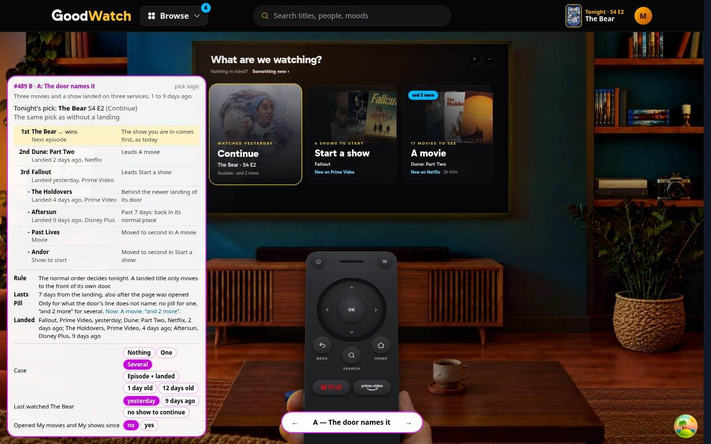
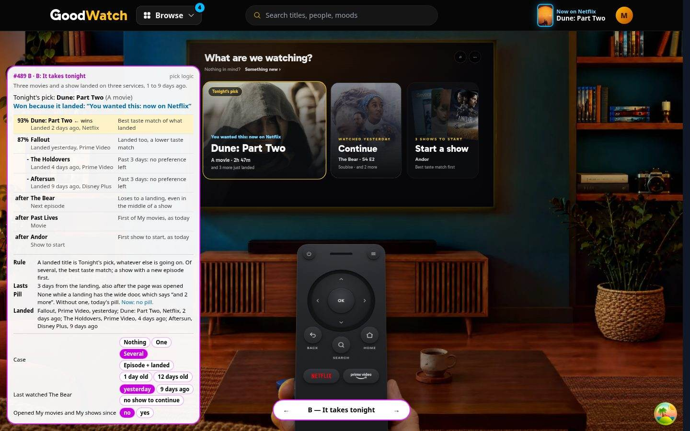
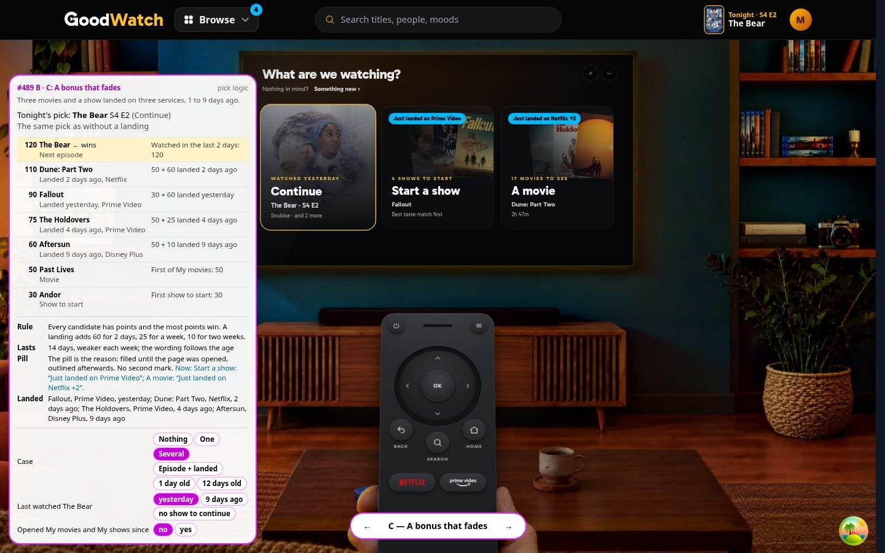
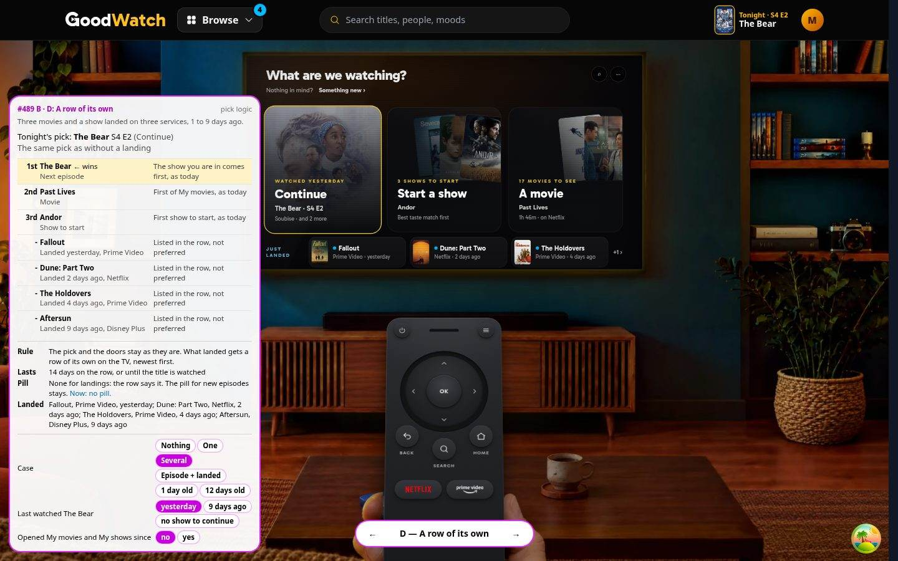

# Picks that prefer a title that just landed

A prototype for [#489](https://github.com/alp82/goodwatch-monorepo/issues/489), part B. Throwaway code.

## The question

The app knows when a Want to See title first appeared on one of a member's services
([#456](../../implementation/tracking/newly-available/README.md)). It uses that only for a signal that clears when the
member opens My shows or My movies. Afterwards nothing shows which titles just arrived.

Should Tonight's pick and home's doors prefer such a title, and say why? Open: how strongly it wins over the normal
pick, how the reason is worded and shown, what happens with several, how long it lasts, and how it lives next to the
sky blue pill of #456 without saying the same thing twice.

## How to open it

```
cd goodwatch-webapp
npm run dev -- --port 3111
```

Then open `http://localhost:3111/prototype/arrival-picks`. No `.env` and no flag is needed. The route answers 404 in
production, its loader reads no service, and nothing is written.

| Parameter | Values | Meaning |
|---|---|---|
| `variant` | `A`, `B`, `C`, `D` | The variation. The pill at the bottom and the left and right arrow keys switch it. |
| `case` | `none`, `one`, `several`, `both`, `fresh`, `old` | The prepared member. Default `one`. |
| `watching` | `yesterday`, `earlier`, `none` | When the member last watched The Bear: yesterday, 9 days ago, or they have no show to continue. |
| `visited` | `yes` | The member opened My movies and My shows since: the signal of #456 has cleared. |
| `panel` | `off` | Hides the debug panel. |

The white panel with the fuchsia ring is the prototype's own. It says which title won tonight and why, lists every
candidate with its rank or points, and holds the chips for the case. The room and the remote are the real ones. The
doors, the header and the phone dock are copies of the built ones, laid over the real header and dock.

What is real in the logic: which landings are still news is decided by the app's own rule (`newlyAvailableOf`), and
today's pill and the count on Browse use the app's own words. The member, the times and the four pick rules are made
up (`goodwatch-webapp/app/ui/prototype-arrival-picks/model.ts`).

## The four variations

| | Bets on | Strength | Shown as | Several | Lasts | The pill of #456 |
|---|---|---|---|---|---|---|
| **A. The door names it** | The least change | A landed title leads its own door. Tonight's pick keeps its order | The door's small line, in sky blue: "New on Netflix" | The latest leads | 7 days | Stays only for what the line does not name: "and 2 more" |
| **B. It takes tonight** | A landing is the event of the evening | It is Tonight's pick over everything, also over the show the member is in | One wide door with the title's own name and backdrop: "You wanted this: now on Netflix". Sky blue ring in the header | The best taste match; the door says "and 3 more just landed" | 3 days | Gone while a landing has the wide door |
| **C. A bonus that fades** | Strength should depend on age and on what else is going on | Points. A landing adds 60 for 2 days, 25 for a week, 10 for two weeks. It beats a show last watched 9 days ago, not one watched yesterday | The pill is the reason, worded by age: "Just landed on Netflix", "New on Netflix this week", "On Netflix since 14 Oct" | Most points lead; the pill counts the rest: "+2" | 14 days | It is the same mark: filled while news, outlined after the page was opened |
| **D. A row of its own** | A landing is news, not a recommendation | None. The pick and the doors stay | A row under the doors lists what landed, newest first: "Netflix · 2 days ago" | All listed, three shown | 14 days | Gone for landings; the row has a dot for what is still news |

In all four the preference is counted from the landing and outlives the page visit. That is the gap of today: the
pill is gone after the visit, the title keeps its place.

## Who wins tonight

The member watched The Bear yesterday and has not opened the pages, unless the case says otherwise.

| Case | A | B | C | D |
|---|---|---|---|---|
| Nothing landed | The Bear S4 E2 | The Bear S4 E2 | The Bear S4 E2 | The Bear S4 E2 |
| One movie, 2 days ago | The Bear. Dune leads A movie | **Dune: Part Two** | The Bear, 120 to 110. Dune leads A movie | The Bear. Dune on the row |
| Three movies and a show, 1 to 9 days ago | The Bear. Dune and Fallout lead their doors | **Dune: Part Two**, the best match | The Bear. Dune and Fallout lead their doors | The Bear. Three on the row, "+1" |
| Slow Horses: a new episode, and it landed | The Bear. The landing is not said, as today | **Slow Horses S5 E3** | **Slow Horses S5 E3**, 160 to 120 | The Bear. Slow Horses on the row |
| One movie, 1 day ago | The Bear | **Dune: Part Two** | The Bear, 120 to 110 | The Bear |
| One movie, 12 days ago | The Bear. Doors as today, today's pill | The Bear. Doors as today, today's pill | The Bear. Dune still leads A movie: "On Netflix since 14 Oct" | The Bear. Dune on the row, dimmed |
| 1 day ago, The Bear last watched 9 days ago | The Bear | **Dune: Part Two** | **Dune: Part Two**, 110 to 80 | The Bear |
| 2 days ago, no show to continue | **Dune: Part Two** | **Dune: Part Two** | **Dune: Part Two** | Past Lives, as today |
| Several, the pages opened since | The Bear. No pill, the lines stay | **Dune: Part Two** | The Bear. The pills are outlined | The Bear. The row stays, without dots |

## Recommendation

C, with two cuts.

- **Why C.** It is the only one that changes the pick for the right member: it leaves someone in the middle of a show
  alone and speaks up when they are not. And it needs no new element: the pill that is there today becomes the
  reason, so nothing is said twice, and it fits a phone's door ("Just landed").
- **Cut the points to two plain rules.** A landed title leads its own door. It is also Tonight's pick unless the
  member watched an episode of their show in the last 2 days. The points give this in every prepared case, and a
  rule that can be said in two sentences is easier to stand behind than a table of numbers.
- **Cut 14 days to 7.** "On Netflix since 14 Oct" reads as old news. With 7 days two wordings are enough.
- **Why not A.** For a member with a show going Tonight's pick never changes, and the line is the smallest text on
  the door.
- **Why not B.** It overrules a member in the middle of a show, it changes home's layout for something that happens
  under ten times a week across all members, and on a phone the two narrow doors cut their lines. Its 3 days from
  the landing are over before many members come back.
- **Why not D.** It prefers nothing, which is the ticket's question, and it overlaps with the page of part C of #489.

This is a judgment from made-up data. Nothing was looked at with a member.

## Open, for the owner

1. **May a landing take Tonight's pick from the next episode of a show the member is in?** Never (A), always (B), or
   only when they have not watched it in the last 2 days (C).
2. **How long, and counted from what?** 3, 7 or 14 days from the landing. Or from the day the member first saw it: a
   member who was away for a week sees nothing of B.
3. **What ends it early?** The prototype ends nothing early. Watched and removed from Want to See seem clear. Open:
   the offer leaves again, the member opens the title's page. Opening My movies ends the filled pill in all four,
   not the preference: is that right?
4. **Of several, which leads?** The latest (A), the best taste match (B), or the freshest and then the match (C). And
   are the others counted on the door ("+2", "and 2 more") or left to My movies?
5. **The wording.** "New on Netflix", "You wanted this: now on Netflix", or by age "Just landed on Netflix" and then
   "New on Netflix this week". And the service's name: short ("Prime Video") or as the catalog spells it?
6. **A show the member watches that landed and has a new episode.** Say both (B, C), or only the episode, as today
   (rule 12 of #456)?
7. **Phones.** Tonight's pick has no place on a phone outside the hub. Should the hub's tile say the reason? Not
   prototyped.

## Not built

The hub's tiles, the pick on other pages than home, the TV's own pick screens, ending a preference early, and real
data. On a phone the debug panel covers the remote; `panel=off` shows the room alone.

## Screenshots

72 pictures in this folder, at 1440 x 900 and 390 x 844: `<variant>-<case>-<desktop|phone>.jpg`. Taken with
[`shots.mjs`](shots.mjs), which also prints Tonight's pick of every shot.

| Case | A | B | C | D |
|---|---|---|---|---|
| Nothing landed (`none`) | [desktop](A-none-desktop.jpg), [phone](A-none-phone.jpg) | [desktop](B-none-desktop.jpg), [phone](B-none-phone.jpg) | [desktop](C-none-desktop.jpg), [phone](C-none-phone.jpg) | [desktop](D-none-desktop.jpg), [phone](D-none-phone.jpg) |
| One (`one`) | [desktop](A-one-desktop.jpg), [phone](A-one-phone.jpg) | [desktop](B-one-desktop.jpg), [phone](B-one-phone.jpg) | [desktop](C-one-desktop.jpg), [phone](C-one-phone.jpg) | [desktop](D-one-desktop.jpg), [phone](D-one-phone.jpg) |
| Several (`several`) | [desktop](A-several-desktop.jpg), [phone](A-several-phone.jpg) | [desktop](B-several-desktop.jpg), [phone](B-several-phone.jpg) | [desktop](C-several-desktop.jpg), [phone](C-several-phone.jpg) | [desktop](D-several-desktop.jpg), [phone](D-several-phone.jpg) |
| A new episode and a landing (`both`) | [desktop](A-both-desktop.jpg), [phone](A-both-phone.jpg) | [desktop](B-both-desktop.jpg), [phone](B-both-phone.jpg) | [desktop](C-both-desktop.jpg), [phone](C-both-phone.jpg) | [desktop](D-both-desktop.jpg), [phone](D-both-phone.jpg) |
| 1 day old (`fresh`) | [desktop](A-fresh-desktop.jpg), [phone](A-fresh-phone.jpg) | [desktop](B-fresh-desktop.jpg), [phone](B-fresh-phone.jpg) | [desktop](C-fresh-desktop.jpg), [phone](C-fresh-phone.jpg) | [desktop](D-fresh-desktop.jpg), [phone](D-fresh-phone.jpg) |
| 12 days old (`old`) | [desktop](A-old-desktop.jpg), [phone](A-old-phone.jpg) | [desktop](B-old-desktop.jpg), [phone](B-old-phone.jpg) | [desktop](C-old-desktop.jpg), [phone](C-old-phone.jpg) | [desktop](D-old-desktop.jpg), [phone](D-old-phone.jpg) |
| 1 day old, last watched 9 days ago | [desktop](A-fresh-earlier-desktop.jpg), [phone](A-fresh-earlier-phone.jpg) | [desktop](B-fresh-earlier-desktop.jpg), [phone](B-fresh-earlier-phone.jpg) | [desktop](C-fresh-earlier-desktop.jpg), [phone](C-fresh-earlier-phone.jpg) | [desktop](D-fresh-earlier-desktop.jpg), [phone](D-fresh-earlier-phone.jpg) |
| One, no show to continue | [desktop](A-one-nocontinue-desktop.jpg), [phone](A-one-nocontinue-phone.jpg) | [desktop](B-one-nocontinue-desktop.jpg), [phone](B-one-nocontinue-phone.jpg) | [desktop](C-one-nocontinue-desktop.jpg), [phone](C-one-nocontinue-phone.jpg) | [desktop](D-one-nocontinue-desktop.jpg), [phone](D-one-nocontinue-phone.jpg) |
| Several, the pages opened since | [desktop](A-several-visited-desktop.jpg), [phone](A-several-visited-phone.jpg) | [desktop](B-several-visited-desktop.jpg), [phone](B-several-visited-phone.jpg) | [desktop](C-several-visited-desktop.jpg), [phone](C-several-visited-phone.jpg) | [desktop](D-several-visited-desktop.jpg), [phone](D-several-visited-phone.jpg) |





