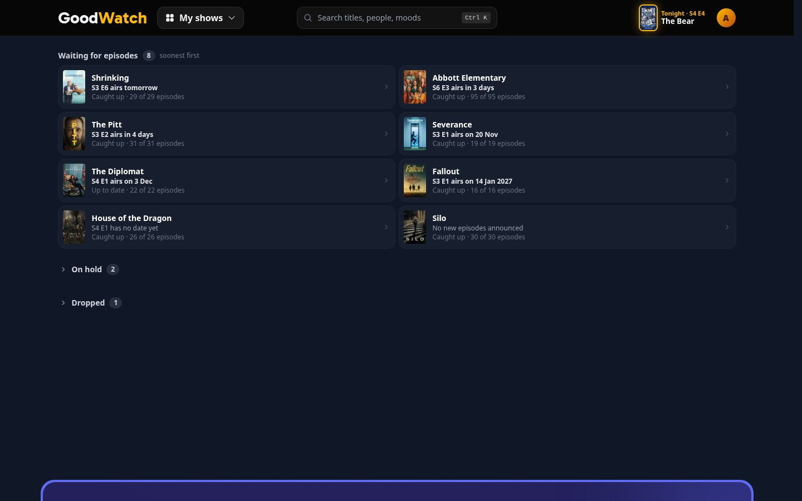
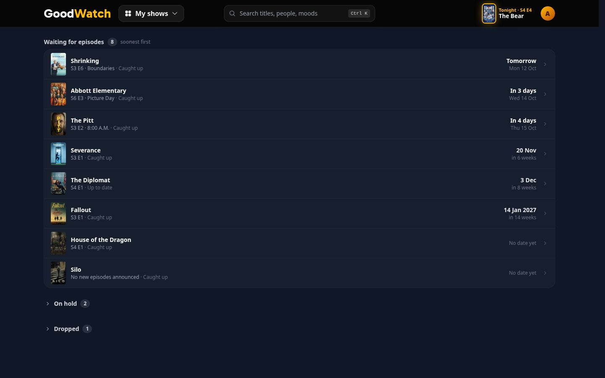
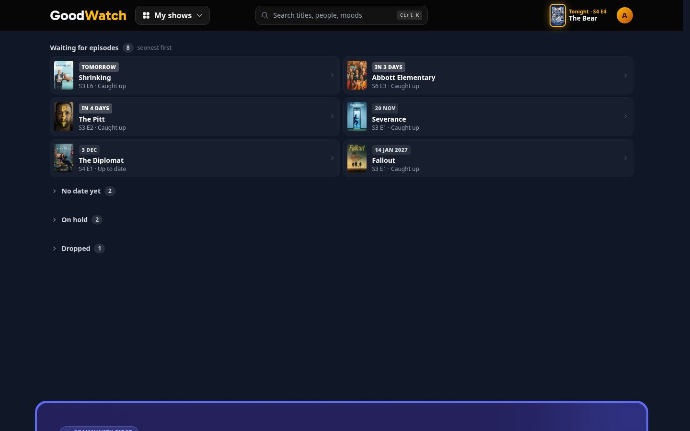
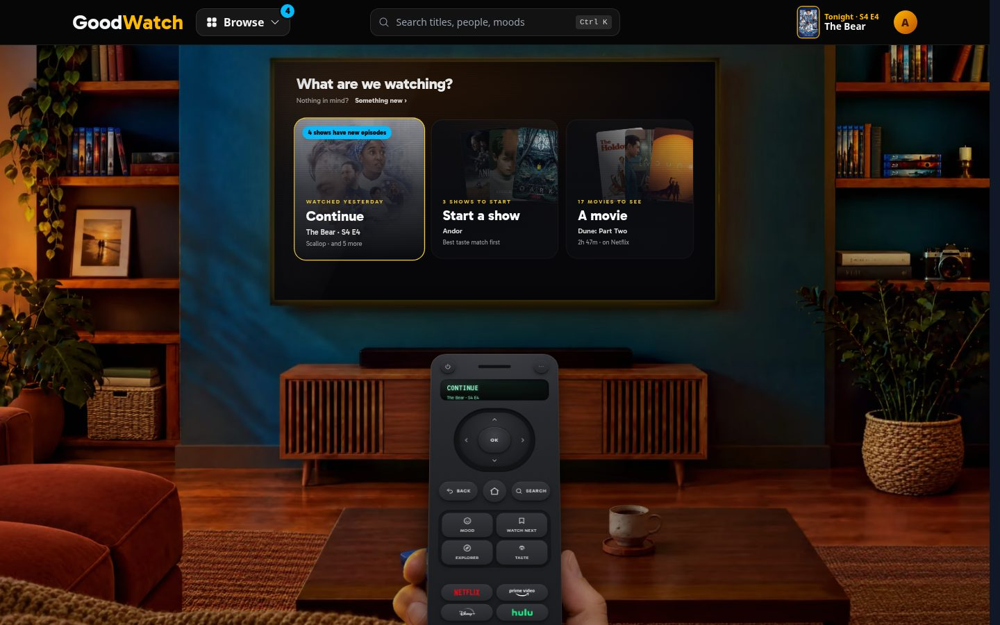
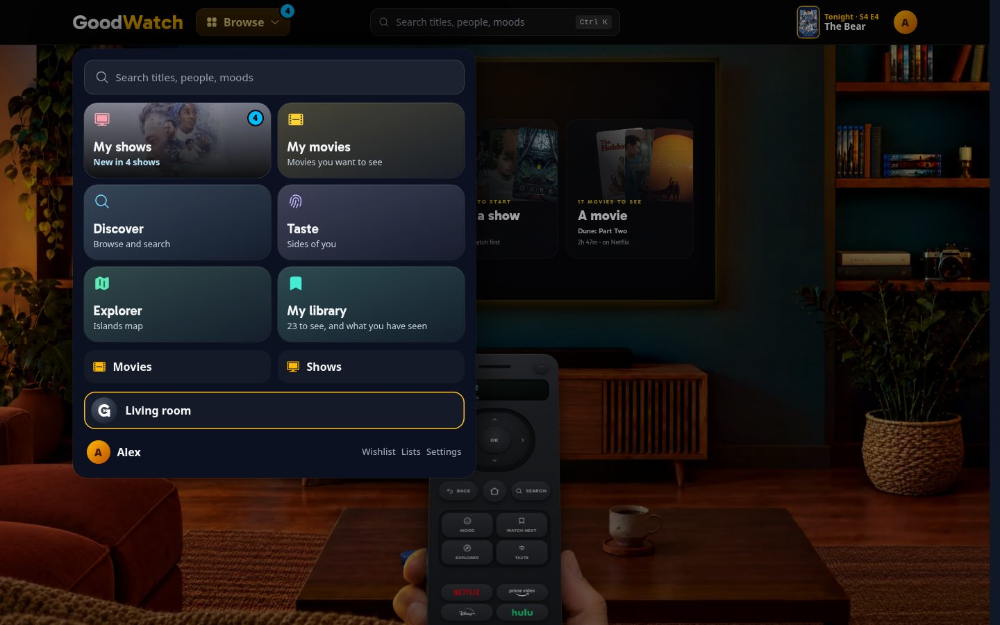
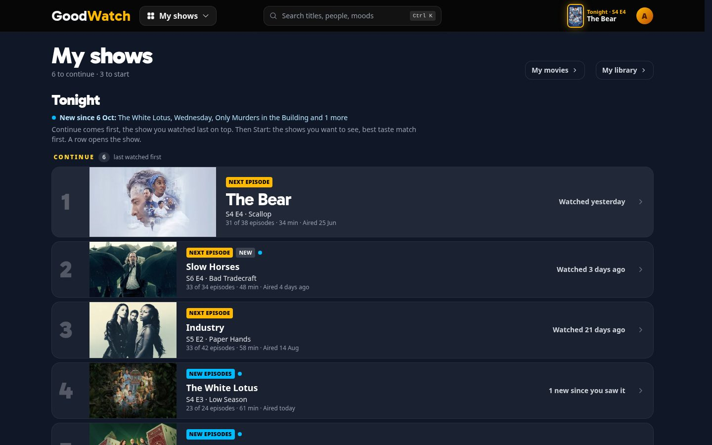

# New episodes for the shows a member tracks

A prototype for the map [#365](https://github.com/alp82/goodwatch-monorepo/issues/365). Throwaway code. The feature
is "new episodes for shows you watch", in the app only: no email, no push, no release calendar.

## The question

My shows already puts a Seen show with new episodes into Continue under a "New episodes" tag, and marks a Next
episode that aired in the last seven days "New". Two things are missing:

1. **Upcoming dates.** "Waiting for episodes" says only "Caught up" or "Up to date". When does each show's next
   episode air, and where does that sit in a row?
2. **A signal outside My shows.** A member who is not on My shows does not learn that something aired. What does the
   signal count, when does it clear, and what does it look like on a phone and on a desktop?

## How to open it

```
cd goodwatch-webapp
REC_NAVIGATION=on REC_WATCH_NEXT=on npm run dev
```

Then open `http://localhost:3003/prototype/new-episodes`. The route answers 404 in production, has no loader that
reads a service, and writes nothing.

| Parameter | Values | Meaning |
|---|---|---|
| `surface` | `home`, `shows` | Home with its doors, or My shows. |
| `signal` | `dot`, `shows`, `episodes` | What the signal shows: variants A, B, C. Default `shows`. |
| `clears` | `open`, `watched` | When the signal clears. Default `open`. |
| `row` | `line`, `column`, `chip` | Where the day sits in a waiting row: variants A, B, C. |
| `member` | `mixed`, `none`, `one`, `season`, `many` | The sample member. |
| `hub` | `open` | The hub sheet (phone) or the Browse panel (desktop) starts open. |
| `chrome` | `off` | Hides the prototype's own controls. Worth doing on a phone. |

The white controls with the fuchsia ring are the prototype's own. The pill (and the left and right arrow keys)
switches the piece that is open on the surface on screen: the signal on home, the waiting row on My shows.
Everything else is the design, including the site header, the phone dock and the hub, which are copies laid over the
real ones.

Things to try:

- On home, open the hub (Browse on a desktop, the round key on a phone) and look at the My shows tile. Switch the
  signal with the arrow keys.
- Click the Continue door. My shows opens, says what was new, and the signal is gone everywhere. Go back home.
- Press **Next day**. Shrinking's episode airs: the show leaves "Waiting for episodes", joins Continue, and the
  signal is back with one show.
- Open **State**. It lists every show with whether it counts and why, and has a **Watch** key per show, which marks
  its Next episode watched.
- Switch **Clears when My shows is opened** to **Stays until watched** and repeat.
- Change the sample member to the one who was away for three weeks.

## What is real and what is made up

- The show titles and the image paths are TMDB's, written into the prototype. Every season, episode name, air date,
  show status and watch is made up. The prototype's "today" is Sunday 11 October 2026, and the sample member last
  opened My shows on Tuesday 6 October (18 September for the member who was away).
- The groups of My shows come from the real planner, `planMyShows` in `app/domain/my-shows.ts`, fed with the sample
  shows. The page around them is a copy of `MyShowsPage.tsx`; the real page, the navigation, home, the domain and
  the server modules are untouched.
- Rows do nothing when clicked. In the real page a row opens the show.
- State lives in React: the day, the last opening of My shows, the episodes marked watched. A reload starts over.

## Gap 1: when the next episode airs

Fixed in all three variants:

- The group is sorted soonest first. Shows with an episode listed but no date come after the dated ones; shows with
  no episode listed come last.
- The words: "tomorrow", "in 4 days" up to six days, then the date ("20 Nov"), with the year when it is not this
  year ("14 Jan 2027").
- Without a date: "S4 E1 has no date yet" when TMDB lists the episode, "No new episodes announced" when it lists
  none.
- The group's head says "soonest first".

**A, a line in the row.** Today's two columns of compact rows. The middle line becomes one sentence, "S3 E6 airs
tomorrow", and "Caught up" moves to the last line beside the progress.



**B, a date column.** One column, one show a line, and the day in a column of its own at the end, with the weekday
and date under it ("Tomorrow / Mon 12 Oct", "20 Nov / in 6 weeks").



**C, the date leads.** The day is a tag above the title, as the tags lead the rows of Continue. Shows without a date
are a closed group of their own, "No date yet".



Phone: [A](waiting-line-phone.jpg), [B](waiting-column-phone.jpg), [C](waiting-chip-phone.jpg). The whole page:
[mixed member](shows-full-desktop.jpg), [the member who was away](shows-many-full-desktop.jpg).

## Gap 2: the signal outside My shows

### Where it sits

My shows is not in the header or the dock. It is a tile in the hub, one step away. A signal only on the tile would
be invisible until the hub is open, so the signal is in three places:

1. On what opens the hub: the Browse button on a desktop, the round key of the dock on a phone.
2. On the My shows tile: the mark in the corner, and the tile's line says what is new.
3. On the Continue door on home, which opens My shows: a pill in the door's corner.

The door keeps showing what it shows today, the show the member watched last. The signal colour is the sky blue of
the "New episodes" tag on My shows, so that amber keeps meaning "you are here".

### What it shows

| | On the opener and the tile | Tile's line | Door, desktop | Door, phone |
|---|---|---|---|---|
| **A, a dot** | a dot | New episodes | New episodes | New |
| **B, shows** | 4 | New in 4 shows | 4 shows have new episodes | 4 shows |
| **C, episodes** | 12 | 12 new episodes | 12 new episodes | 12 new |

When exactly one show is new, every variant names it: "New: Slow Horses S6 E4", or "New: Wednesday, 8 episodes".




| | Home, desktop | Home, phone | Hub, desktop | Hub, phone |
|---|---|---|---|---|
| A | [picture](signal-dot-home-desktop.jpg) | [picture](signal-dot-home-phone.jpg) | [picture](signal-dot-hub-desktop.jpg) | [picture](signal-dot-hub-phone.jpg) |
| B | [picture](signal-shows-home-desktop.jpg) | [picture](signal-shows-home-phone.jpg) | [picture](signal-shows-hub-desktop.jpg) | [picture](signal-shows-hub-phone.jpg) |
| C | [picture](signal-episodes-home-desktop.jpg) | [picture](signal-episodes-home-phone.jpg) | [picture](signal-episodes-hub-desktop.jpg) | [picture](signal-episodes-hub-phone.jpg) |

### Which shows count

A show counts when **its Next episode aired after the member last opened My shows**. With it count all its aired
episodes from the Next episode on.

- A Seen show with new episodes counts: its Next episode is the first new one.
- A Watching show whose Next episode is the new one counts (Slow Horses in the sample).
- A Watching show the member is nine episodes behind on does not count when a tenth airs (Industry). Its Next
  episode is an old one, and nothing changed about what the member would watch.
- On hold and Dropped shows never count (The Last of Us has a new season and stays quiet).
- An episode the member already watched, for example on the show's page, does not count (Abbott Elementary).

The State panel shows the count under the wider rule too (any new episode of a Watching or Seen show).

### When it clears

**`open`, the default.** The signal clears the moment My shows is opened, on every surface. My shows then says once,
above the list, what was new ("New since 6 Oct: The White Lotus, Wednesday, Only Murders in the Building and 1
more"), and each of those rows has a small blue dot beside its tag. Watching the new episode elsewhere also clears
its show. This needs one remembered fact per member: when they last opened My shows.



**`watched`, the alternative.** Nothing is remembered. The signal holds every show whose Next episode aired in the
last seven days and is not watched, which is the rule of the "New" mark on the page today. It clears by watching, or
after seven days. Opening My shows changes nothing.

### The awkward cases

| Case | What happens | Pictures |
|---|---|---|
| Nothing new | No mark anywhere. The tile says "The Bear S4 E4 tonight", as today. | [home](case-none-home-desktop.jpg), [phone](case-none-home-phone.jpg), [hub](case-none-hub-desktop.jpg), [hub, phone](case-none-hub-phone.jpg) |
| One show, one episode | The show and episode are named. | [home](case-one-home-desktop.jpg), [phone](case-one-home-phone.jpg), [hub](case-one-hub-desktop.jpg), [hub, phone](case-one-hub-phone.jpg) |
| A whole season at once | B says 1, C says 8. Both name the show: "New: Wednesday, 8 episodes". | B: [hub](case-season-shows-hub-desktop.jpg), [phone](case-season-shows-hub-phone.jpg). C: [hub](case-season-episodes-hub-desktop.jpg), [phone](case-season-episodes-hub-phone.jpg) |
| Many shows (away three weeks) | B says 11, C says 42. | B: [home](case-many-shows-home-desktop.jpg), [phone](case-many-shows-home-phone.jpg). C: [home](case-many-episodes-home-desktop.jpg), [phone](case-many-episodes-home-phone.jpg), [hub](case-many-episodes-hub-desktop.jpg), [hub, phone](case-many-episodes-hub-phone.jpg) |
| A Seen show with new episodes beside a Watching show with a new Next episode | Both count, and both are in Continue: the Watching show in its place by last watch with "New", the Seen shows after it with "New episodes". | [My shows](shows-full-desktop.jpg) |
| No date known | Last in the waiting group, in two wordings. | [A](waiting-line-desktop.jpg) |
| The date arrives | "Tomorrow" becomes a Continue row, "Aired today", and the signal has one show. | [after Next day](case-next-day-desktop.jpg) |

The prototype's controls: [desktop](controls-desktop.jpg), [phone](controls-phone.jpg),
[State panel](state-panel-desktop.jpg).

## Questions for the owner

Each has my recommendation.

1. **Shows or episodes?** Recommended: **B, the number of shows.** A season dropped at once is one thing to do, and
   C makes it 8. For the member who was away, 11 is a number to act on and 42 is not. A dot is the quietest, but the
   tile and the door have room for words, and the number costs nothing there.
2. **Which shows count?** Recommended: **the rule above, the Next episode is new.** The wider rule adds shows the
   member is already behind on, where one more episode changes nothing for tonight. On hold stays out because the
   member set the show aside. If a returning On hold show should be news, that is the one exception worth
   discussing.
3. **When does it clear?** Recommended: **on opening My shows.** A signal that stays until an episode is watched
   becomes a badge the member learns to ignore: they saw the news and chose not to watch tonight. The cost is one
   stored fact per member, the time My shows was last opened, written on each visit. Storing it with the member
   keeps phone and desktop in step; a browser-only value would not. That is a data change for the build, not made
   here.
4. **Does My shows say what was new?** Recommended: **yes, the one line above the list, for that visit only.** It
   answers the click. The dots beside the tags are optional; the "New" and "New episodes" tags already mark most of
   those rows.
5. **Where does the day sit in a waiting row?** Recommended: **B, the date column.** One column makes "soonest
   first" readable, which two columns do not: in A and C the order runs left, right, then down. The day lines up at
   the end of each row, so the group reads as a timetable without being a calendar. On a phone the "Caught up" label
   is cut when the episode has a name; the build should drop the name there. A is the smallest change if the group
   should stay as compact as it is.
6. **Should the Continue door change to the new episode?** Recommended: **no.** The door is Tonight's pick, the
   show watched last, and stays predictable. The pill says something else is new.
7. **On the opener, a number or always a dot?** Recommended: **the same as the tile.** A number on "Browse" without
   words is a little bare, so a dot there with the number on the tile is a fair alternative. Both can be seen by
   switching A and B.

## Found on the way

- **"Today" never appears in the waiting group.** An episode airs on its date, so on that day the show is already
  in Continue with "Aired today". The words "today" exist only for a member whose day is ahead of the server's.
  Recommended: keep the rule. TMDB has dates and no times, so an episode can be listed as aired some hours before
  the service has it.
- **The tile's line must fit one line on a phone**, about 22 characters. "4 shows have new episodes" wraps and
  pushes the tile's name into its icon, so the tile says "New in 4 shows". The real tile has the same limit today
  ("23 to see, and what you have seen" wraps on My library).
- **The waiting group needs each waiting show's episode list.** Today the server reads the cached episode list only
  for the Continue rows, the first 30 (`getMyShows` in `app/server/my-shows.server.ts`). Upcoming dates add one read
  of the cached list per waiting show.

## Not verified

- Nothing here ran against real data. How often TMDB lists a next episode with a date for the shows members
  actually wait for, and how fresh the cached episode lists are for them, is not measured.
- The cost of reading the episode lists of all waiting shows on My shows is not measured.
- "Tomorrow" is computed in UTC here. The build has to use the member's day, as the show page does.
- The header, dock and hub are copies. The signal was not tried inside the real components, with their focus
  handling and the hub's first-use loading.
