# TV expand transitions prototype

Throwaway. Branch `prototype/tv-expand-transitions` (from `prototype/tv-screen-flow`). The question, in the
owner's words: "Expand animation: quick prototype showing different transitions (today, new, others) and focusing
on seamless transitions and easy navigation back".

Nine transitions from the approved Cinema TV into the **real** page behind its Expand key, on one route, and the
ways back from the real page into the same TV screen with the same focus.

**Where it stands (round three, 2026-10-14).** The owner chose **9 Lean in, light** ("9 is better"): it is what
the address opens on and the only transition the controls offer; the other eight stay behind the keys `1` to `8`
for comparison. The way back is a **TV button**: on the desktop in the scroll-up bar, on the phone in the dock in
place of its left part. It lives for two pages. See [Round three](#round-three-the-tv-button).

## Open it

`http://100.71.215.115:3157/prototype/tv-expand` (over Tailscale; the server is left running).

The destinations are the real routes with every `REC_*` flag on: `/discover?moods=funny` from the mini Discover
results, `/movie/546554-knives-out` from the title screen. Any other TV screen with an Expand key works too.

| Key | Button | What it does |
| --- | --- | --- |
| `1` to `9` | `Lean in` | The transition (`?t=today\|grow\|frame\|morph\|camera\|live\|wipe\|lean\|leanlite`). Without `t`: 9, the chosen one, shown as "Lean in". The button names another one only while it is being compared, and leads back to the chosen one |
| `T` | `TV button: set` | How the TV button is drawn: set, screen, plain (`&button=set\|screen\|plain`). Works on the real page too |
| `L` | `Dock: left part` (phone) | Where the TV button stands in the phone's dock: in place of the left part, or beside Search as in round two (`&dock=left\|between`). Works on the real page too |
| `B` | `Back: scroll-up bar` | The way back the real page shows on the desktop: scroll-up bar, corner key, Escape only (`&back=bar\|key\|esc`). Works on the real page too. Without `back`: the bar. On a phone the way back is a key in the dock, whichever is chosen |
| `W` | `Slow page` | The page's data takes 1.5 s longer (`&slow=1`) |
| `R` | `Reduced motion` | Reduced motion, whatever the system says (`&calm=1`) |
| `D` | `Results screen` / `Title screen` | The other of the two TV screens |
| Arrows, `Enter`, `Escape` | the Remote | Drive the TV. `Enter` on the Expand key leaves. `Escape` while a page is on its way cancels |
| `Escape` on the real page | the TV key or bar | Back to the TV, for as long as the way back lives (two pages) |

No key needs Shift or AltGr. On the phone the controls are behind the small `⋯` key under the TV.

To start it again:

```
cd goodwatch-webapp
npm ci
ln -s /home/alper/projects/goodwatch-monorepo/goodwatch-webapp/.env .env
REDIS_READ_ONLY=on REDIS_COMMAND_TIMEOUT_MS=60000 \
SEARCH_DATABASE_URL= SEARCH_STORAGE_KEY= OPENROUTER_API_KEY= TYPESAFE_API_KEY= MILVUS_URL= \
REC_TASTE_MATCH=on REC_FILTER_BAR=on REC_WATCH_NEXT=on REC_TASTE_PAGE=on REC_EXPLORER=on \
REC_NAVIGATION=on REC_AGE_FILTER=on REC_TRACKING=on npx remix vite:dev --port 3157 --host 0.0.0.0
```

### Where the real pages come from, and what the server may not do

The pages are served by this branch's dev server from production Crate and Valkey, as a reader only:

- `APP_ORIGIN` is not set, so the search history and poster impression endpoints answer 403. Nobody is signed in.
- Valkey is read only. This branch is 253 commits behind `main`, so a value it cached could have an outdated shape.
  `app/utils/cache.ts` on this branch answers every Valkey command that is not a plain read with null and never
  sends it (`REDIS_READ_ONLY=on`); the log shows the first one dropped (`set`). The same file reads the command
  limit from `REDIS_COMMAND_TIMEOUT_MS`, because the title snapshot's chunks take seconds from this machine.
  Without Valkey at all the title page works and Discover answers 503 (it needs the title snapshot).
- **Not changed:** over the Tailscale address the site's own analytics run (PostHog, the Google tag and Sentry are
  off only on `localhost`). Page views of the real pages from this server are sent like from any dev server viewed
  that way. All captures here used `localhost`.

## Round three: the TV button

The owner, on round two: "Expand: 9 is better." "Make the TV button nicer, should be rectangular too." Two pages
of life is right. On the phone: "search can lose its word, but i think it would be even better to replace the
left part with the TV button, a better designed one." From the second page the way back goes to the TV in one
transition, as built.

9 with the final button: [desktop](clips/9-leanlite-desktop.mp4) 
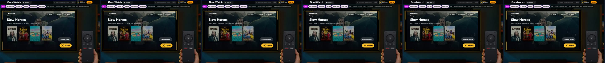 and [phone](clips/9-leanlite-phone.mp4)
 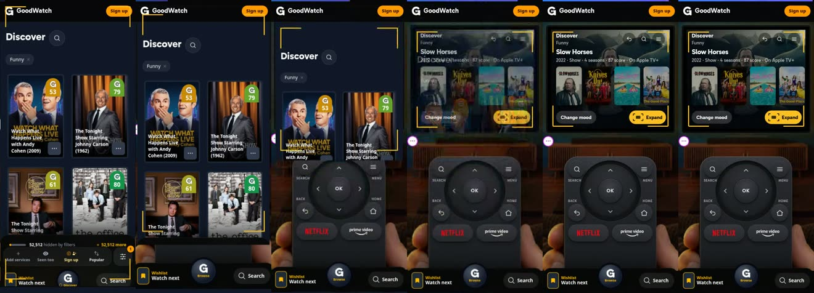

The desktop clip waits about 3 s before it moves. That is the recording on a busy machine: measured without
recording, the motion starts 0.5 to 0.8 s after the press and the page stands after 1.5 s, desktop and phone.

### Three designs (`T` switches, in the room and on the real page)

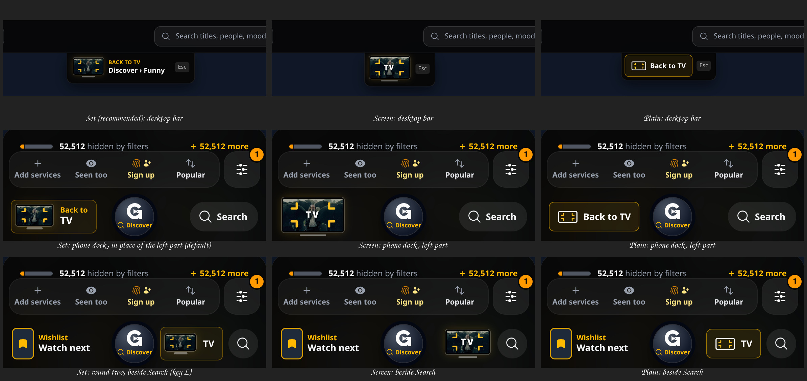

All three are rectangular, show a TV in 16:9 with its bezel and the Expand key's brackets pointing inward, and
are the target the brackets fold into on arrival.

| | What it is | For | Against |
| --- | --- | --- | --- |
| **Set** (recommended) | A small TV set (picture, bezel, foot) showing the backdrop of the screen the person left, and words beside it. In the bar: "Back to TV" over the screen's name ("Discover › Funny"). In the dock: "Back to" over "TV", the two-line form of the part it replaces | Says what it does and shows where it leads; in the dock it reads like the key it stands in for, so the row keeps its rhythm | The widest of the three: 127 px in the dock at 390 px wide, 124 at 360 |
| **Screen** | The key is the TV itself: the picture with "TV" written on it, nothing beside it | The smallest and the most like an object; the picture is the hint | No word says "back"; 13 px letters on a picture are only as readable as the picture lets them be |
| **Plain** | A drawn TV and "Back to TV" in an amber outline, like the site's other keys. No picture | The calmest, and it needs no image | It is a labelled key, not the TV the person came from |

**Recommendation: Set.** It is the only one that is both a TV at a glance and says in words what a tap does, and
the picture of the screen the person left costs one small image (the 300 px file of the backdrop the TV showed).

### The phone's dock: in place of the left part (default; `L` shows round two's place)

While the way back lives, the dock's left part (the tiny poster with "Wishlist / Watch next") does not show and the
TV button stands in its place; Search keeps its word. Two pages on, the left part is back.

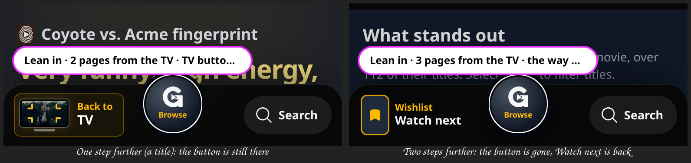

**What it costs:** for those two pages the one-tap way to Watch next is gone from the dock, and with it the tiny
poster of Tonight's pick. Watch next stays two taps away: the round key opens the menu, and Watch next is its
first tile ([the menu](back/round-key-menu.jpg)); the menu also has "Living room". On the desktop nothing is
replaced: the header keeps its Wishlist key and the TV button hangs under the header.

Checked by script with no parameters in the address, at 390 and 360 px: the button stands at the dock's left
edge, 28 and 16 px clear of the round key, and takes the tap; the left part is hidden while it is there and shows
again three pages from the TV; the round key's menu links to `/watch-next`; Escape with that menu open closes
only the menu; from two pages the button lands on the TV screen the person left, with the focus on the Expand key.
On the desktop: the three designs in the bar, each taking the click, gone at three pages, Escape from two pages
lands on the same TV screen.

A fix on the way: Escape went back to the TV while the round key's menu was open. The site's menus now take Escape
first (they say on their key that they are open).

## Round two: the owner's picks

The owner, on the first round: "Let's try 6 and 5 combined with 3's frame animation. Back: scroll up bar." And on
the questions: the way back is "not relevant anymore" after another step or two; inside the dock on the phone "is
a good idea, try that"; Escape should go back.

| | What it is | Desktop | Phone |
| --- | --- | --- | --- |
| **8 Lean in** | 6, 5 and 3 together. While the Expand key has the focus, the real page loads inside the TV. On the press it shows in the picture, the room zooms into the TV with it until the screen is the window, and the brackets ride the picture's edge out to the window's edge and fold into the way back. Nothing is swapped on screen | [clip](clips/8-lean-desktop.mp4) 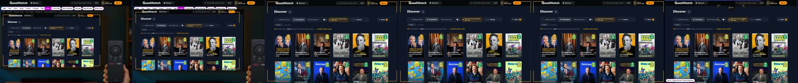 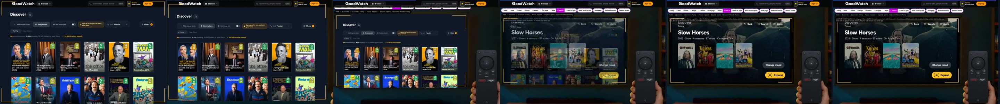 | [clip](clips/8-lean-phone.mp4) 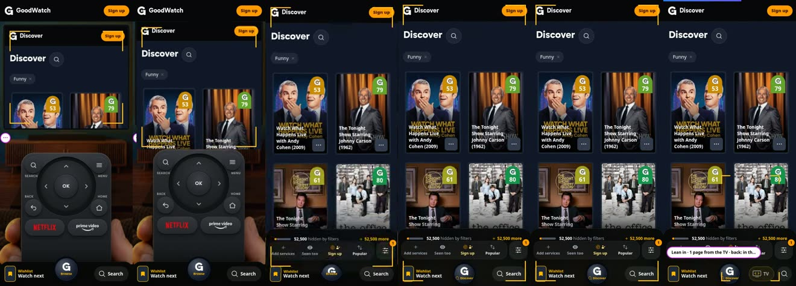 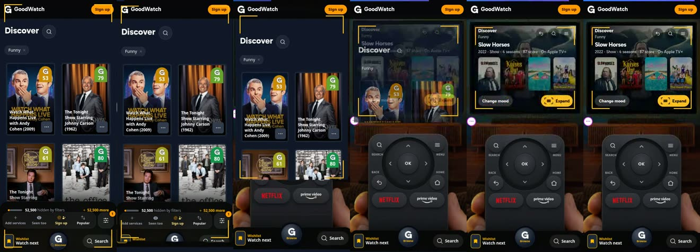 |
| **9 Lean in, light** | The same move without the second copy of the app: 5's zoom with 3's brackets as one view transition. The page is a picture that fades into the TV during the first quarter second | [clip](clips/9-leanlite-desktop.mp4)   | [clip](clips/9-leanlite-phone.mp4)  |

8 on the title screen: [clip](clips/8-lean-desktop-title.mp4) 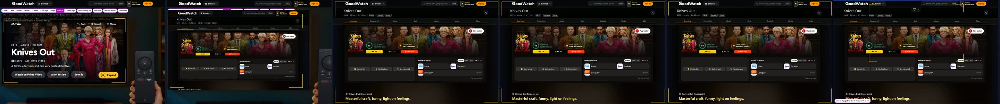

**The way back is the same for both:** one view transition, the page shrinking into the TV while the room zooms
out and the brackets come in from the window's edge to the picture's.

**8 costs what 6 costs.** The page in the TV is an `iframe`: a second copy of the whole app, loaded each time the
Expand key gets the focus, and again after every return. On the title screen it also shows the price in time: the
title page's own data takes about 1.8 s here, and the frame has to cover the window until the real page under it
is there (the clip's way out is 4 s long). **9 is there to see what the second copy buys.** It needs nothing but
CSS on the two pictures the browser takes anyway, the four bracket elements and a name on the site header; it
starts when the page's data is there (0.5 s after the press in the quiet dev build) instead of at once, and the
page fades into the TV instead of standing in it beforehand. I could not tell them apart in the clips once the
motion starts. My advice: build 9, and keep 8 as the picture of what it should feel like.

### The way back, as decided

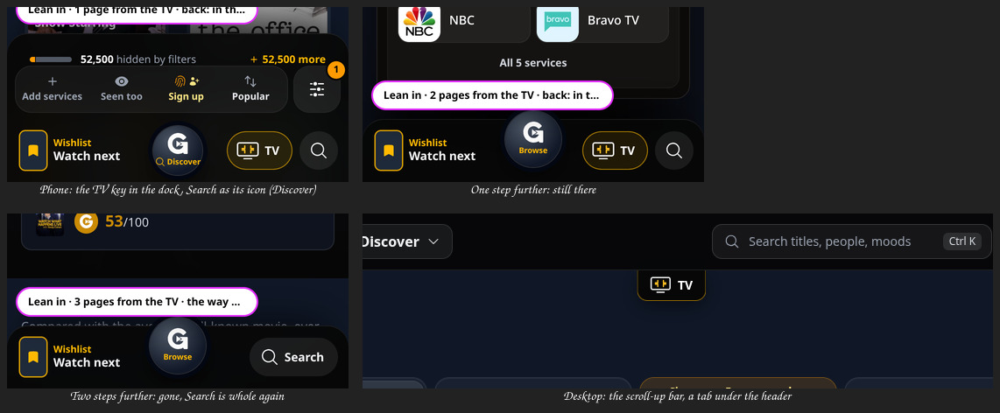

- **Desktop: the scroll-up bar.** A tab under the header at the top of the page, gone while scrolling down, back
  with the destination's name on scrolling up. With 8 and 9 the brackets fold into it on arrival.
- **It lives for two pages:** the page the Expand key opened and one step further. Two steps further it is gone,
  and Escape no longer goes to the TV; the browser's Back still does its normal work, and stepping back into
  those two pages brings the way back again. The number is one constant (`BACK_LIVES` in `trip.ts`). "A step or
  two" could also mean one page only: say so and it is a one-character change.
- **Phone: a key in the dock.** The dock's row has no room for a fourth key as it is (at 390 px wide the gaps
  beside the round key are 31 and 50 px). So while the way back lives, Search gives up its word and stands as its
  icon, and the TV key takes the place between the round key and Search: `Wishlist · G · TV · Search`. When the
  way back is gone, Search is whole again. Checked at 390 and 360 px. Under 350 px the TV key is an icon only;
  that form was not checked.
- **Escape goes back to the TV** on those two pages, unless a dialog or menu of the page is open or the person is
  typing. The pages keep their closed sheets in the document (Discover one, Watch next three), so only a sheet
  that actually shows counts as open.

Checked by script, with no `t` and no `back` in the address: 1 page and 2 pages from the TV the control is there
(on the page on the desktop, in the dock on the phone), 3 pages from it it is gone and Escape does nothing, the
browser's Back to 2 pages brings it back, and from there Escape (desktop) and the dock key (phone) land on the
same TV screen with the focus on the Expand key.

**Seen on the way, not the prototype's doing:** on a 360 px phone a show's page reached by a tap on a Discover
card is laid out 387 px wide (a table reaches to 424 px), which pushes the dock's right end and bottom out of
view. Loaded directly the same page is 360 px wide. It happens without the prototype too.

## The transitions

The seven of round one.

Each row: what it bets on, and what it costs to build for real. Clips are the whole run, out and back; strips are
six frames of the motion itself. Desktop 1440 x 900, phone 390 x 844, both on the results screen.

| | Bets on | Desktop | Phone |
| --- | --- | --- | --- |
| **1 Today** | Nothing new: the real page is revealed from the TV's box by a growing clip, once its data is there | [clip](clips/1-today-desktop.mp4)  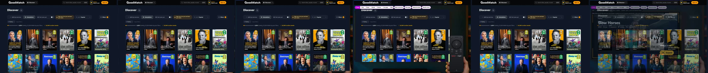 | [clip](clips/1-today-phone.mp4)  |
| **2 New** | Instant feedback: the brackets travel to the picture's edge, the picture itself grows to the window, the page fades in | [clip](clips/2-grow-desktop.mp4) 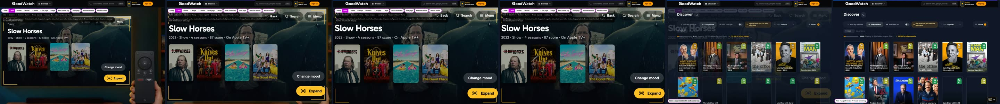 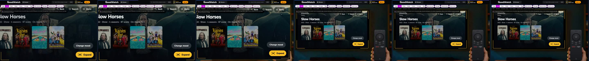 | [clip](clips/2-grow-phone.mp4) 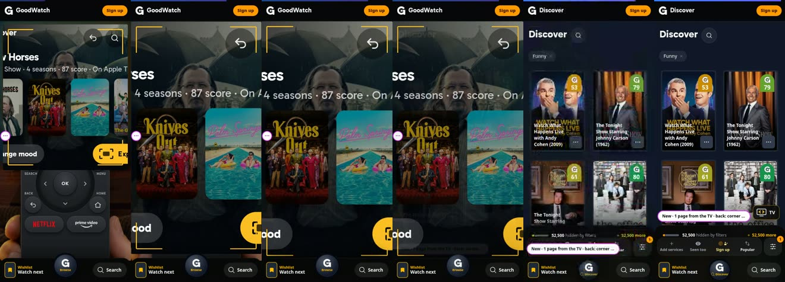 |
| **3 Frame** | The motif carries the whole way: today's clip, with the brackets riding its edge to the window and folding into the Back to TV key | [clip](clips/3-frame-desktop.mp4)  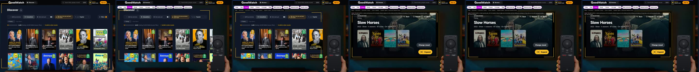 | [clip](clips/3-frame-phone.mp4)  |
| **4 Morph** | The content is the thread: the TV's posters, title and backdrop fly to their places on the page | [clip](clips/4-morph-desktop.mp4) 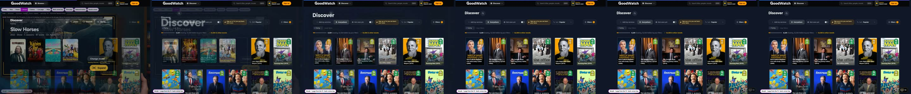 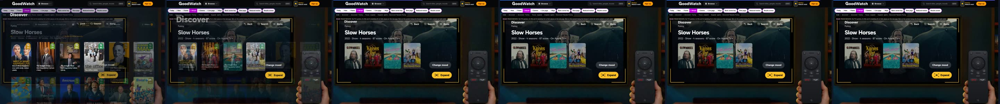 | [clip](clips/4-morph-phone.mp4) 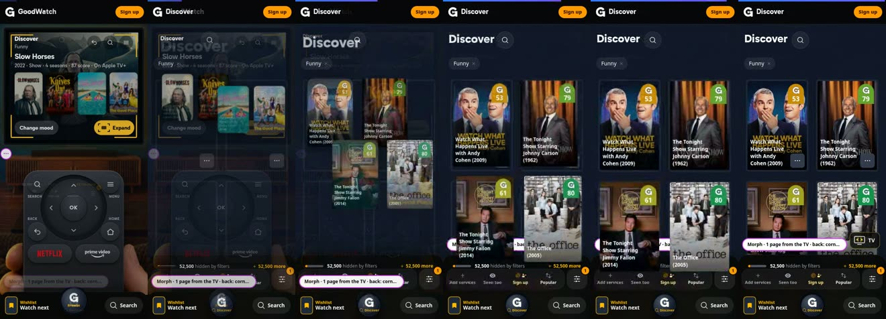 |
| **5 Camera** | The room stays a place: it zooms into the TV until the screen is the window, the page already on the screen | [clip](clips/5-camera-desktop.mp4) 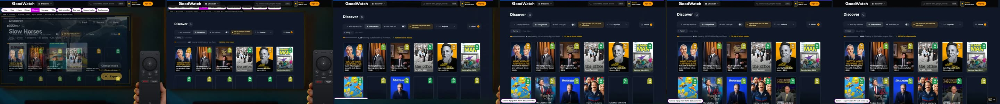 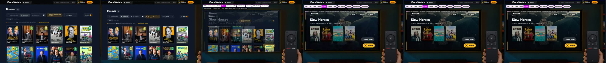 | [clip](clips/5-camera-phone.mp4)  |
| **6 Live page** | Nothing swaps: the real page is loaded inside the TV at scale and only scales up | [clip](clips/6-live-desktop.mp4) 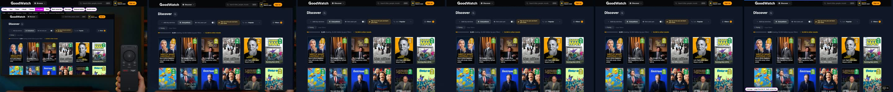 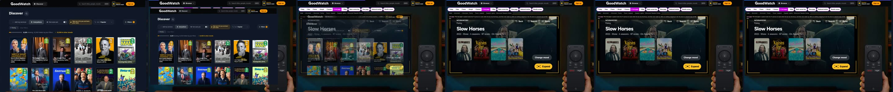 | [clip](clips/6-live-phone.mp4) 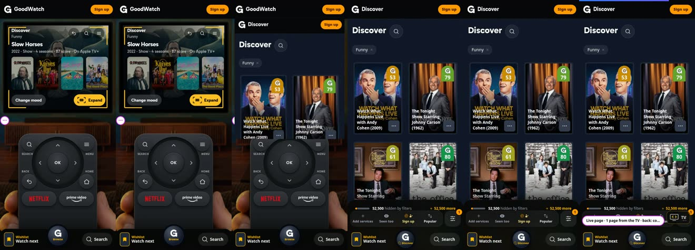 |
| **7 Wipe** | The eye is on the key: the page opens as a circle from the Expand key | [clip](clips/7-wipe-desktop.mp4) 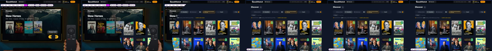 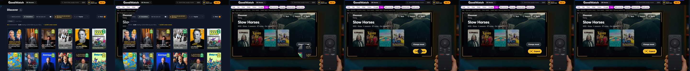 | [clip](clips/7-wipe-phone.mp4)  |

The phone's way back is in `strips/<n>-<name>-phone-back.jpg`. On the title screen:
[Frame](clips/3-frame-desktop-title.mp4), [Morph](clips/4-morph-desktop-title.mp4) (the backdrop and the title
fly: 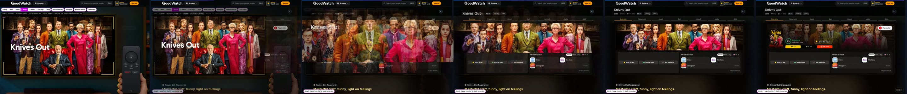), [Camera](clips/5-camera-desktop-title.mp4).

### What each costs to build for real

Same-document View Transitions exist in Chrome and Edge since 111, Safari since 18, Firefox since 144. Run here:
Chromium 153 (all seven), Firefox 157 (Frame, Camera and Morph, both ways, with the same named elements:
[a Firefox frame](states/firefox-frame.jpg)). **Safari was not run.** With reduced motion every transition is a
plain page change.

| | Browser API | Needs from the destination pages | Without the API | Size |
| --- | --- | --- | --- | --- |
| 1 Today | View Transitions through the router's `viewTransition`; one `clip-path` keyframe | Nothing | Plain navigation | Exists (`tv-transition.ts`, `main.css`) |
| 2 New | None for the growing picture (it is the room's own motion), a 0.26 s root fade through View Transitions at the end | Nothing; the page's data must be asked for at the press and the navigation made when the picture has grown | The page replaces the grown picture in one frame | Medium. The prototype grows the picture by changing its box every frame; for real it has to be a `transform` (rendering budget) |
| 3 Frame | Today's, plus four fixed corner elements with a `view-transition-name` each | Nothing | Plain navigation, the brackets disappear | Small: about 40 lines beside today's code |
| 4 Morph | `view-transition-name` on every shared element, on both sides | Each page type names its counterparts (first cards, `h1`, backdrop), has them in its first frame, and shows the same titles in the same order as the TV. A name used twice skips the whole transition | Plain navigation | Large, and per page type |
| 5 Camera | Two keyframes on the two root pictures (`transform`, `clip-path`, `opacity`) and a `view-transition-name` on the site header so it stands still | Nothing | Plain navigation | Small |
| 6 Live page | An `iframe` of the destination inside the start page | Nothing, but it is a second copy of the whole app while the Expand key has the focus: code, data, memory, a second page view in analytics, and again each time the person comes back | Works without View Transitions | Not a candidate as built. It is here as the reference for "nothing swaps" |
| 7 Wipe | Today's with a `circle()` instead of an `inset()` | Nothing | Plain navigation | Trivial |

### Findings

- **The plan's unproven mechanism holds** (section 4, "the brackets grow with the frame"). Four corner elements,
  each with its own name, travel from the picture's edge to the window's edge exactly with the clip, in Chromium
  and in Firefox. One element for all four brackets would be stretched on the way (the TV and the window have
  different proportions); four elements only move. Two changes to the plan's sketch: the brackets are placed by
  script just before and just after the page is swapped (CSS with `:has(.living-room)` was not needed), and the
  room's own brackets are hidden for that moment so the two sets never show together.
- **Discover's first results are in the page's first frame.** In three fresh browsers the posters stood at the
  very frame the page was swapped in, so no transition lands on an empty grid.
- **Timing, dev build, quiet machine, Frame:** from the press to the first moving frame 0.5 s (data 0.03 to 0.3 s,
  then 0.15 to 0.3 s in which the browser stands still while React builds the page inside the transition), the
  motion 0.85 s. Back: the motion starts 0.12 s after Back and takes 0.45 s. Production was not measured (a
  production server must not run on this machine). The recorded clips are slower than that: recording costs time.
- **The focus on return needed two things** that the plan does not mention: the cursor rests wherever the person
  left it on the real page, often over a tile of the TV, and takes the focus the moment the room is back (fixed
  here: hover counts only after the cursor has really moved); and after the browser's Forward and Back again the
  address no longer carries the focus (fixed here by keeping it with the trip, not only in the address).

## The way back

Half of the task. All three are built; `B` switches between them, on the room and on the real page. The pictures
and the table are round one's: since then the bar is what opens, the way back lives for two pages, and the phone
has its key in the dock ([Round two](#round-two-the-owners-picks)).

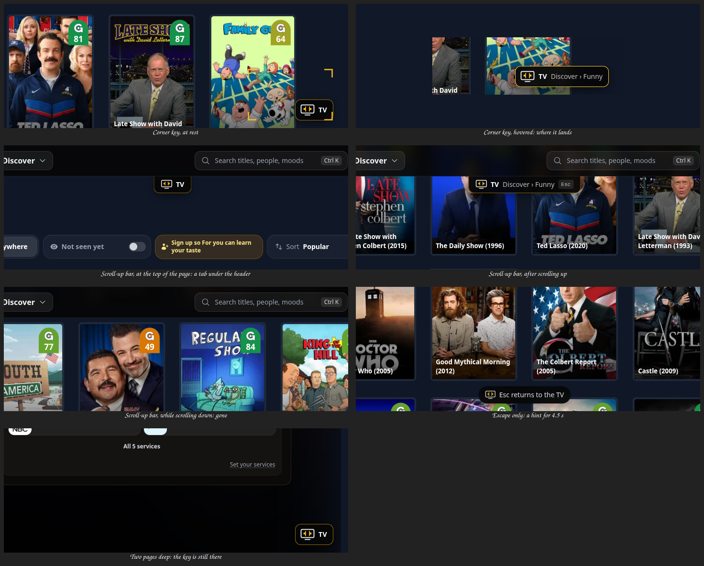
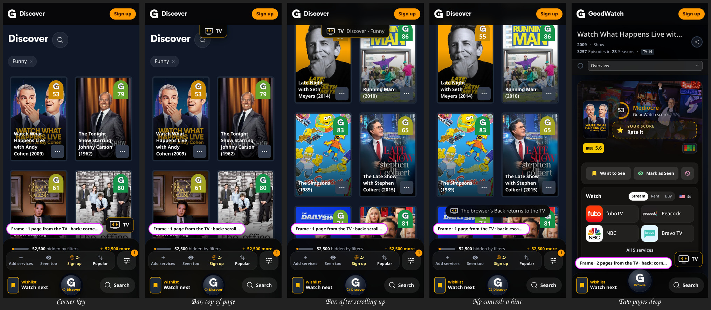

| Way back | What it is | For | Against |
| --- | --- | --- | --- |
| **Corner key** | A small TV with its brackets pointing inward (the Expand motif reversed) and the word "TV", pinned at the bottom right, 44 px high, above the phone's dock. Hovered or focused it says where it lands ("Discover › Funny") | Always reachable, also for a finger; sits in the corner the Expand key was pressed in; with Frame the brackets fold into it on arrival, which shows where the way back is | One more thing on every page reached from the TV. On the phone's Discover it floats above 170 px of dock and filter bar |
| **Scroll-up bar** | A tab hanging under the header at the top of the page; it hides while the person scrolls down and returns, with the destination's name, when they scroll up | Nothing on the page while reading | It is gone exactly when someone deep in a page looks for it, and it covers the page's top edge |
| **Escape only** | No control. A hint for 4.5 s on arrival ("Esc returns to the TV"; on the phone "The browser's Back returns to the TV") | No clutter at all | Invisible afterwards, and nothing for a finger |

In every variant:

- **The browser's Back** runs the transition in reverse into the same TV screen with the same focus (checked for
  all seven, desktop and phone).
- **Escape** on the real page goes back to the TV, unless the page's own dialog or menu is open or the person is
  typing.
- **Two pages deep** (a title opened from Discover): the control is still there and still says "TV". It goes
  straight to the TV screen the person left (one history move over both pages), with the transition; the browser's
  Back goes one page at a time, as always. After the browser's Forward the control is back. Three pages deep it
  is gone (round two).
- **A reload** of the real page keeps the way back (the trip is in `sessionStorage`).
- A page reached from the room by another way than the Expand key (the header, the dock) gets no control. This
  one is by the code only; it was not run.

## The other cases

- **A slow page** (`W`, 1.5 s): 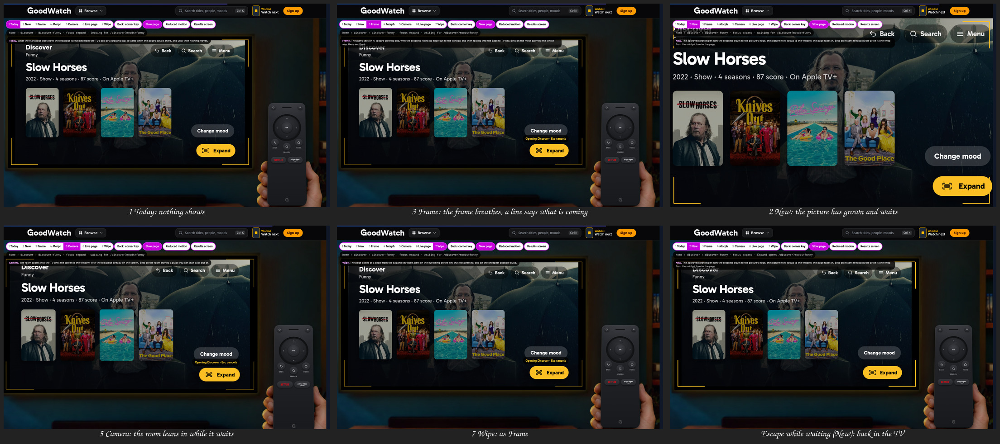
  Today shows nothing until the page comes. The others say at once that something is coming: the frame breathes
  and, after 0.35 s, a line reads "Opening Discover · Esc cancels"; New has already grown the picture; the Camera
  has begun to lean in. **Escape cancels while waiting**: the navigation is dropped and the lead-in runs backwards
  (checked for Today, New and Frame). Backspace and the Remote's Back key are wired to the same; they were not run.
- **Reduced motion** (`R`, or the system's setting): the frame stands at the picture's edge at once, the page
  replaces the room without any animation, and so does the way back (0 running animations measured, both ways,
  for Frame, Camera, New and Live page). The line still says what is coming.
- **The phone**: every transition runs at 390 x 844 (clips above). The TV is almost as wide as the window there,
  so the Camera's zoom is only 1.08x and reads as the page opening downward.
- **Back in the middle of the way out**: [clip](states/back-during-frame.mp4)
  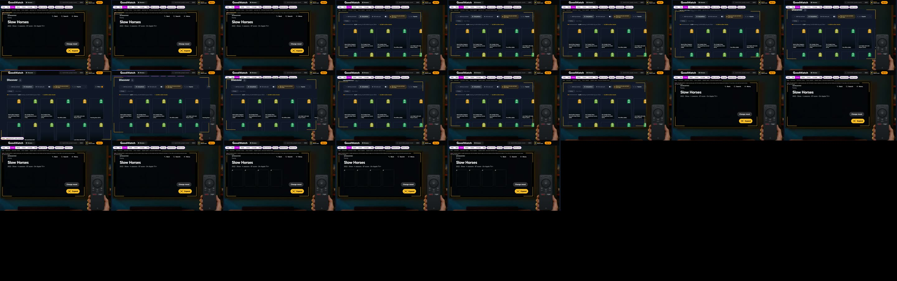
  A view transition cannot be turned around. The router skips the running one, the page stands whole for the
  moment the room takes to build, and then the normal way back runs. That is one jump, in every transition built
  on View Transitions (1, 3, 4, 5, 7). I tried starting the way back from where the way out had come to; it added
  a second jump and is removed. Only New can turn around smoothly, and only while the picture is still growing in
  the room.

## What is not seamless, and why

1. **The picture in the TV's box cuts from the mini screen to the page** at the first frame (Today, Frame, Wipe).
   They are two layouts of the same thing. The Camera softens it with a 0.26 s fade, Morph bridges the parts both
   sides have, only Live page avoids it.
2. **The browser stands still while the page is built** inside the transition (0.15 to 0.3 s in the dev build).
   The lead-in in the room cannot run during it.
3. **Back in the middle of the way out jumps** (above).
4. **Morph's posters change in flight**: the TV shows the prototype's sample titles, the real page its real first
   results. For real the TV would have to show the page's own first results.
5. **Live page loads the page twice**, and again after each return.
6. **The Camera's header shimmers**: the site header is 90% opaque, so the zooming room shows through it.
7. **Today with a slow page gives no sign at all** for as long as the data takes. That is today's behaviour,
   reproduced as it is.

## Recommendation

**Out: 3 Frame.** It is the approved motif carried to the end, it is the smallest step from what runs today, it
needs nothing from the destination pages, it behaves the same on the desktop and the phone, and the mechanism the
plan called unproven works in two engines. From New it should take two things: the brackets' short travel when
the key is pressed without having the focus, and the waiting state with its cancel.
Second choice: **5 Camera**, if the room should feel like a place one leans into; it costs the same, but it is
weak on the phone and leaves the brackets behind. Morph is the best of all on the title screen (backdrop to
backdrop, title to title) and could be added there later; as the general way out it asks too much of every page.
Not Live page, not Wipe, and not New as built (the blown-up mini picture and its swap are the least seamless
moment of all seven).

**Back: the corner key, with Escape and the browser's Back doing the same.** It is the only one that is always
reachable and works for a finger. It lands on the TV screen the person left, from any depth.

## Questions for the owner

Round three's, on top:

1. Set, Screen or Plain?
2. In the dock the Set says "Back to / TV". Should its second line name the screen instead ("Discover"), as the
   desktop's bar does? There is room for about eight letters.
3. While the TV button stands in the left part, Watch next is two taps away instead of one. Acceptable for two
   pages?

Answered in round two: the transition (6 and 5 with 3's frame), the way back (scroll-up bar), how long it lives
(a step or two), the phone (in the dock), Escape (yes). Open:

1. 8 or 9? 8 loads the app a second time inside the TV; 9 is the same move without it.
2. "A step or two": built as two pages (the one the Expand key opened and one further). Or one?
3. In the dock, Search stands as its icon while the TV key is there. Acceptable, or should another key give way?
4. From the second page the way back jumps straight to the TV, over the first page. Right, or one page at a time
   like the browser's Back? (Not answered in round one.)

## Files

- `goodwatch-webapp/app/routes/prototype.tv-expand.tsx`: the route
- `goodwatch-webapp/app/ui/prototype-tv-expand/scene.tsx`: the room, the lead-in, the controls
- `goodwatch-webapp/app/ui/prototype-tv-expand/trip.ts`: the transitions and the way back, as plain DOM code
- `goodwatch-webapp/app/ui/prototype-tv-expand/host.tsx`: the transitions' CSS and the controls on the real page
- `goodwatch-webapp/app/root.tsx`: mounts `host.tsx` in development only (a production build drops it)
- `goodwatch-webapp/app/utils/cache.ts`: `REDIS_READ_ONLY` and `REDIS_COMMAND_TIMEOUT_MS`, for this branch only
- `goodwatch-webapp/vite.config.js`: the route and the folder in `PROTOTYPES`
- `docs/prototypes/tv-expand-transitions/`: this file, `clips.mjs` (records a clip and its strips), `clips/`,
  `strips/`, `back/`, `states/`

Imported and not changed: the Cinema TV, its phone room and Remote, and the pointer from
`ui/prototype-tv-design/`, the engine and sample data from `ui/prototype-tv-flow/`, today's transition from
`ui/living-room/tv-transition.ts`. The desktop room's layout is copied into `scene.tsx`, because
`prototype-tv-design/scene.tsx` does not export it and is being edited elsewhere.

How it works, for whoever builds it: the router starts a view transition once the next page's data is there. The
prototype wraps `document.startViewTransition` to mark `<html>` and place the brackets just before the old picture
is taken and just after the page is swapped, and wraps `fetch` to hold the page's data request until the room's
lead-in is over (and to simulate the slow page). Production needs neither wrapper: the marks can be set at the
press, as `tv-transition.ts` does, and the hold becomes a prefetch at the press with the navigation at the end
of the lead-in.

## Checked

- `npx remix vite:build` passes. The build's scripts contain none of the prototype (in it the root's
  `TvExpandHost` is `null`); the read-only switch in `cache.ts` is server code and is in the server bundle.
- `npx biome lint` on the four new files: clean. `tsc` reports no error in them.
- All nine transitions, out and back, desktop and phone, land on the same TV screen with the focus on the Expand
  key (the 22 runs that made the clips each print it).
- The ways back, two pages deep, Forward and Back again, a reload, the slow page and its cancel, reduced motion:
  by script, with the screenshots above.
- Not checked: Safari, a production build's timing, a real phone (the phone is Chromium at 390 x 844 with touch).
