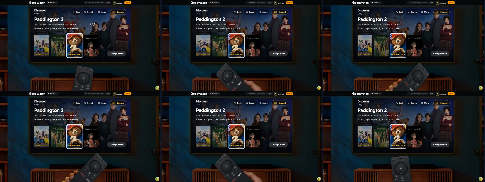
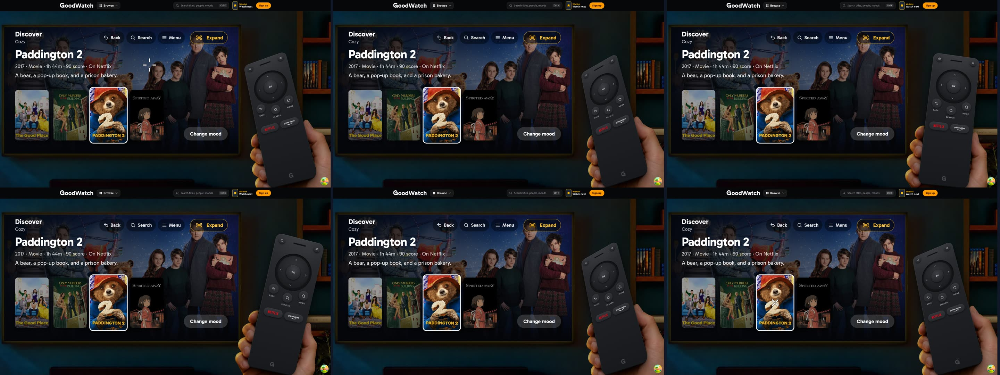
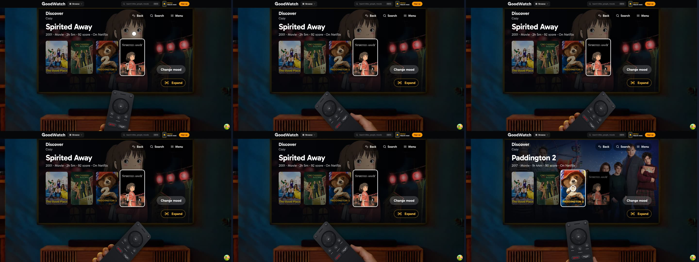
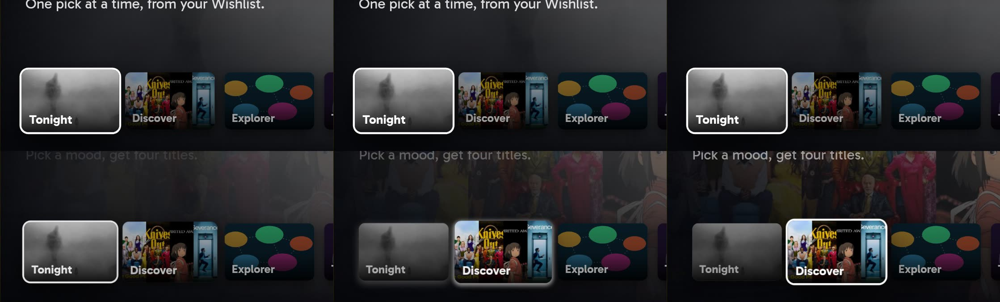
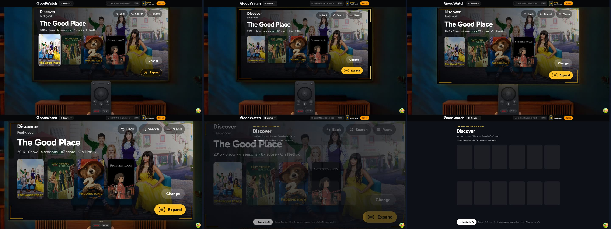
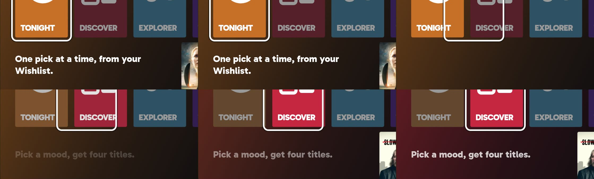
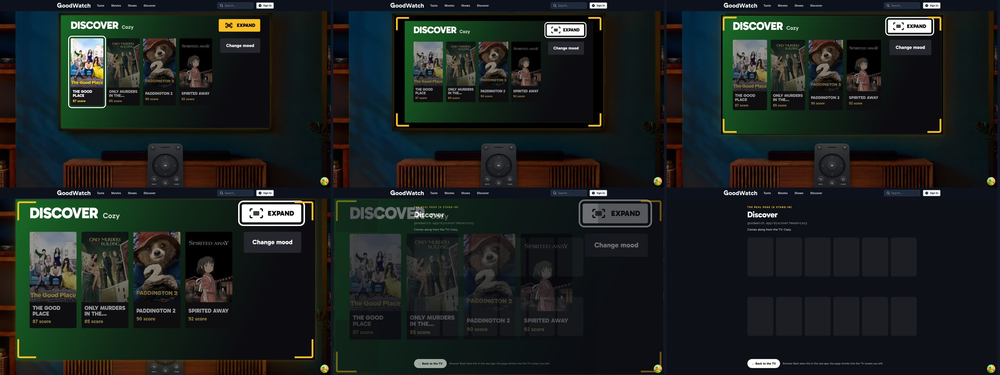
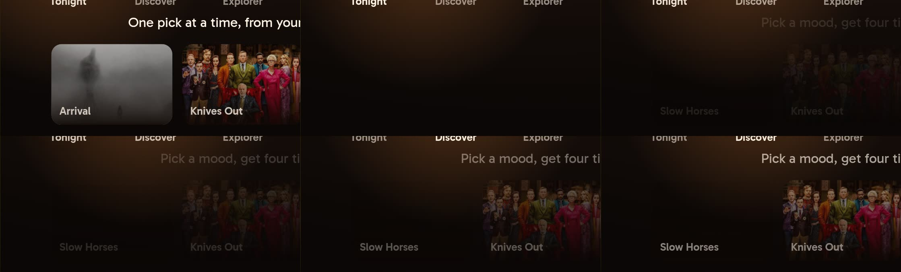
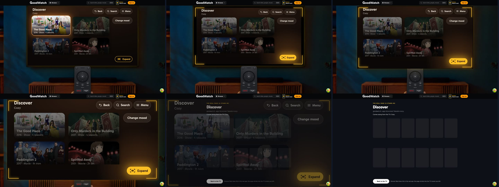

# TV screen design prototype

Throwaway. Branch `prototype/tv-screen-flow`. Round two of the TV revamp on the start page: **what the TV looks
like.** The flow is fixed: the owner chose **apps** in round one (`docs/prototypes/tv-screen-flow/`). Here the same
flow, with the same screens and the same items, is dressed three ways. The owner chose **Cinema**; it is what the
address shows without `?design=`, and the other two stay one key away.

## Open it

```
cd goodwatch-webapp
npm ci
REC_TASTE_MATCH=on REC_FILTER_BAR=on REC_WATCH_NEXT=on REC_TASTE_PAGE=on REC_EXPLORER=on \
REC_NAVIGATION=on REC_AGE_FILTER=on REC_TRACKING=on npx remix vite:dev --port 3147
```

**Every `REC_*` flag must be on**, as in the command: without them the site around the room is the old design.
With them the room sits under the new header (the wordmark, Browse, the search field, the Wishlist key, Sign up)
and, on a phone, above the new dock. Nothing fails without Crate or Valkey: no request of either prototype route
answers with an error.

`http://localhost:3147/prototype/tv-screen-design`

No Crate, no Valkey, no session. Titles, scores and islands are the flow prototype's sample data; posters and
backdrops are real, from `image.tmdb.org` (paths hard-coded in `app/ui/prototype-tv-design/art.ts`, so the browser
needs the internet but nothing needs a key).

| Control | What it does |
| --- | --- |
| `1 Cinema` / `2 Marquee` / `3 Glow` at the top left, or the keys `1` `2` `3` | Choose the direction (`?design=cinema\|marquee\|glow`). The screen you are on stays, only its dress changes, so any screen can be compared in place |
| `Guest` / `Member`, or `P` | The person (`&as=member`) |
| `In the room` / `TV only`, or `V` | The room with the Remote, or the TV alone (`&view=tv`) |
| `“Expand”`, or `L` | Cycle the expand key's label |
| `Remote under`, or `R` | The other place for the Remote than the one the window's size chose: under the TV or beside it (`&remote=below\|beside`) |
| `Remote: in the hand` / `on the table` on a phone, or `K` | The phone Remote's two forms (`&form=table`) |
| `⋯` on a phone | Unfolds these controls: on a phone they are behind one small key under the TV's left corner, so the picture shows the real proportions |
| `C` | The two pointer shapes that were not chosen, crosshair and dot; the ring is the pointer (`&pointer=cross`) |
| `Expand in the corner`, or `B` | The expand key's place: last in the top bar (the corner), first in it, or out of the bar at the picture's bottom right (`&bar=first\|bottom`) |
| Arrow keys, Enter, Escape or Backspace | Directions, OK, Back |
| `H`, `M`, `S` | Home, Menu, Search (typing on the search screen goes to the TV) |
| The Remote, mouse and touch on the TV | As in the flow prototype |

Every key is a plain key on a German keyboard: none needs Shift or AltGr. `&chrome=off` hides these controls.

## Fixed, as decided

- The apps flow: home with large app tiles and a preview of the focused one; Tonight, Discover, Explorer, Taste and
  (member) My shows as apps on the TV; a title screen; search; the menu; the four-answer quiz.
- One way out: the expand key at the top right of every app. Focusing it frames the whole picture, OK grows the
  picture into the page. Label "Expand" by default.
- Decided on this prototype: the direction is **Cinema**; the Remote sits **under the TV** and moves beside it
  only in very small windows; the pointer is the **ring**; the expand key is **last, in the corner**; the room
  photo stays.

## The top bar

Every screen has the same bar: its name on the left (with one short line under it, such as the mood), and at the
top right the same actions in the same place, as large as everything else (64 px tall, 72 in Marquee; an icon and
one word). They do what the Remote's keys do, and are reached with Up from the top row of a screen, with the
pointer, and by touch.

| Screen | Back | Search | Menu | Expand |
| --- | --- | --- | --- | --- |
| Home | no: nothing to go back to | yes | yes | no: home has no page of its own |
| Tonight, the moods, the titles, the map, an island, Taste, a side, My shows, a title | yes | yes | yes | yes |
| The quiz, rating a title, What is GoodWatch? | yes | yes | yes | no: no page to grow into |
| Search (typing) | yes | no: you are there | yes | no |
| Search results | yes | no | yes | yes |
| While the menu is open | the menu itself has no bar; the screen under it shows no Menu action | | | |

**The arrangement (chosen):** Back, Search, Menu, a wider gap, then Expand, last, in the corner. The three are quiet (dark
pills or blocks); Expand alone is amber and carries the motif, so it is not one of them. The corner is where
round one put it, and Right along the bar always ends on it. **The alternative** (`B`): Expand first, then the
gap, then the three; it reads first, but it moves away from the corner and sits beside the screen's name.
[compare/top-bar.jpg](compare/top-bar.jpg) shows both in each direction.

**A third place, to compare** (`B` again): Expand **out of the bar, in the picture's bottom right corner**, the
bar keeping Back, Search and Menu. It is where the phone has it (below), and on the desktop it is one more press
of `B`; the corner at the top right stays the desktop's default. [compare/expand-bottom.jpg](compare/expand-bottom.jpg)
shows it in each direction. Every screen keeps that corner free: the moods are a little lower (Cinema's 158
instead of 190, the others 190), Cinema's list drops the line under the focused title, Glow's list of stills ends
above the key, Marquee's poster on a title ends above it; the other screens had the corner free already. Down or
Right from the last item reaches it, and the brackets grow from there. `walk.mjs` checks on all 16 screens per
direction that it covers no type and no focus target.

On a phone the bar's three are icons without their words and the bar is one line: the name on the left, the
actions on the right. The expand key is not in the bar there (see [The phone](#the-phone)).

## Pointing the Remote at the screen

- **The Remote follows the cursor.** Wherever the mouse is in the window (over the site's header and dock too),
  the Remote in the hand aims at it: it turns about the wrist, leans further back for a far point and less for a
  near one, rolls toward the cursor's side, and moves a little toward it. It eases with a short lag (about a tenth
  of a second) and returns to rest when the cursor leaves the window.
  - Under the TV (the default) it **swings**: up to 42 degrees to either side, which reaches the top corners.
    It turns about the wrist, which is just under the streaming keys, so they hardly move; the hand lifts it a
    little as it turns, and the streaming row stays in the window.
  - Beside the TV (small windows) it **nods**: it turns 13 degrees at most and rolls more instead (26 degrees),
    so it never swings over the picture it points at.
- **Its keys stay hittable.** Over the Remote's own place it settles at rest, so the keys are where they were.
- **The TV's own pointer.** Over the TV picture the system cursor is hidden and the TV draws a pointer that
  follows with a slightly shorter lag. Over an item the item takes the focus and the pointer changes shape and
  leans a little toward the item's middle; over the expand key it turns amber; a click is OK. It fades after
  3.2 seconds without movement and at once when a key of the keyboard or of the Remote is used, and comes back
  on movement.
- **The ring is the pointer** (the owner's choice). The other two shapes stay behind `C` for comparison. One look
  for all three directions (white with a dark edge, so it reads on any art):

  | Shape | Free | Over an item | |
  | --- | --- | --- | --- |
  | **Ring** (chosen) | a circle with a centre dot | the circle closes around the dot | Reads at once as "where the Remote points", shows the exact spot, covers the least |
  | Crosshair | four ticks around a gap | the ticks close in and turn into an X | The most "aiming", but the thinnest on busy posters, and an X over an item can read as "close" |
  | Dot | a lit puck | opens into a ring | The friendliest and the easiest to find, but it hides what is under it |

  A clip and a strip per shape, the Remote following the cursor into the four corners and across the TV:
  [ring](pointing/ring.mp4)  [crosshair](pointing/cross.mp4)
   [dot](pointing/dot.mp4) 
- **Touch and the phone:** there is no cursor, so no pointer is drawn. A tap chooses directly; on a touch screen
  with the room the Remote turns a little toward the tap (40% of the way) and comes back after 0.65 s. The phone
  has its own Remote, which does not turn.
- **Reduced motion:** the Remote stays still; the pointer is drawn without lag.
- **How it is built** (`pointing.tsx`): one `pointermove` listener on the window writes the cursor into a ref; one
  `requestAnimationFrame` loop eases two transforms (the Remote's `translate3d perspective rotateZ rotateX
  rotateY` about the wrist, the pointer's `translate3d`) and stops when both have arrived. No React state is set
  on a mouse move; the pointer's states are attributes written when they change, and its shape changes are CSS
  transitions of `transform` and `opacity`. The real Remote component is untouched.

## The three directions

| | **1 Cinema** | **2 Marquee** | **3 Glow** |
| --- | --- | --- | --- |
| The bet | The art does the work | Words and colour do the work | Light does the work |
| A title in a list | A bare poster, no frame, no caption; its name and facts stand large above the row for the focused one | A poster over a caption block with the title in capitals | A still in landscape with the title on it, two in a row |
| An app on home | A still of what is inside it (tonight's pick, four posters, a map, a fingerprint, the next episode) in a dock at the bottom | A tall block of flat colour with one large sign and the name in capitals | A round disc with the same pictures, the name under it |
| The focus | The item comes forward: 9% larger, lit, a white edge and a deep shadow; the others sit at 62% brightness | Nothing grows. One white ring glides from item to item; the focused one is in full colour, the others muted | A lamp: the item lights up, lifts 8 px and throws amber light; a pool of that light glides behind it; the others at half brightness |
| Type | Gabarito bold, large and quiet, sentence case | Gabarito at its heaviest (900), capitals, tight | Gabarito semibold, warm white, sentence case, centred where it can be |
| The background | The backdrop of whatever has the focus, across the whole picture, cross-fading as the focus moves, under a shade on the left and bottom | A flat field of the focused item's colour falling off to black | A warm, dark gradient that does not change; a backdrop only as a faint tint on a title |
| Corners | 14 px | 6 px, square in spirit | 28 px and round |
| Between screens | A short zoom out of the picture (0.3 s) | A push from the side the screen comes from: right going in, left coming back (0.24 s) | A gentle rise (0.36 s) |
| The expand key | A dark glass pill, amber outline and thin brackets; amber when focused | A solid amber block, black capitals, thick brackets; white when focused | An amber outline pill; filled and glowing when focused |
| The frame while it is focused | Thin amber brackets (3 px), picture steps back to 94% | Thick brackets (10 px), picture steps back to 90% | Rounded, glowing brackets (5 px), picture steps back to 95% with round corners |

All three keep one rule from round one: **amber means the way out.** In Cinema and Marquee nothing else on the TV
is amber. Glow breaks this on purpose (its focus light is amber too), which is its one cost: the expand key
stands out less there.

All motion stops with `prefers-reduced-motion`: screens cut, the ring and the light jump, the brackets stand still.

### Side by side, the TV alone

One image per screen, the three directions under each other at the TV's real size on a 1920 x 1080 window (1271 x 686):

- Home: [compare/home.jpg](compare/home.jpg)
- Mini Discover, the moods: [compare/discover-moods.jpg](compare/discover-moods.jpg)
- Mini Discover, the titles: [compare/discover-results.jpg](compare/discover-results.jpg)
- Mini Explorer: [compare/explorer.jpg](compare/explorer.jpg)
- A title: [compare/title.jpg](compare/title.jpg)

### Motion

| | The focus moving | The expand run |
| --- | --- | --- |
| Cinema | [clip](focus/cinema.mp4)  | [clip](expand/cinema.mp4)  |
| Marquee | [clip](focus/marquee.mp4)  | [clip](expand/marquee.mp4)  |
| Glow | [clip](focus/glow.mp4)  | [clip](expand/glow.mp4)  |

The focus clips are the browser's own frames (a screencast, real time) of one walk: along the apps and back, into
Discover, around the moods, into the titles, up to the expand key. The focus strips are six of those frames from
the first move. The expand clips are composed from frames frozen at fixed points of the run, played at its real
speed (0.85 s).

### Every screen

`screens/<direction>/<nn-name>-desktop.jpg` (1920x1080, in the room) and `-phone.jpg` (390x844, without the
prototype's own key): 19 screens per direction, taken with every `REC_*` flag on and with the top bar. 01 home, 02 Tonight, 03 the moods, 04 the titles, 05 the expand key focused, 06 the map, 07 an island,
08 Taste before a taste, 09 the quiz, 10 a title, 11 rating, 12 search, 13 search results, 14 the menu, 15 What is
GoodWatch?, and for a member 16 home, 17 the three sides, 18 a side, 19 My shows.

## The room: the TV and the Remote

**Under the TV, as the owner chose**, wherever the window has room for it; beside the TV only in a very small
window. `R` shows the other one for comparison.

- **Under** (`below`): the TV is centred at the top, the Remote in the hand under it, free to swing toward the
  cursor. The TV is as tall as the window leaves once a Remote of 0.56 of its size shows down to its streaming
  keys: **1271 x 686 on 1920 x 1080**, **1080 x 583 on 1920 x 940**. That is unchanged.
- **The Remote is raised and larger** ("move the remote a little bit more to the top"). Its top was 8 px under the
  picture; it now reaches **18 px over the picture's bottom edge**, in front of the TV's lower bezel and the
  sideboard, and the TV sits 4 px higher (8 px from the top instead of 12). The height that frees goes into the
  Remote, not into showing more of the hand: **0.62 of its size instead of 0.56 on 1920 x 1080** (199 px wide
  instead of 181), **0.55 instead of 0.5 on 1920 x 940** (178 instead of 160), 0.74 instead of 0.68 on
  2560 x 1300. Its streaming row still ends inside the window. Before and after:
  [1920 x 1080](viewports/remote-raised-1920x1080.jpg), [1920 x 940](viewports/remote-raised-1920x940.jpg).
- **It covers no content.** The 18 px it takes of the picture are in the bottom margin, in the middle (about 200
  px wide), where no direction puts type or a focus target: `walk.mjs` checks all 16 kinds of screen in each
  direction at both sizes. For that, Glow's list of stills now ends 16 canvas pixels above the bottom margin
  instead of running to the picture's edge (its third row, which pages in, used to peek out there). The nearest
  type or focus target above the Remote's top is 48 px away on 1920 x 1080 and 38 px on 1920 x 940 in Cinema and
  Marquee (a title's buttons), and 30 and 22 px in Glow (that third row).
- In a shorter window the Remote gives way first, down to 0.46 of its size, so that the TV keeps the width that
  holds its type at 18 px.
- **The threshold is unchanged: under needs a window at least about 918 px tall and 1110 px wide.** Below that it
  cannot show the streaming row and keep type of 20 canvas pixels at 18 px, so the Remote moves **beside** the TV:
  the TV on the left as large as the window allows, the whole Remote to its right with its end on the bottom
  edge, and the Remote only nods toward the cursor there. 1920 x 910 is already beside.
- **The photo** is the same one, stretched to about 1.35 times its largest file at 1080p. What I did about the
  softness, cheaply: a slight blur on the photo (1.8 px) that removes the stretch's grain and reads as depth of
  field, and a soft darkening toward the corners around the TV. Both are set once and never animate. The start
  page's rendering budget (#190) rules out a blur over the photo, so the real build should bake the blur into the
  image file instead.

| Window | Remote | TV | Canvas shown at | Smallest type on the TV (Cinema) | Remote's size | Remote's width | Its streaming row ends at | The Remote ends at |
| --- | --- | --- | --- | --- | --- | --- | --- | --- |
| 1920 x 1080 | under | 1271 x 686 | 1.06 | 22.2 px | 0.62 (was 0.56) | 199 px (was 181) | 1064 of 1080 | runs off |
| 1920 x 940 | under | 1080 x 583 | 0.90 | 18.9 px | 0.55 (was 0.5) | 178 px (was 160) | 926 of 940 | runs off |
| 2560 x 1300 | under | 1556 x 841 | 1.30 | 27.2 px | 0.74 (was 0.68) | 238 px (was 219) | 1281 of 1300 | runs off |
| 1536 x 730 | beside | 1080 x 583 | 0.90 | 18.9 px | 0.71 | 231 px | 474 of 730 | 723 of 730 |
| 1440 x 800 | beside | 1080 x 583 | 0.90 | 18.9 px | 0.54 | 174 px | 606 of 800 | 793 of 800 |
| 1366 x 650 | beside | 998 x 539 | 0.83 | 17.5 px | 0.5 | 160 px | 471 of 650 | 643 of 650 |
| 1280 x 720 | beside | 949 x 513 | 0.79 | 16.6 px | 0.5 | 160 px | 541 of 720 | 713 of 720 |

The width is the Remote as drawn at rest, tilted toward the TV, which is a little wider than its size times 312.
The beside rows are as they were.

[viewports/contact-sheet.jpg](viewports/contact-sheet.jpg) shows Cinema's home at each size, all at the same scale.

- **18 px holds at 1440 x 800, 1536 x 730, 1920 x 940 and everything larger.** At 1366 x 650 the TV is limited by
  the height (the site's header takes 64 px of 650) and its smallest type is 17.5 px; at 1280 x 720 it is limited
  by the width and is 16.6 px. Nothing is cut at either; the type is smaller. Marquee's smallest type is 20 canvas
  pixels (Cinema's and Glow's 21), so it is 5% smaller than the column says, and exactly 18 px where the TV is
  1080 wide.
- **The phone** has a layout and a Remote of its own, without scrolling: see [The phone](#the-phone).

## Size numbers

Measured by `shots.mjs` in the room on a 1920x1080 window, over all 19 screens, at rest (without the growth of a
focused item); `sizes.json` has the output.

| | Smallest text | Where | Smallest focus target | Where |
| --- | --- | --- | --- | --- |
| Cinema | 22.2 px | the "Start" strip on a poster in My shows | 68 px tall (146 x 68) | Menu in the top bar |
| Marquee | 21.2 px | "92 score" under a poster | 76 px tall (168 x 76) | Search in the top bar |
| Glow | 22.2 px | the facts line on a still | 68 px tall (146 x 68) | Menu in the top bar |

The script reports the target with the smallest shorter side; all actions of the top bar share that height, and
Back, with the shortest word, is the narrowest of them.

The TV shows its canvas at 1.06 there, so the sizes in the code print 6% larger. In canvas pixels the primary
labels are: app names 26 to 108 px, screen titles 36 to 62 px, a title's name 46 to 104 px, buttons 25 to 32 px
in keys 64 to 124 px tall. At most five targets in a row (My shows has six in Cinema and Marquee; the sixth pages
in), at most two rows of tiles on screen at once (Glow's My shows has a third that pages in).

## Recommendation

**Cinema**, with the map of Marquee.

- It is the one that reads as a TV at once: the picture of the thing you point at fills the screen, as on the
  boxes the owner named. The art the app already has (backdrops, posters) does the polish; nothing has to be drawn
  per title.
- It keeps the fewest things on screen: a list is four bare posters and one large name.
- Its weak spot is the art itself. A dull or busy backdrop makes a dull or busy screen (the sample member's
  Tonight opened on Arrival's grey fog until this round, where Spirited Away leads instead; the map's island of
  Space is another), and type on a picture needs the shade to stay readable.
- Marquee is the easiest to read from far away and has the clearest focus (the ring), but it looks least like a
  TV and most like a poster wall; its app signs would need real illustration work. Its **Explorer is the best of
  the three**: flat islands with their names inside read as a map; round stills (Cinema) and plain orbs (Glow) do
  not say what an island is.
- Glow fits the room best and is the calmest, but it dims everything that is not focused, its light costs the most
  to draw, and amber stops meaning "the way out".

## The phone

**One screen, nothing scrolls, and it is the same room.** The owner's verdict on the last round: "the tv screen
does not look like a tv, room is not hinted, the remote does not look like a remote. the expand button gets in the
way at the top right". What the phone shows now, from the top (the site's header and dock are above and below):

- **The wall.** The teal wall of the room, from the portrait room photo the start page already has
  (`room-phone`), softened and dimmed like the desktop's. Nothing new is loaded.
- **The TV, as a TV.** A dark bezel (5 px) around the picture, 9 px of wall on either side and above, the warm
  light on the wall around it while it is on, and under it a short stand with its foot on the soundbar. The
  picture is **never taller than its width by 1.2**: a tall phone no longer gets a tall, narrow panel, it gets the
  same TV and more room.
- **The room under it.** The soundbar and the walnut sideboard of the photo directly under the TV, then the floor,
  the coffee table and the blanket. A short phone shows a strip of the sideboard between the TV and the Remote; a
  tall phone shows all of it.
- **The Remote, as a remote.** The desktop Remote's own parts and materials (its dark body with the lit edge, the
  round wheel with OK, the round keys with their icons and words, the Netflix and Prime Video keys), in a body
  short enough for a phone. All keys as before: the four directions, OK, Back, Home, Search, Menu, Netflix, Prime
  Video. The power key stays dropped: "Turn off" is in the TV's menu, and a dark TV turns on with any key.
- **The prototype's controls** are folded behind one small key (`⋯`) under the TV's left corner and open over the
  room, so they take no height: what is on the screen is the real proportions.
- **No pointer** is drawn, and a tap chooses directly.

### Two forms of the Remote (`K`, `&form=table`, or the controls)

| | **In the hand** (shown first, recommended) | **On the table** |
| --- | --- | --- |
| What it is | The Remote upright, held in the same hand as on the desktop, rising from the bottom edge: its grip and the hand run off the screen | A wide, short Remote lying in front of the TV |
| Keys | The wheel, with a round key in each corner of its square (Search and Menu above, Back and Home below, their words beside them), and the two streaming keys under it | The wheel in the middle; Back, Search and Netflix on its left, Home, Menu and Prime Video on its right |
| Size at its smallest | 236 px wide, 222 px down to the end of its keys | 336 px wide, 176 px tall |
| Reads as | A remote in a hand, at once: it is the desktop's picture, cut at the streaming keys | A remote, but one of its own kind; nothing holds it, and it covers the sideboard on a short phone |
| What it costs | 46 px more than the other on the shortest phones: at 375 x 667 the TV is 260 px tall instead of 289 | Nothing: the TV is at its full height at every size |

**I recommend In the hand.** It is the one that looks like the desktop's Remote and like the same room: the hand,
the thumb beside the streaming keys, the body running off the screen. Its price is real only on the two shortest
windows (375 x 667 and 390 x 700), where the TV loses about a tenth of its height; from 360 x 740 up the TV is the
same in both forms. On the table is the fallback if that tenth matters more.

### The expand key at the bottom right

On the phone the expand key is **out of the top bar, in the bottom right corner of the picture**, amber as before;
the bar keeps Back, Search and Menu. The brackets that grow into the page start from there. Every screen keeps the
corner free for it, and uses the row beside it: the focused mood's line, a list's "Change mood" or its two "Sail
to" islands, Taste's "Rate more"; on a title the three actions stand in a column on the left and the key beside
the last of them. `walk.mjs` checks on all 16 screens, at every size and in both forms, that the key covers no type
and no focus target, and that no focus target runs off the picture's bottom edge. A toast ("Only Netflix") stands
above that row, clear of the key.

### Using the height

- **The screens are laid out for the TV's real height** (a canvas of 500 x 417, or 375 to 405 on the two shortest
  windows with the Remote in the hand), not for a tall panel. Lists and grids take the height that is left instead
  of a fixed size, so nothing is cut and nothing is left empty: the gap between the home screen's text and its
  apps, about 175 px at 390 x 844 before, is about 60 px there now (30 on the shortest window).
- What each kind of screen does there: the moods and the islands are three by two (they were two by three and ran
  off a short TV); a list shows all four posters at once in Cinema; the three sides stand side by side; the quiz
  answers are two by two; the menu's five entries fit with the bar.
- **The member's Tonight** opened on Arrival's grey fog. The sample member's picks are now Spirited Away, Knives
  Out and Palm Springs (all from the sample Wishlist), so the first picture is a lively one.
- Type on the TV is 20 canvas pixels and up, which prints at 13.3 to 16.1 px on these phones. That is 0.5 px less
  than before at each size: the price of the wall beside the TV.

| Phone | Remote | TV picture | TV with its bezel | Canvas | Shown at | Smallest type | Remote's width | Smallest key | Remote starts at | Its keys end at |
| --- | --- | --- | --- | --- | --- | --- | --- | --- | --- | --- |
| 390 x 844 | in the hand | 362 x 302 | 372 x 312 | 500 x 417 | 0.72 | 14.5 px | 265 px | 49 px | 451 | 696 of 844 |
| 390 x 844 | on the table | 362 x 302 | 372 x 312 | 500 x 417 | 0.72 | 14.5 px | 365 px | 48 px | 526 | 705 of 844 |
| 360 x 740 | in the hand | 332 x 277 | 342 x 287 | 500 x 417 | 0.66 | 13.3 px | 245 px | 46 px | 396 | 622 of 740 |
| 360 x 740 | on the table | 332 x 277 | 342 x 287 | 500 x 417 | 0.66 | 13.3 px | 337 px | 44 px | 451 | 617 of 740 |
| 375 x 667 | in the hand | 347 x 260 | 357 x 270 | 500 x 375 | 0.69 | 13.9 px | 236 px | 44 px | 355 | 573 of 667 |
| 375 x 667 | on the table | 347 x 289 | 357 x 299 | 500 x 417 | 0.69 | 13.9 px | 351 px | 46 px | 391 | 563 of 667 |
| 430 x 932 | in the hand | 402 x 335 | 412 x 345 | 500 x 417 | 0.8 | 16.1 px | 292 px | 55 px | 498 | 769 of 932 |
| 430 x 932 | on the table | 402 x 335 | 412 x 345 | 500 x 417 | 0.8 | 16.1 px | 402 px | 53 px | 580 | 777 of 932 |
| 390 x 700 (a browser with its bars) | in the hand | 362 x 293 | 372 x 303 | 500 x 405 | 0.72 | 14.5 px | 236 px | 44 px | 388 | 606 of 700 |
| 390 x 700 | on the table | 362 x 302 | 372 x 312 | 500 x 417 | 0.72 | 14.5 px | 365 px | 48 px | 414 | 593 of 700 |

Every key is 44 px or more in both directions at every size; both forms have 11 keys. The positions are from the
window's top; the site's dock begins 64 px above the window's bottom.

[viewports/phones.jpg](viewports/phones.jpg): home, a mini Discover and a title at each of the five sizes, the
Remote in the hand. [viewports/phones-table.jpg](viewports/phones-table.jpg): the home at each size with the
Remote on the table. [viewports/phone-before-after.jpg](viewports/phone-before-after.jpg): the three screens at
390 x 844 before this round and after.

- **Nothing scrolls, for real**, as before: the site's page behind the scene is held at the window's size while
  the phone layout is on. `walk.mjs` drags a finger up on the TV and on the Remote in a touch browser and checks
  that nothing moved and that the page is no taller than the window. The Remote's lowest key ends 30 px or more
  above the scene's bottom edge, clear of the site's dock and its round Browse key, which reaches 17 px over that
  edge.
- What a phone still gives up against the desktop: Cinema drops the line under the focused title, the mood and
  side tiles their second line (the focused one's line stands beside the expand key or over the row), Marquee the
  posters on home and the poster on a title, Glow the stills on home and on a title. A long line under a screen's
  name is cut with an ellipsis. Not built: swiping, landscape.

## Not in this round, and what I did not check

- **Rendering cost.** Cinema cross-fades a full-picture image on every focus move, Glow draws large soft shadows,
  and the TV is 2.4 times the area of today's. The start page has a rendering budget (#190). Nothing here was
  measured against it.
- **The art is not curated.** Backdrops are TMDB's first choice per title; some carry the title as text, some are
  dull. The real build would need a rule for which image to take, and a fallback for a title without one.
- **Moving focus by a ring over a paging row** (Marquee) follows the item until it stands still, however long
  the row pages or the screen takes to arrive (it used to stop after 0.7 s, which left the ring behind on a slow
  device).
- Boot screen, sign-in, browser history and the real pages behind the expand run are as in round one: not built.

## Questions for the owner

1. The phone's Remote: **in the hand** or **on the table**? I recommend in the hand.
2. With the Remote in the hand, the two shortest windows (375 x 667, and 390 x 700 with the browser's bars) have
   a TV of 260 and 293 px height instead of 289 and 302. Fine, or should those windows switch to the Remote on
   the table by themselves, as the desktop switches to "beside" in a small window?
3. The TV on a phone is at most 1.2 times wider than tall, so that it reads as a TV. A tall phone therefore shows
   more room, not more TV. Right, or should the TV take more of a tall phone (taller, and less like a TV)?
4. The expand key on the desktop: stay in the top right corner, or move to the bottom right as on the phone
   (`B` shows it)? At the bottom it is nearer the Remote and out of the bar, but four kinds of screen give up a
   little for it (see The top bar).
5. The stand under the phone's TV is a hint (a short neck and a foot on the soundbar). Enough, or should the TV
   hang on the wall as in the photo, with no stand?
6. Is the Remote under the desktop's TV high enough now (18 px over the picture's bottom edge, a tenth larger)?
   There is room for about 20 px more in Cinema before it comes close to a title's buttons.
7. On the smallest desktop windows (1366 x 650, 1280 x 720) the TV's smallest type is 16.6 to 17.5 px.
   Acceptable, or should the TV's content itself change there (fewer, larger things) rather than scale?
8. Cinema shows no name on a poster in a list (the name stands above for the focused one). Enough, or should
   every poster carry its name?
9. The app pictures (the map, the fingerprint) are drawn in code as stand-ins. Should they be illustrated, or
   made from real art as Tonight and My shows are?

## Files

Added:

- `goodwatch-webapp/app/routes/prototype.tv-screen-design.tsx`: the route
- `goodwatch-webapp/app/ui/prototype-tv-design/scene.tsx`: the larger room, the TV, the Remote, the expand run per direction, the controls
- `.../base.tsx`: the apps flow (which screen shows what; item ids as in round one), the app pictures, the follower that glides to the focus
- `.../cinema.tsx`, `.../marquee.tsx`, `.../glow.tsx`: the three directions
- `.../art.ts`: TMDB poster and backdrop paths of the 25 sample titles
- `.../pointing.tsx`: the Remote aiming at the cursor and the TV's own pointer
- `.../phone-room.tsx`: the phone's room (the wall, the TV's body and stand, the sideboard) and where the TV and the Remote sit in it
- `.../phone-remote.tsx`: the phone's Remote, in its two forms
- `docs/prototypes/tv-screen-design/`: this file, `shots.mjs`, `walk.mjs`, `sizes.json`, `screens/`, `compare/`, `focus/`, `expand/`, `pointing/`, `viewports/`

Changed: `goodwatch-webapp/vite.config.js` (`PROTOTYPES` lists the route and the folder), and in
`prototype-tv-flow` only `data.ts`: the addresses of the pages the TV expands into are those of the flag-on pages
(`moods=` for Discover, a title's TMDB id in its address). The engine, the focusable item and the title actions
are imported as they are, and the flow prototype works as before.

## Proof

- `npx remix vite:build` passes; `npx biome lint` on the added files is clean; `tsc` reports nothing in them.
- `walk.mjs`: 582 checks pass. 57 per direction: the apps, a mood, titles, Want to See, rating, the way along the
  top bar to the expand key and back, the menu, the map in four directions, the Remote's keys, search, the quiz,
  a member's My shows; the top bar (which actions each kind of screen has, reaching them with Up, what Back,
  Search and Menu do, the expand key first, and its third place: at the picture's bottom right, the bar keeping
  the three, Down from the last mood reaching it, OK growing the picture from there, Back coming back to it); and
  pointing (the pointer appears over the TV and the system cursor is hidden, the item under it takes the focus, a
  click is OK, it hides on a key and after 3.2 s, the Remote swings far toward each of the four corners, the
  streaming row stays in the window while it is turned, it settles over its own keys and is at rest after the
  cursor left). 9 for what may cover the picture, each on 16 screens: the raised Remote in each direction at
  1920 x 1080 and 1920 x 940, and the expand key at the bottom right in each direction, cover no type and no focus
  target (what a list cuts off does not count, nor the menu that opens over a screen). 55 for the window sizes:
  at 1920 x 1080, 1920 x 940 and 2560 x 1300 the Remote is under the TV, at 1536 x 730, 1440 x 800, 1366 x 650
  and 1280 x 720 beside it; at each the streaming row ends inside the window, both streaming keys take a click,
  beside the TV the whole Remote is inside the window, and the smallest type is 18 px or more (under 18 px at the
  two smallest, as stated above); the same for Marquee and Glow at 1920 x 940 and Glow at 1536 x 730.
- Of those, **330 are the phone's**, in a touch browser. Cinema at 390 x 844, 360 x 740, 375 x 667, 430 x 932 and
  390 x 700, with the Remote in the hand and on the table (27 each): the layout is the phone's and the Remote has
  the form asked for; the TV has its body on every side of the picture and wall beside it, and is wider than
  tall; the Remote starts under the TV; it has its 11 keys, each 44 px or more, inside the window and under
  nothing (the site's dock included); a tap on each does what it says (the four directions, OK, Back, Search,
  Home, Menu, both streaming keys); the expand key is at the picture's bottom right and not in the bar, covers
  no type and no focus target on any of 16 screens, and a tap on it grows the picture into the page and Back
  returns; no focus target runs off the picture's bottom edge on any screen; and at the end a finger drags up on
  the TV and on the Remote, the page is told to scroll, and nothing has moved and the page is no taller than the
  window. Marquee and Glow at 375 x 667 and 430 x 932 (15 each): the same without the keys' effects.
- And 17 more: the nod and the `R` key with the Remote forced beside the TV, the direction buttons and the keys
  1, 2, 3, the ring and the two shapes behind `C`, no pointer at phone width, the phone's controls folded away
  and unfolding (a direction, the Remote's other form).
- `shots.mjs` made every picture, clip and number here (the clips of the focus, the expand run and pointing are
  from the round before: nothing they show has changed).
