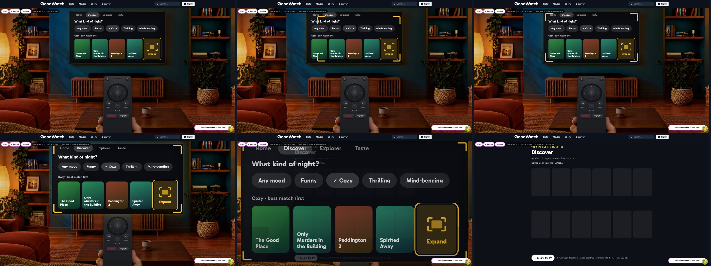
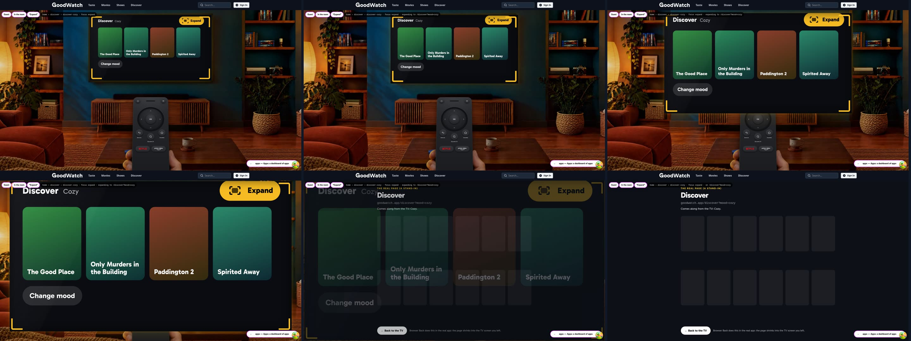
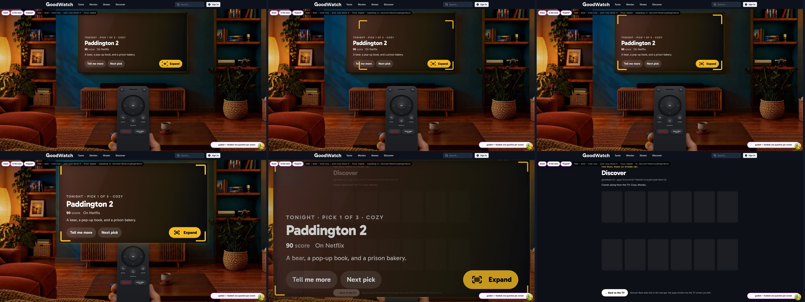

# TV screen flow prototype

Throwaway. Branch `prototype/tv-screen-flow`, based on `prototype/living-room-remote` (the Remote verdict, hug-arc).
Round one of the TV revamp on the start page: **which TV screens exist, how you move between them, and how you
leave for a real page.** The visual design is round two and not in here; the look is plain on purpose, the sizes
are already TV-true.

## Open it

```
cd goodwatch-webapp
npm ci
npx remix vite:dev --port 3147        # 3003 is usually taken
```

`http://localhost:3147/prototype/tv-screen-flow`

It needs no Crate, no Valkey and no session: every title, score and island is sample data in
`app/ui/prototype-tv-flow/data.ts`, and Want to See, ratings and the quiz live in memory until you reload. On a
machine whose `.env` points at production, start it with the keys blanked (an empty value wins over `.env`), as
the screenshots here were made.

| Control | What it does |
| --- | --- |
| Pill bottom right, or `[` `]` | Switch the flow variant (`?variant=rows\|apps\|guided`) |
| `Guest` / `Member`, or `P` | The person (`&as=member`) |
| `In the room` / `TV only`, or `V` | The room with the Remote, or the TV alone and large (`&view=tv`) |
| `“Expand”`, or `L` | Cycle the expand control's label (`&label=full-view` and so on) |
| Arrow keys, Enter, Escape or Backspace | Directions, OK, Back |
| `H`, `M`, `S` | Home, Menu, Search (typing on the search screen goes to the TV) |
| The Remote | All of the above by mouse or touch: wheel arrows, OK, Back, Search, Home, Menu, power, Netflix and Prime Video (only titles of that service) |
| Mouse and touch on the TV | Pointing focuses, a click or tap chooses |

The dark strip at the top left shows the state: the stack of TV screens, the focused item, and the page the TV is
expanding into. Every screen has an address (`&at=home.discover.discover-cozy`), so a screen can be linked.

## What the current TV does that a TV would not

Read from `tv-flow.ts`, `TvScreens.tsx` and `TvQuiz.tsx` on `main`.

- **One-dimensional focus.** All four arrows step forwards or backwards through one list. Up and Down do the same
  as Left and Right, so the layout on screen does not predict where the focus goes.
- **Small type.** Fifteen lines of `TvScreens.tsx` and `TvQuiz.tsx` set type at 11 to 13 px on a 960 px canvas, and the canvas is shown at about 0.8 on
  a 1080p screen: labels land near 10 px.
- **Crowded screens.** Moods: 12 tiles. The quiz: 16 targets (four levels, a 1 to 10 strip, skip, Want to See).
  Search: a 26 key keyboard plus presets. A title: five equal pills in one row.
- **Small graphics.** Fanned posters 86 px wide, mood chips at 12 px used as decoration, 24 px badges.
- **Early exits.** A member's home doors leave for My shows or My movies on the first press. The menu's Watch
  next, Discover, Taste and Explorer leave from any screen in one press, and so do the Remote's feature keys. A
  quiz pick opens its title page directly.
- **Exits that look like everything else.** "More in Discover ↗" and "Full page ↗" are pills of the same size and
  weight as "Pick a mood" and "Seen it".

## What all three variants share

- **Four directions.** The focus moves to the nearest item in the direction pressed: Left and Right stay in the
  row, Up and Down take the next row. Down from a wide item starts at the row's left end. Back gives the focus
  back to where it was on the screen before.
- **Sizes.** No type under 20 canvas px, no focus target under 60 px tall, tiles 160 px and wider.
- **Mini features on the TV.** Discover (a mood, four titles), Explorer (islands, four titles each, a step to the
  island next door), Taste (rate five titles, then three sides of you), and for a member My shows (next episodes).
  A title is a screen with three actions: Watch on the service, Want to See, Seen it (which asks how it was).
- **One way out.** Nothing leaves the TV except the expand control and "Watch on Netflix" (which would open the
  streaming service). A member's doors, the menu and the Remote no longer leave.
- **The same everywhere:** rating a title, the taste quiz, search, the menu (Home, Search, Sign in or Account,
  What is GoodWatch?, Turn off).

## The expand control

The owner's correction: no "Open full Discover" buttons. The control shows what it does and carries a short label.

- **The motif:** a small picture inside four corner brackets, in amber. Amber is used for nothing else on the TV,
  so amber brackets always mean "this leaves the TV". While the control has the focus, the brackets move outward
  and back: the picture wants to grow past its frame.
- **It expands what you are looking at.** In Discover it opens Discover with your mood, on an island the map at
  that island, on a title the title page. It never names a page, and it never goes somewhere unrelated.
- **Leaving:** the brackets leave the control and travel to the edge of the TV picture; then the picture itself
  grows past the TV, over the room, to the size of the window; the real page fades in at the end. Back on the page
  runs it backwards into the same TV screen with the same focus. (The real app does the growing part today with
  View Transitions, #232; the bracket part is new.)

Label options, one or two words. Cycle them with `L`:

| Label | For | Against |
| --- | --- | --- |
| **Expand** (recommended) | A verb for exactly what the motif shows; fits a title as well as a feature | None found |
| Full view | Names where you end up | A noun, reads as a mode rather than an action |
| Full page | Plain | "Page" is a web word on something dressed as a TV |
| Open up | Friendly | Unclear what opens |
| Go big | Playful | Tone may not fit every screen |
| Maximise | Familiar from windows | Long, technical, spelling differs by country |

Three treatments, all with the motif and a short label:

| | Where the control is | How it leaves | Clip | Frames |
| --- | --- | --- | --- | --- |
| **rows** | The last tile of every row, and the last button on a title | One OK. Brackets to the edge in 0.4 s, picture grows in 0.85 s | [gif](expand/rows.gif), [mp4](expand/rows.mp4) |  |
| **apps** | One key in the top right corner of every app, always the same place | Focusing it already frames the whole picture, a little smaller (this is what grows). One OK, picture grows in 0.85 s | [gif](expand/apps.gif), [mp4](expand/apps.mp4) |  |
| **guided** | The last control on the last screen of a path | OK starts a slow run: the brackets creep to the edge in 2.4 s. Back cancels, a second OK skips the wait. Then the picture grows | [gif](expand/guided.gif), [mp4](expand/guided.mp4) |  |

## Screen maps

Screenshots: `screens/<variant>/<nn-name>-desktop.jpg` (1920x1080, in the room) and `-phone.jpg` (390x844).

### rows: tabs, a hero, rows of tiles

A streaming box's home. The tabs switch as the focus lands on them. A title, an island and a side of you are
screens of their own without tabs.

| Screen | On it | Moves | Leaves by |
| --- | --- | --- | --- |
| Home (guest) `01` | Tabs (4), hero "Tonight's pick", rows: Discover (4 titles), Explorer (4 islands), Taste (one banner) | Up to the tabs, Down pages the rows, a title opens its screen | The last tile of the Discover and Explorer rows |
| Home (member) `02` `03` | Tabs (5), hero "Next episode", rows: My shows, My movies, Discover, Explorer | The same | The last tile of each of the four rows |
| Discover `04` `05` | Five mood chips, four titles | OK on a mood swaps the titles in place | The row's last tile, with the mood |
| Explorer `06` | Six islands in two rows | OK steps onto an island | The first row's last tile |
| Island `07` | Four titles, two islands next door | Next door swaps the island | The row's last tile, at that island |
| Taste (guest) `08`, quiz `09` | "Rate 5 titles", Start rating | The quiz asks one title at a time, four answers | The key beside Start rating |
| Taste (with a taste) `10`, a side `11` | Three sides of you, Rate more; a side shows four titles | | The row's last tile |
| My shows (member) `12` | Continue (3 next episodes), Start next (3 shows) | A show opens its title screen | The first row's last tile |
| Title `13`, rating `14` | Facts, Watch on the service, Want to See, Seen it | Seen it asks "How was it?" | The last key in the row |
| Search `15` `16`, menu `17`, What is GoodWatch? `18` | | | Search results: the row's last tile |

### apps: a dashboard of apps

A console. Home is one row of large app tiles with a preview of the focused one under it. OK opens the app on the
TV; Back returns to the dashboard.

| Screen | On it | Moves | Leaves by |
| --- | --- | --- | --- |
| Home `01` `02` | Tonight, Discover, Explorer, Taste, and for a member My shows; the preview follows the focus | OK opens the app | Nothing: home never leaves |
| Tonight `03` | One pick at a time (a member's Wishlist, a guest's best rated): Details, Another one | | The corner key |
| Discover `04` `05` `06` | Six moods in a grid, then four titles and Change mood | | The corner key, with the mood |
| Explorer `07`, island `08` | A small map: six islands on the sea with their bridges, the focus sails in four directions; an island shows four titles and "Sail to" two neighbours | | The corner key, at that island |
| Taste `09` `10`, a side `11` | As in rows, larger | | The corner key |
| My shows (member) `12` | Three next episodes, three shows to start | | The corner key |
| Title `13` | Facts on the left, the three actions stacked on the right | | The corner key |
| Search results `14`, menu `15` | | | The corner key |

### guided: one question per screen

A TV's setup. Home asks what you would like to do; each answer starts a path of questions with three or four big
answers; a path ends on one title at a time.

| Screen | On it | Moves | Leaves by |
| --- | --- | --- | --- |
| Home `01` `02` | "What would you like to do?": Find something for tonight, Wander the map, Teach it my taste; a member also gets Continue with the next episode | | Nothing |
| Tonight, steps 1 to 3 `03` `04` `05` `06` | "What kind of night?", "A movie or a show?", then pick 1 of 3: Tell me more, Next pick | Back goes one question back | The last control on the pick, with mood and kind |
| The map, steps 1 and 2 `07` `08` | "Where do we start?" (four islands), then one title of the island at a time: Tell me more, Next title, Sail to the island next door | | The last control, at that island |
| Taste `09` `10` | The quiz, then "Your taste so far": Show my picks, Rate more | | The last control |
| Continue (member) `11` | The next episode: Seen it, Another show | | The last control, to My shows |
| Title `12` | Facts and the three actions | | The last control |

## Recommendation

**apps** for the structure, with its corner key as the exit, and the label **Expand**.

- It is the one variant where a mini feature is a place of its own, which is what "smaller versions of the main
  features, each with an option to expand" describes. One expand control per screen, always in the same corner,
  cannot be mistaken for content.
- Its screens are the emptiest: five tiles at home, six in Discover, four titles and one button in the results.
- rows is the closest to a streaming box, but it is the fullest (up to fifteen targets with the tabs), and a
  member's home carries four expand tiles at once. Worth taking from it: the hero with tonight's pick or the next
  episode.
- guided is the gentlest for a first visit and the slowest for the tenth. Worth taking from it: its path as what
  the Tonight app does for a guest, and the cancellable slow run if leaving still feels too quick.

## The phone edition

The prototype works at phone width (tap chooses; the Remote sits under the TV). What it changes, and what a real
phone edition would have to decide:

- The TV fills the width and is taller than the TV on the wall (a 560 x 640 canvas), so the same type prints at
  14 px and up. The room photo is left out here.
- A row shows two and a half tiles and pages sideways as the focus moves or a finger taps the cut tile. Swiping a
  row is not built.
- Button rows stack, grids go from three columns to two, the Explorer map becomes a grid of six islands (the
  sea and bridges need the width), guided answers stack.
- The Remote shows its wheel, Back, Search and Home; the streaming keys run off the bottom, as on the real page.
- Not built: phone landscape, and the hand photo.

## Not in this round

- The look: colours, posters and backdrops (titles are flat colour tiles), motion beyond the expand run.
- The boot screen, sign-in, the guest services step and "this or that" pairs of today's flow. Whether they stay
  is a question below.
- Browser history: screens do not push history entries here. Today's TV does, and Back in the browser pops a
  screen; the real build should keep that.
- A real page behind the expand run: it ends on a stand-in that names the page, its address and what comes along.

## Questions for the owner

1. Which structure: rows, apps or guided, or a mix (for example apps with the hero of rows)?
2. Which expand treatment: a tile at the end of a row, one corner key with the framing preview, or the last step
   with the slow, cancellable run? Is one press enough once the control looks like this?
3. Which label: Expand, Full view, or another?
4. Should the growing picture show the mini screen until the page is there (as built), or cross-fade earlier?
5. "Watch on Netflix" also leaves GoodWatch. Should it get a sign of its own, different from the amber brackets?
6. Do the tabs of rows switch as the focus lands on them (as built, like a streaming box), or only on OK?
7. What happens to today's guest steps: choosing services, the "this or that" pairs, the 1 to 10 score strip in
   the quiz? Here the quiz has four answers and services are the Remote's two streaming keys.
8. Search on the TV: suggestions plus typing on the device's keyboard (as built), or an on-screen keyboard as
   today?
9. Should the Menu key stay, now that Home and Search are keys and the menu only adds Sign in, What is GoodWatch?
   and Turn off?
10. The TV on the wall is about 770 px wide on a 1080p screen. Should the room make the TV larger for round two?

## Relabel "Living room"

Not changed in this task. Every place where the words reach a person:

| Where | Text | Who sees it |
| --- | --- | --- |
| `goodwatch-webapp/app/ui/navigation/destinations.ts:64` | `label: "Living room"` | The hub's home tile (`Hub.tsx:265`) and the command palette's "Go to Living room" (`CommandPalette.tsx:164`); the palette also matches a search for these words (`:160`) |
| `goodwatch-webapp/app/ui/living-room/room.ts:20` | `alt: "A cozy living room at dusk: ..."` | Screen readers and search engines, on the desktop room photo |
| `goodwatch-webapp/app/ui/living-room/room.ts:139` | `alt: "The living room at dusk seen from the sofa, ..."` | The same, on the phone photo |
| `goodwatch-webapp/app/server/living-room.server.ts:78` | `error: "Unable to load living room data"` | The body of a 503 when a member's data fails to load; a person sees it only if the error page prints it |
| `goodwatch-webapp/app/routes/_index.tsx:130` | `"Unable to load living room picks"` | A thrown error of a background request; in the console, not on screen |

Never shown to a person, and fine as they are: the dock's key already says "Home" (`destinations.ts:65`, `short`),
the page title and description do not use the words (`_index.tsx`, `HOME_TITLE`), the quiz copy does not either,
and the rest are code comments, `console.error` lines on the server, storage keys and class names.

**Recommendation: "Home".** The dock key under the same destination already says Home, the TV's own first screen
and the Remote's key are called Home, and it is what every TV calls this place; "Start page" is a web word. The
two alt texts describe a photo of a living room and can stay. The glossary term in `CONTEXT.md` can stay as the
internal name of the scene.

## Files

Added:

- `goodwatch-webapp/app/routes/prototype.tv-screen-flow.tsx`: the route
- `goodwatch-webapp/app/ui/prototype-tv-flow/scene.tsx`: the room, the TV, the Remote, the expand run, the controls
- `.../engine.tsx`: the stack of screens, the focus in four directions, the keys, the expand run's clock
- `.../kit.tsx`: the focusable item, tiles, buttons, the expand control, the shared screens
- `.../rows.tsx`, `.../apps.tsx`, `.../guided.tsx`: the three variants
- `.../data.ts`: sample data
- `docs/prototypes/tv-screen-flow/`: this file, `shots.mjs`, `walk.mjs`, `screens/`, `expand/`

Changed, for the mount only:

- `goodwatch-webapp/app/ui/living-room/Remote.tsx`: the wheel takes an optional `onDirection`; without it nothing changes
- `goodwatch-webapp/app/ui/prototype-remote/RemoteVariants.tsx`: `HugRemote` is exported and passes `onDirection` on
- `goodwatch-webapp/vite.config.js`: `PROTOTYPES` lists the route and the folder

The real living room (`/`) is untouched: it still renders the Remote prototype's variants on today's TV flow.

## Proof

- `npx remix vite:build` passes; `npx biome lint` on the added files is clean; `tsc` reports nothing in them.
- `walk.mjs` drives the prototype with keys and with clicks on the Remote and checks the state after each step:
  35 checks, among them the four directions, Back's focus, the tabs, search, and all three expand treatments
  including cancel and return.
- `shots.mjs` made every screenshot, strip and clip here. Both need `playwright-core` from a scratch folder; see
  their first lines.
