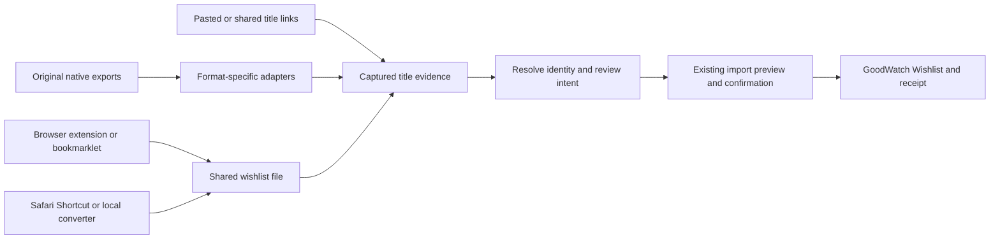

# Wishlist imports: deeper exploration

Research date: 2026-10-18. This follows [the first streaming-watchlist investigation](../streaming-watchlist-imports.md). The owner supports the shared wishlist file direction and requested deeper, creative research by several GPT-6.1 Sol agents at medium reasoning. Findings and proposed experiments here are research, not shipped support or approved implementation decisions.

## Research tracks

- [Tracker routes](tracker-routes.md): Simkl, Trakt, their import/export ecosystems, and adjacent tracker formats.
- [Browser routes](browser-routes.md): extensions, userscripts, bookmarklets, extraction code, browser capabilities and alternatives.
- [Alternative routes](alternative-routes.md): privacy archives, portable personal collections, self-hosted tools and overlooked bridges.

Each track distinguishes provider contracts, inspected implementation, publisher claims and hypotheses. No authenticated streaming account was tested. The research does not imply that an endpoint seen in community code is an officially supported integration.

## What changed after the first survey

The deeper evidence supports **native-file adapters and browser capture in parallel**, sharing the same normalized input. It also argues against making another tracker account a required bridge.

| New finding | Effect on the direction |
| --- | --- |
| Simkl explicitly says Trakt blocked its API access; local Trakt ZIP import remains available. | Prefer the original export directly. An advertised connection is not proof of a functioning route. [Current Simkl instructions](https://simkl.com/apps/import/trakt/). |
| A historical Netflix importer has an actual `MyList.csv` parser, including profile, title, country and added time. | Raise official-archive validation alongside the Netflix browser pilot. The 2023 parser does not prove the current archive or its membership semantics. [Pinned parser](https://github.com/bionic-dev/bionic/blob/598834bfecb9cc6e84add77b4fe79a40b802b4e8/imports/netflix/my_list.go). |
| Watcharr exports structured records with source TMDB identity and an explicit `PLANNED` status. | A small native adapter can demonstrate the shared format without streaming authentication. [Native format consumer](https://github.com/sbondCo/Watcharr/blob/ab7041fd6deb0b34e342b1f8967f821b76eab99b/src/routes/(app)/import/+page.svelte). |
| Google collection and Serializd exporters can enrich titles with the first search result. | Preserve extracted identity separately from guessed matches; never upgrade a guess into a provider-supplied ID. [Google enrichment code](https://github.com/evile92/cineharvest/blob/1adedf33da0ae1cd92f1fce9cd5b3988b9374024/tmdb.py), [Serializd public-list scraper](https://github.com/EleonoraGiangrandi/Listizd/blob/de736c0f59ef5f1b24a516bd442d3edc6d0fec82/scraper.py). |
| Seerr has an actual paged watchlist route, but chooses local entries or a Plex fallback rather than combining both. | Existing-user tools can be useful producers, provided each producer declares exactly which list it read. [Route implementation](https://github.com/seerr-team/seerr/blob/63705622eac5dd4e1006775e9fc43215c3ea0c88/server/routes/user/index.ts). |
| Simkl's distributed Netflix Enhancer and Universal Trakt Scrobbler read viewing history; inspected modules do not export Netflix My List. | Borrow relevant protocol knowledge only; installing a scrobbler is not a saved-wishes migration. [Package inspection and hashes](tracker-routes.md#official-netflix-enhancer-inspected-distribution-history-only), [UTS source findings](browser-routes.md#universal-trakt-scrobbler). |
| Simkl has new AUTH V2/scopes and a premium Custom Lists beta; some older documentation contradicts it. | A direct Simkl connector is feasible research, but choose the current API and handle body-level errors and distinct pagination. [Current API migration](https://api.simkl.org/guides/migrating-v1-to-v2), [Custom Lists](https://api.simkl.org/guides/custom-lists). |
| MediaShelf's mixed-media selectors and one final DOM read can omit titles; its background import uses replacement. | Reuse architectural ideas, not its completeness or replacement assumptions. [Inspected source and defects](browser-routes.md#mediashelf-clipper-genuine-multi-site-list-code-weak-capture-boundary). |

The [alternative-routes report](alternative-routes.md) includes additional file producers, licensing, identifiers and concrete sample-validation experiments. The two other tracks add current tracker policies and browser implementation evidence.

## What the shared format should connect

The useful boundary is **many ways to extract a list, one way to review and import it**. A new file format should not require every source to build a GoodWatch-specific exporter first. Accept known native exports with small adapters and use the shared representation internally; publish the same representation for an extension, a local converter or another application to produce directly.

GoodWatch already accepts server-side `ParsedImport` observations through `previewParsedImport` and `previewFetchedImport`. An external capture envelope must be validated and resolved before entering that boundary: the existing observation type requires `movie` or `show`, whereas a browser or privacy archive may not know either. Unknown identity and unknown media scope are valid captured evidence, not a reason to invent a show identity. Sources: [import domain](../../../goodwatch-webapp/app/domain/imports.ts), [service boundary](../../../goodwatch-webapp/app/server/imports/service.server.ts).

The present importer recognizes a fixed set of ZIP, XML and CSV shapes. A generic title list or a new JSON file is not currently accepted. Its title/year fallback is restricted to Letterboxd and CSV, and unsupported/unmatched rows are reported rather than automatically corrected by a general-purpose matching editor. Sources: [file recognition](../../../goodwatch-webapp/app/ui/imports/ImportFileRecognition.ts), [file parsers](../../../goodwatch-webapp/app/server/imports/files.server.ts), [preview](../../../goodwatch-webapp/app/server/imports/preview.server.ts), [preview UI](../../../goodwatch-webapp/app/ui/imports/SourceImportPreview.tsx).

### Proposed format requirements

These are design inferences to test against the researched exports, not a finalized schema.

| Concern | Proposed representation | Why it matters |
| --- | --- | --- |
| Producer versus origin | Exporter name/version separately from original service, selected profile and list | A Simkl-produced JustWatch export remains evidence about a JustWatch list. |
| Intent | Explicit saved wish, custom-list membership, or unknown meaning | A favorites list, recommendation list, collection or continuation rail must not silently become Want to See. The user can explicitly choose to import a custom list as wishes. |
| Source identity | Provider-scoped opaque IDs as strings, original URL, optional known TMDB/IMDb IDs | IDs from different providers can collide; season and show IDs are different scopes. Do not discard source IDs after matching. |
| Matching evidence | Original title, optional year, type/scope including unknown, optional parent references | A title-only result is useful for review but insufficient for an unambiguous automatic match. |
| Membership | Separate source-list membership from the title identity | One movie in two source lists should become one GoodWatch wish with explainable origins. |
| Time | Capture time separately from source-added time and its precision | Exporting now must not invent an earlier source action or a watch date. |
| Coverage | Captured count, reported total when known, partial/unknown status, reason, extraction method | Count agreement is evidence, not a guarantee; missing rows never imply deletion during an additive import. |
| Resolution | Original evidence separate from a later catalog match and the basis for that match | A suggested match or user correction must not masquerade as an identifier supplied by the provider. |
| Privacy | Selected-list fields only; no cookies, bearer tokens or whole network archives | The portable artifact should remain useful independently of the account session that produced it. |

Initially, emit one file per selected profile/list. This makes ownership and selection explicit and avoids designing household-wide synchronization before the first importer works. JSON can carry the full envelope; a small CSV variant can cover spreadsheet users, with omitted metadata treated as unknown. Both should feed the same validation and matching code.

Do not force Schema.org onto the core format merely to call it a standard. Its `ItemList` can describe titles, positions and a total count, but does not by itself establish that the collection is a person's current wishlist, whose profile it belongs to, or whether the extraction is complete. It is a possible optional input adapter when pages actually expose it. [Schema.org ItemList](https://schema.org/ItemList).

## Integration decisions exposed by the research

- **Rewatch wishes:** current `applySet` skips wishlist writes when any watch-log row exists. Interactive Want to rewatch is supported by the domain. Preserving an explicitly saved rewatch wish needs an intentional import rule and validation; the format alone cannot fix this. [Writer](../../../goodwatch-webapp/app/server/imports/apply.server.ts), [tracking ADR](../../adr/0009-tracking-is-a-state-machine.md).
- **Custom lists:** an arbitrary named list can express recommendations, ownership or a challenge. Require list selection and an explicit choice to treat its members as wishes; never union every list automatically.
- **Repeated imports:** additive import can reuse the existing journal and undo. Continuous source reconciliation requires durable membership/provenance and rules for later GoodWatch edits, incomplete reads and removals. A shared file should preserve evidence for that future work without promising sync now.
- **Unknown titles:** offer an unresolved-item receipt at minimum. Interactive matching and provider-ID crosswalks are additional work, not features already supplied by the format.

## Creative experiments beyond service-specific connectors

These are proposals, not verified provider integrations.

1. **Local export converter:** drop a native tracker export into a browser page, select the wishlist/custom-list files locally, then produce the shared file. This could let users keep unrelated account/archive data off GoodWatch and use the converter without an intermediary tracker account. Confirm actual source schemas first.
2. **User-selected list capture:** let the person select the list container or a set of title links, show exactly what was captured, and send those candidates through review. This trades automation for coverage when a service's adapter breaks. It must state that only the selected/loaded items were captured.
3. **Share a title instead of syncing an account:** receive a title URL from a mobile share sheet, or accept pasted links. This helps users maintain the centralized Wishlist after a bulk import. Receiving shares is a platform-specific capability, separate from a website's ability to send shares; retain paste/upload fallbacks. [MDN share targets](https://developer.mozilla.org/en-US/docs/Web/Progressive_web_apps/How_to/Share_data_between_apps), [web.dev OS integration](https://web.dev/learn/pwa/os-integration).
4. **Recover a list from text or screenshots:** offer candidate extraction from a user-supplied list when no structured export exists. Require title review and make no completeness claim. This is a last-resort intake experiment; it cannot reliably recover hidden rows, identities or exact dates.
5. **Reusable adapter kit:** share the normalized format, synthetic fixtures and completeness checks so browser tools and independent exporters can target GoodWatch without duplicating its matching/import logic. Publishing the format and licensing any implementation would be separate work.

## Validation standard

Measure extraction separately from matching: source items captured, supported intentions identified, catalog matches established, and wishes actually applied. A tool that extracts 100 title strings has not demonstrated 100 correct imports. Compare against a known list including two profiles, remakes, movies and shows, a season/episode entry, an unavailable title, a rewatch wish and more than one page. Test repeated imports and an interruption midway. Keep unproven coverage explicit.

## Recommended next experiments

This refines the original Netflix/Prime-first proposal without abandoning it. Prove the common input with reliable native identities while testing streaming extraction separately.

| Experiment | What it would establish | Stop or revise when |
| --- | --- | --- |
| Define the minimal envelope against Watcharr PLANNED JSON, IMDb Watchlist CSV, existing Trakt wishes and Netflix Manager JSON. | One internal representation can preserve known IDs and unknown provider-only identities without requiring an intermediate account. | A format forces a guessed media type, loses origin, or treats history/custom-list membership as wishes automatically. |
| Obtain and inspect Simkl's publicly offered JustWatch bookmarklet and a minimal output file. | Whether its promised IMDb/TMDB-rich local file can feed GoodWatch directly. | The script/output cannot be inspected, list meaning is mixed, or paging/completeness is unknown; keep it a lead, not shipped support. |
| Compare a current Netflix My List privacy export with existing browser JSON capture. | Which route best preserves current membership, selected profile, unavailable titles and identity. | Historical schema differs or membership is an event history that cannot be reconstructed reliably. |
| Test a selected Prime Watchlist's DOM, structured page state and selected network response. | Whether movie/show identities and page cursors are available before building an extension UI. | Captured state describes recommendations/history or contains no provable list boundary. |
| Prototype one Safari Shortcut and one desktop extension producer using the same small output. | Whether users can capture a selected loaded list on both desktop and iPhone without separate import implementations. | Native-app content cannot be accessed, the site blocks execution, or unloaded items are presented as complete. |
| Explore a direct Simkl planned-title file producer across movies, shows and anime. | Whether current scoped authorization and stable identities make a useful optional existing-user route. | Premium/error responses are misread as empty lists or anime scope cannot be mapped without guessing. |

The smallest useful product slice is **a shared wishlist intake plus one reliable native adapter and one validated streaming capture path**, using the existing preview/receipt flow. Compatibility with more native files can then grow independently from browser-store distribution. Scheduled synchronization, server-held streaming sessions and two-way list replacement are separate decisions.

## Implementation follow-up

The first implementation follows the shared-file and native-adapter path. See the [version 1 producer contract](../../implementation/shared-wishlist-format.md) and the [Opus UX decisions](../../implementation/shared-wishlist-imports-ux.md). It adds original Watcharr Planned entries and compatible shared files to the existing preview, confirmation, receipt, and Undo pipeline.

Further validation notes:

- [Browser capture validation](capture-validation.md): synthetic accumulation experiment and the limits of streaming-link reverse matching; no live provider claim.
- [Watcharr validation](watcharr-validation.md): pinned exporter source and native field shapes, followed by successful authenticated export requests against the unmodified local backend with isolated synthetic accounts. The captured response is a parser regression fixture; no real streaming account was tested.

This implementation does not turn the research-only Netflix, Simkl, or JustWatch routes into supported connectors. Those still require current source samples or a live capture check.
