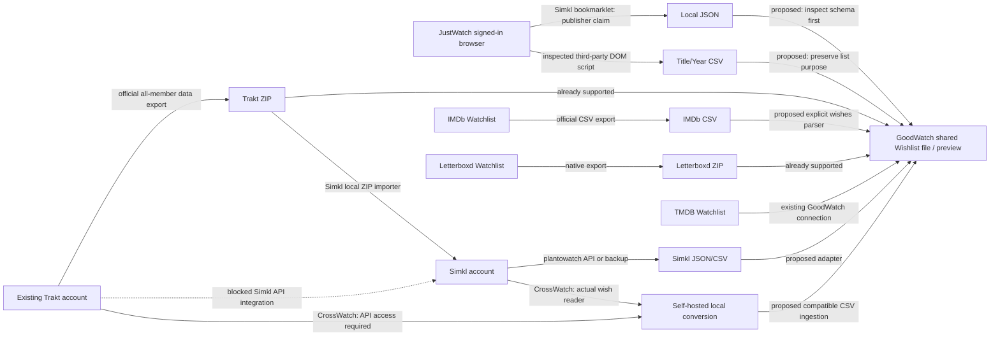

# Tracker routes for importing streaming wishes

Research date: **2026-10-18**. Scope: Simkl, Trakt, and adjacent IMDb, Letterboxd, TMDB and self-hosted bridges. This is research, not an implementation or a new domain decision. No account was connected, no authenticated provider request was made, and no export from a real person was obtained.

Evidence labels used below:

- **Code verified**: inspected actual publicly distributed code or this repository's implementation. This establishes what the code attempts, not that the provider still accepts it.
- **Documented / publisher claim**: a first-party page describes the behavior; authenticated behavior remains untested.
- **Proposal**: a route inferred from those building blocks, with the unverified step named.

Read alongside [the earlier streaming investigation](../streaming-watchlist-imports.md), [native imports](../../implementation/native-imports.md), [ADR 0008](../../adr/0008-one-row-per-watch.md), and [ADR 0009](../../adr/0009-tracking-is-a-state-machine.md). GoodWatch's Wishlist expresses **Want to See**; a streaming service's watch history or a tracker's entire library does not establish that intention. A Seen title can still carry Want to rewatch. Consequently, silently filtering all watched titles is also lossy.

## Findings that change the route choice

1. **Trakt → Simkl through OAuth is currently broken by design.** Simkl's current importer explicitly states Trakt blocked its API access and connecting no longer imports anything. Its ZIP importer remains available. This is stronger and more current evidence than old “sync every hour” instructions that still appear lower on the same page. [Current Simkl Trakt importer](https://simkl.com/apps/import/trakt/).
2. **The most useful Simkl JustWatch feature may require no Simkl account.** The public instructions put downloading the bookmarklet's local JSON before signing into Simkl. Reading that JSON directly could avoid the entire JustWatch → Simkl → GoodWatch round trip. However, the actual bookmarklet source and output schema could not be retrieved in this run; this remains a publisher-supported lead, not verified extraction code. [Simkl JustWatch importer](https://simkl.com/apps/import/justwatch/).
3. **Simkl's official Netflix Enhancer imports history, not Netflix My List wishes.** Its actual distributed 8.7.1 code confirms this distinction. It is useful identity/protocol research, but does not solve the wishlist requirement by installing it and connecting Simkl. [Official extension](https://chromewebstore.google.com/detail/enhancer-for-netflix-crun/dbpjfmehfpcgmlpfnfilcnhbckmecmca).
4. **Simkl now has a substantially newer API reference.** The official API repository says Apiary was frozen on May 22, 2026 and points to `api.simkl.org`. AUTH V2, scopes, premium Custom Lists and new sync details materially change implementation choices. [Official migration notice](https://github.com/SIMKL/API/blob/7f790cc015c9090810dc52ded16a56fca56044de/README.md), [new documentation index](https://api.simkl.org/llms.txt).
5. **IMDb is not a hidden route into Prime Video.** IMDb's July 2026 Watchlist FAQ explicitly says the two watchlists are separate. [IMDb Watchlist FAQ](https://help.imdb.com/article/imdb/track-movies-tv/watchlist-faq/G9PA556494DM8YBA).

## Route graph and account requirements

Arrows marked proposed require a parser/adapter; they are not existing GoodWatch functionality.



The JustWatch → local file and converter → local file routes need the **source** account/session but no Letterboxd or Simkl destination account. A Trakt/Simkl middle hop always needs that middle account and can add premium limits, data mutations and identity losses. Existing members can use their existing tracker state; asking streaming-only members to create a tracker is unnecessary for a local-file architecture. These are architectural deductions from the cited extraction/export contracts, not successful journeys tested here.

## Simkl: distinguish the library, planned titles and Custom Lists

### Planned titles through the API

**Documented.** `GET /sync/all-items/{type}/{status}` returns an object keyed by `movies`, `shows`, and/or `anime`. For wishes, request each type with **`plantowatch`**. The unfiltered endpoint returns every status, including watched, dropped and held titles. Empty filtered results can be `{}`, so a missing top-level key alone is not a decoding failure. This endpoint does **not** use page/limit pagination. Large history requests can return `400 max_items`; requesting only planned-title buckets avoids unnecessary episode expansion. [Current get-all-items reference](https://api.simkl.org/api-reference/simkl/get-all-items).

**Documented.** Simkl's status vocabulary is `plantowatch`, `watching`, `hold`, `dropped`, `completed`; movies have only planned/completed/dropped. These are mutually exclusive library statuses. They are separate from named Custom Lists. For GoodWatch, only `plantowatch` intrinsically expresses Want to See; other statuses require their own import observations. Simkl cannot represent every GoodWatch “Seen plus independent Want to rewatch” combination in this single status field. [Status reference](https://api.simkl.org/conventions/list-statuses).

**Documented.** Read-only AUTH V2 access can request `media:read`; public clients use authorization code plus S256 PKCE rather than an embedded client secret. New apps should use V2; the published migration target retires V1 around April 2027. Do not copy older scripts' assumptions that there are no refresh tokens or scoped grants. [V2 scopes](https://api.simkl.org/api-reference/oauth2-scopes), [V2 authorization](https://api.simkl.org/api-reference/oauth2-authorization-code), [migration](https://api.simkl.org/guides/migrating-v1-to-v2).

**Documented.** Repeated synchronization should first check `/sync/activities` and fetch changed buckets using the previous activity timestamp as `date_from`. A full pull on every timer is specifically discouraged. That is future sync guidance, not a requirement to build continuous sync for a one-time file import. [Sync workflow](https://api.simkl.org/guides/sync).

**Code verified.** CrossWatch already implements planned-title reads for all three buckets at `/sync/all-items/{bucket}/plantowatch`, plus state/watermark handling and ID normalization. This is an actual wish adapter rather than a scrobbler misclassified as one. Its source is AGPL-3.0, so code copying needs a deliberate license decision. [Simkl wishlist adapter, inspected commit 160c47c](https://github.com/cenodude/CrossWatch/blob/160c47c8e0c46c0a4706c951f10d227a78d98780/providers/sync/simkl/_watchlist.py), [license](https://github.com/cenodude/CrossWatch/blob/160c47c8e0c46c0a4706c951f10d227a78d98780/LICENSE).

### Custom Lists: newly possible, premium and semantically different

**Documented.** The newer guide exposes a read-only beta: `GET /lists/user/{userId}` then `GET /lists/{id}`. It requires an AUTH V2 token belonging to a PRO/VIP member, including for public lists. Free-account calls can return **HTTP 200 with `premium_only`** instead of data; V1 tokens return `403 oauth2_token_required`. A successful HTTP status is insufficient. The general statuses page still says Custom Lists are unavailable: prefer the dedicated current guide and record this documentation inconsistency. [Custom Lists guide](https://api.simkl.org/guides/custom-lists).

**Documented.** Custom Lists paginate through a JSON `pagination` object, whereas many other Simkl APIs use `X-Pagination-*` headers. Lists default to 50, accept up to 500 per page, and cap reachable `page × limit` at 10,000. The normal `/sync/all-items` endpoint has neither model. A single shared “read headers until last page” helper would silently truncate Custom Lists. [Pagination conventions](https://api.simkl.org/conventions/pagination).

**Proposal.** Let a person explicitly select a named list as wishes, while retaining the list ID/name and membership purpose. “Favorites,” “Best movies,” followed lists, and collections are not automatically Want to See. A custom list could preserve rewatch wishes independently of Simkl's single library status, but whether a person actually uses it that way cannot be inferred from the list's name alone.

### Actual CSV and backup contracts

**Documented.** Simkl's CSV importer accepts `Type` (`movie`, `tv`, `anime`), `SIMKL_ID`, `TVDB_ID`, `TMDB_ID`, `IMDB_ID`, `MAL_ID`, `Title`, `Year`, `LastEpWatched`, `Watchlist`, `WatchedDate`, `Rating`, `Memo`; unknown columns are ignored. **CSV `Watchlist` values differ from API spellings:** `plan to watch`, `watching`, `completed`, `dropped`, `on hold`. `TMDB_ID` requires `Type` because movie/show number spaces overlap. Upload limit is 5 MB. A planned-title CSV should leave watch date/progress/rating blank. [Exact importer schema and sample link](https://simkl.com/apps/import/csv/).

**Documented.** The current backup page shows a PRO simple CSV containing last watched episode only, VIP automated JSON backup to Drive/email, a ZIP/JSON download area, and free API export. It also contains “OR FREE ONCE A MONTH” text, whose placement does not establish an exact unauthenticated ZIP entitlement. Older prose labels ZIP/JSON a PRO feature; verify the signed-in UI before promising availability. The API route is the explicitly free route for ordinary library export; premium Custom Lists remain the specific exception. [Current backup UI](https://simkl.com/apps/backup/), [older export formats guide](https://docs.simkl.org/how-to-use-simkl/advanced-usage/import-export-data/exporting-from-simkl/export-data-formats).

**Code verified / negative result.** `NilSilva/simklExporter` is linked by Letterboxd as a migration helper, but its actual code hardcodes `/sync/all-items/movies/completed`, writes only `tmdbID,imdbID,WatchedDate`, and uses V1 PIN auth. It exports completed movies, **not wishes**, and has no explicit license in the inspected tree. It would need intentional changes and permission assessment before reuse. [Source, commit 0285da8](https://github.com/NilSilva/simklExporter/blob/0285da85613700dbfeeb4cb88f3a1aa145a31c0d/simklExporter.py).

### Simkl API conditions that affect a GoodWatch connector

**Documented.** Current rules require Simkl branding/per-item links, restrict use as a generic metadata host, and say tracker apps already syncing another tracker must offer Simkl login/sync too. Commercial apps earning at least USD 150/month need a commercial license. Caps are documented as 10 GET/sec and 1 POST/sec per app and user token; calls to uncached endpoints should normally be sequential. A personal file converter is a different operational choice from shipping a production GoodWatch API connector. Inspect the whole rule set before committing to the latter. [Current API rules](https://api.simkl.org/api-rules), [rate limits](https://api.simkl.org/resources/rate-limits).

## Simkl JustWatch bookmarklet: promising accountless handoff, unresolved code

**Publisher claim.** Its public page says the bookmarklet reads the person's JustWatch browser session and downloads JSON with wishes, seen titles, episode dates, IMDb and TMDB IDs; nothing is sent to Simkl until upload. Signing into Simkl comes at the upload step. The page provides desktop and phone installation instructions. That supports an extraction journey without an intermediary account. It does not prove field names, pagination, token handling or that wishes stay separate in the file. [Official instructions](https://simkl.com/apps/import/justwatch/).

**Explicit research failure.** Raw requests to the public page, canonical/`www` variants and simple query variants returned Cloudflare HTTP 403 challenge HTML. The web reading tool could render the instructions but omitted the JavaScript bookmark URL and copy-button handler. No public repository containing this specific script was found. Therefore **the script was not inspected**, no exact output schema is asserted, and “no data sent elsewhere” remains a publisher claim. No signed-in workaround or challenge-solving was attempted.

**Code verified alternative.** Letterboxd links a much smaller JustWatch DOM helper. It reads `.titles-count`, `.title-card-heading`, asserts visible cards equal total, then returns `Title,Year` CSV. Its comments include explicit `inner_tab=watchlist`, `seenlist`, and `likelist` URLs. It requires manually scrolling every title into the DOM; `console.assert` does not stop an incomplete export; it has no ID capture, downloader, pagination loop, or type column. It is useful as a source-account-only fallback and a clear warning about completeness, not a production-ready extractor. No license was present in this one-file gist. [Actual script](https://gist.github.com/rvighne/cb12f4d57ebb5a739ed5017021e8f85f).

**Next decisive check.** Obtain the public bookmark URL/code and a minimal redacted JSON from a person able to open the page. Audit the script's network destinations, distinguish watchlist/tracked-unstarted/seen sets, confirm IDs and media type, and prove cursor exhaustion on a list longer than one page. Then compare direct JSON ingestion with writing an independent extractor. The local file can be the handoff; it need not be uploaded to Simkl first.

## Official Netflix Enhancer: inspected distribution, history-only

**Code verified.** Downloaded the public Chrome update package for extension ID `dbpjfmehfpcgmlpfnfilcnhbckmecmca`; manifest reports **8.7.1**, MV3. Package permissions include storage, webRequest, scripting and alarms, with optional Netflix/Crunchyroll hosts. Inspected `js/netflix.js`, `js/crunchy.js`, `js/simkl.js`; did not execute the extension. [Official distribution endpoint](https://clients2.google.com/service/update2/crx?response=redirect&prodversion=140.0&acceptformat=crx2,crx3&x=id%3Ddbpjfmehfpcgmlpfnfilcnhbckmecmca%26uc), [publisher's release notes](https://simkl.com/apps/chrome/enhancer/updated/).

Actual behavior found:

- Netflix `getHistory()` calls `https://www.netflix.com/api/aui/pathEvaluator/web/^2.0.0` with `['aui','viewingActivity',page,50]`, the selected profile GUID, and a routing header. It recursively advances pages, obtains playback progress, requires at least **70%**, and uses a stored import-date watermark. It preserves Netflix movie/episode IDs and seconds derived from source dates.
- `simkl.js` submits `movies[]` or `episodes[]` with Netflix IDs, dates and country to **`/sync/history`**. It also queries watched status/ratings for UI decoration. No My List read or planned-title export was found in the inspected JavaScript.
- Crunchyroll reads `/content/v1/watch-history/{accountId}?page_size=100&page=...`, not `/watchlist`; profile selection and watched-progress handling are present.

The above is independently inspected package evidence; release notes and store claims also describe **history** import. Store installation is not a reusable-code license. No explicit open-source license was found in the extracted package, so use this as protocol evidence rather than copying its implementation.

Reproducibility hashes (SHA-256; package URLs are mutable, hashes identify this inspection):

```text
CRX              90f7a3ed5b37fea58b8c1b57ca3720a641cee6c39b53b14df1d3cc1b05a19c57
js/netflix.js    53890607fcbb79db728e04b2db733238b3fa73a33dff43c934ad9c83cde889ba
js/simkl.js      ebc284198d2a474713f6e72acd8b981dae3c1e4c1629b4f5715012a1fa53baf3
js/crunchy.js    11ed013320ca555aa9cf12cd6b80d6482e703b3a6ed610a287ea3566b1279b01
```

## Trakt: the ZIP is the strongest current migration path

### Official export and existing GoodWatch support

**Documented.** Trakt's all-members announcement distinguishes free raw JSON ZIP export from VIP convenience CSV/RSS/automatic backups. The later FAQ says Settings → Data → Export now downloads a ZIP in the browser. The old announcement's weekly/email delivery details should not be treated as the current user interface. [All-members announcement](https://forums.trakt.tv/t/freemium-experience-more-features-for-all-with-usage-limits/41641/97), [export FAQ](https://forums.trakt.tv/t/how-do-i-export-my-data/54762).

**Code verified locally.** GoodWatch already reads `lists-watchlist.json` inside native Trakt ZIPs, in addition to history/ratings/favorites. Rows use `type`, `movie`/`show`, external `ids`, and list metadata. It explicitly recognizes custom-list filenames separately and reports unsupported observations. A new shared file format should complement this existing original-archive route. This repository's accepted shapes are implementation evidence, not a claim of a newly downloaded real export. [Native import contract](../../implementation/native-imports.md), [current parser](../../../goodwatch-webapp/app/server/imports/files.server.ts).

Illustrative API-style wish row, **not a captured export**:

```json
{
  "rank": 1,
  "id": 123,
  "listed_at": "2026-10-01T20:00:00.000Z",
  "type": "movie",
  "movie": {"title": "Example", "year": 2020, "ids": {"trakt": 456, "imdb": "tt1234567", "tmdb": 789}}
}
```

### API route, pagination and present restrictions

**Documented.** Trakt defines Watchlist as future intentions and explicitly warns against treating it as currently watching; custom Lists are independent collections. `/sync/watchlist` supports mixed movies/shows/seasons/episodes. Seasons/episodes need explicit unsupported handling or review before projecting a wish onto a whole show. [Current introduction](https://developer.trakt.tv/), [watchlist reference](https://trakt.docs.apiary.io/#reference/sync/get-watchlist/get-watchlist).

**Documented.** Paginated requests use `page`, `limit` and `X-Pagination-Page`, `-Limit`, `-Page-Count`, `-Item-Count`. Limits can be silently clamped; trust returned headers rather than assuming the requested 500 was honored. [Pagination](https://developer.trakt.tv/docs/pagination).

**Documented.** New-app instructions dated October 1 require a verified GitHub account and recommend PKCE without a client secret. They do not support simply repeating older July claims that all app registration is currently VIP-only. Read account/list limits from `/users/settings`; `420` is account capacity, not a transient retry. Standard GET caps are documented as 500/5 minutes, writes 1/sec, but returned rate headers and `Retry-After` govern handling. [Registration](https://developer.trakt.tv/docs/create-an-app), [account limits](https://developer.trakt.tv/docs/user-account-limits), [rate limits](https://developer.trakt.tv/docs/rate-limiting).

**Documented; does not grant unconditional GoodWatch access.** The September 22 API policy explicitly lists “A personal script migrates a user's own watch history to their account on another platform” as permitted at the user's request. It permits user-directed personal migration, but prohibits harvesting/redistributing broader Trakt data and routing blocked integrations through replacement keys or user credentials. Registrations unused for 30 days, or test-only during their first 30 days, may be deleted. A GoodWatch production integration still needs its own compliant registration and review of the complete terms; an allowed personal script is not blanket clearance for a competing service. [API use policy](https://developer.trakt.tv/docs/api-use-policy).

**Publisher claim, verified as current page content.** Simkl says its integration is blocked; its ZIP uploader parses locally and sends only history/watchlist/ratings. Its older hourly-sync controls remain visible below. Do not resurrect that blocked route using another app's credentials. The original ZIP already works in GoodWatch and avoids another account, so the intermediate Simkl upload offers little migration value here. [Simkl's current importer](https://simkl.com/apps/import/trakt/).

### Useful actual import/export tools

| Tool and inspected source | True wishes? | Format and hidden blocker |
| --- | --- | --- |
| [Trakt2Letterboxd e63d1b6](https://github.com/anoopsankar/Trakt2Letterboxd/blob/e63d1b64a08fb4a4df87f414b1fc75bdc86bc6d4/Trakt2Letterboxd.py) | **Yes, movies only.** Reads `/sync/watchlist/movies` separately from history. | Writes `WatchedDate,tmdbID,imdbID,Title,Year`; watchlist date is blank. Loops using page-count header, 10 per page. Apache-2.0. Requires Trakt OAuth/device flow; no Letterboxd account is needed to produce CSV. Code includes bundled app credentials and locally cached tokens: do not reuse those credentials. README's generic `/import` advice risks marking wishes watched; select Letterboxd Watchlist import instead, or bypass Letterboxd. |
| [xbgmsharp/trakt 7ba7b1b](https://github.com/xbgmsharp/trakt/blob/7ba7b1ba58a865380486cbeea934b5e4f1ebd085/import_trakt.py), [format guide](https://github.com/xbgmsharp/trakt/blob/7ba7b1ba58a865380486cbeea934b5e4f1ebd085/import.md) | **Yes.** Distinct `watchlist`, `history`, `ratings`, `collection` destinations. | CSV columns use lowercase identifier namespace, e.g. `imdb,title`; movie/show type is a command argument. Defaults to watchlist; POST `/sync/{list}`. GPL-3.0. Optional history `--seen` can synthesize an old fallback date, and `--clean` mutates destination: do not use those for wish conversion. |
| [TraktRater 2f8fd0e](https://github.com/damienhaynes/TraktRater/blob/2f8fd0e3053276246200d0c9bd6530844aa63a30/Sites/IMDb.cs), [IMDb field map](https://github.com/damienhaynes/TraktRater/blob/2f8fd0e3053276246200d0c9bd6530844aa63a30/Sites/API/IMDb/IMDbFieldMapping.cs) | **Yes.** Separate IMDb Watchlist CSV handling for movie/show rows. | Maps `Const`, `Title Type`; batches `AddMoviesToWatchlist`. Can discard watched items depending on `IgnoreWatchedForWatchlist`, losing explicit rewatch wishes. Additional history/ratings features are separate and should remain off for a wish-only journey. License not established in this inspection; check before copying. |
| [PlexTraktSync configuration c2b6b58](https://github.com/Taxel/PlexTraktSync/blob/c2b6b5889314f5023a0fc0e430311166a09a748e/plextraktsync/config.default.yml) | **Yes.** Separate watchlist switches in both directions. | An account-mutating synchronization bridge, not a file converter. Configuration warns one-way settings overwrite a destination watchlist; watched status and ratings also default on. Do not recommend running defaults merely to obtain a local GoodWatch import file. |

These tools prove useful adapter patterns, not universal present-day API access. A route can have correct parsing code and still fail because the registered app was removed or the provider changed permissions.

## IMDb, Letterboxd and TMDB adjacent bridges

**IMDb — documented.** Native list export is available through the list's Export icon. Watchlist supports movies and TV and is private by default; no need to publish a list to use its downloaded CSV. `Const`/IMDb title ID is the strongest identity to retain; provider-global IMDb rating is not the person's rating. An arbitrary IMDb custom list needs an explicit “these are wishes” choice. Again, Prime Video membership is separate. [Export help](https://help.imdb.com/article/imdb/track-movies-tv/faq-for-the-list-feature/GNQMN47VZSE7KW38), [Watchlist semantics](https://help.imdb.com/article/imdb/track-movies-tv/watchlist-faq/G9PA556494DM8YBA), [actual CSV parser field names](https://github.com/damienhaynes/TraktRater/blob/2f8fd0e3053276246200d0c9bd6530844aa63a30/Sites/API/IMDb/IMDbFieldMapping.cs).

**Letterboxd — documented.** One UTF-8 CSV dialect can target watched films, a list, or Watchlist; **destination matters**. Main account import automatically marks items watched. Strong identity columns are `LetterboxdURI`/`url`, `tmdbID`, `imdbID`; title/year is a fallback. This is a useful existing transport dialect for movies, with no need to create an actual Letterboxd account when merely generating the file. Native GoodWatch Letterboxd ZIP already carries Watchlist. [Import specification](https://letterboxd.com/importing-data/), [GoodWatch contract](../../implementation/native-imports.md).

**TMDB — documented and already implemented.** Movie and TV watchlists are separate paginated account resources; responses include TMDB IDs, `page`, `total_pages`, `total_results`. Movie titles use `title`/`release_date`; TV uses `name`/`first_air_date`. A v3 application key alone is not permission to read a person's private account: user authorization/session is part of the account route. Existing GoodWatch connection is preferable to adding a Trakt/Simkl detour. [Movies API](https://developer.themoviedb.org/reference/account-watchlist-movies), [TV API](https://developer.themoviedb.org/reference/account-watchlist-tv), [GoodWatch TMDB client](../../../goodwatch-webapp/app/server/imports/tmdb-client.server.ts).

## CrossWatch as a self-hosted converter, with precise losses

**Code verified.** At commit `160c47c`, `services/export.py` exposes conversion of locally available provider state, including watchlist state. Its Letterboxd wish export writes `imdbID,tmdbID,Title,Year` and filters `type == movie`. Its JustWatch-labeled output writes `tmdbID,imdbID,Title,Year,Type` without that movie filter. IMDb output is only `const` and drops items without IMDb IDs. The format name alone does **not** prove JustWatch or IMDb accepts the file today. [Export code](https://github.com/cenodude/CrossWatch/blob/160c47c8e0c46c0a4706c951f10d227a78d98780/services/export.py).

**Proposal.** Existing CrossWatch users could export wishes locally and upload them to a shared GoodWatch parser without opening Letterboxd/IMDb/JustWatch accounts. Retain type and provider IDs rather than funneling mixed movie/show lists through movie-only Letterboxd export. Deploying CrossWatch solely for migration adds self-hosting, provider authorization and synchronization settings; an independent one-shot converter would be easier for ordinary users. AGPL code and API access obligations are separate considerations.

## Implications for a shared Wishlist format

The accepted direction benefits from preserving semantics before deciding how each provider is reached. Recommended adapter contract, proposed rather than implemented:

1. Carry **source kind, list ID/name and list purpose**. A label “Watchlist” means planned titles on Trakt but Simkl's full library is also called a watchlist.
2. Preserve namespace **and** entity type with IDs. `tmdb:123` alone is ambiguous between a movie and show. Keep provider IDs alongside known crosswalks; a failed crosswalk must not erase the original row.
3. Keep explicit planned membership separate from `watched`, `rating`, `currently watching` and `completed` observations. Exporters that only emit history cannot manufacture wishes.
4. Keep `addedAt` unknown unless a real source list timestamp exists. Neither export time nor last-watched time means “wanted since.”
5. Keep explicit rewatch wishes. An adapter option that removes all watched titles is a product choice with a loss, not harmless deduplication.
6. Mark scope/completeness: all three Simkl buckets, both TMDB endpoints, all Trakt pages, selected profile, unsupported seasons/episodes, and named list selection. A CSV generator that omitted shows must report that.
7. Treat `premium_only`, expired authorization and blocked client access as errors/unsupported states, never an empty wishlist. An additive import must never infer deletions from such a result.

The highest-value next experiments are the **Simkl JustWatch bookmarklet's actual local file** and a **read-only Simkl planned-title export across movies/shows/anime**. For existing Trakt/Letterboxd/TMDB users, build on GoodWatch's existing paths. For streaming-only users, prefer source-browser → local shared file → GoodWatch: tracker ecosystems provide useful extraction code and file dialects, but no verified universal wishlist master connector emerged.
