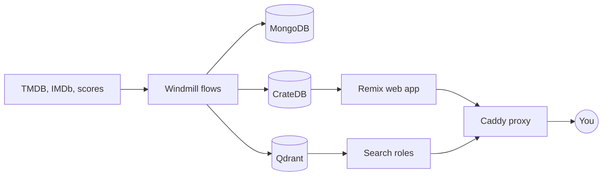

<!-- PROTOTYPE variant B: product screenshot + architecture diagram. Throwaway, see prototype-readme/README.md -->

#  GoodWatch

<a href="https://goodwatch.app"></a>
<a href="https://discord.gg/TVAcrfQzcA"></a>
<a href="https://github.com/alp82/goodwatch-monorepo/issues/52"></a>
<a href="LICENSE"></a>

GoodWatch helps you decide what to watch. It learns your taste from your ratings, shows every major score in one place, and tells you where each title streams.

<a href="https://goodwatch.app"></a>

## Features

- **For You:** recommendations from the titles you rated and watched.
- **Fingerprint:** hundreds of categories per title, from mood and plot to visual style.
- **Streaming availability:** where each title streams in your country.
- **Scores:** IMDb, Metacritic, and Rotten Tomatoes together, plus episode ratings grids.
- **Use with AI:** a GoodWatch connector for Claude and ChatGPT.
- **Imports:** bring your history from IMDb, TMDB, Plex, and other services.

## Built with




## Repository

| Area | Directories |
|---|---|
| Apps | `goodwatch-webapp`, `goodwatch-search`, `goodwatch-hq` |
| Data | `goodwatch-flows`, `goodwatch-crate`, `goodwatch-mongo`, `goodwatch-qdrant`, `goodwatch-cache` |
| Operations | `goodwatch-proxy`, `goodwatch-remote`, `goodwatch-metrics`, `goodwatch-monitoring`, `goodwatch-benchmark` |

## Development

```shell
cd goodwatch-webapp
cp .env.example .env   # add your TMDB API key and other secrets
npm install
npm run dev
```

The setup guide is out of date, so ask in [Discord](https://discord.gg/TVAcrfQzcA) before you start. For the full infrastructure, see the [server guide](docs/server-guide.md).
